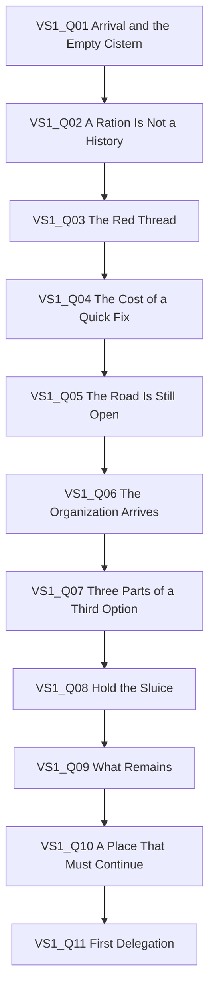

# AHTW — Complete Writing, Dialogue & Narrative Implementation Dossier

**Audience:** quest writers, dialogue writers, editors, localization writers, narrative implementers, narrative QA.
**Purpose:** fully self-contained review copy of the writing rules, narrative canon, five-act content inventory, quest/sidequest planning, vertical-slice dialogue, scene graphs, and Act I data. This is a design/content handoff, not proof of runtime integration.
**Status distinction:** story architecture and full-game content-lock baseline are authored; full dialogue for every quest, localization, branching coverage, and runtime QA remain pending unless explicitly marked authored below. Do not infer missing prose or choices.

## How to use this dossier
- Treat this file as the independent review package. Its embedded source sections are reproduced below so a reviewer does not need to open other project files.
- Preserve canonical IDs, state keys, quest dependencies, and outcome distinctions exactly when writing or implementing.
- If an embedded source conflicts with a later explicit project decision, record the conflict for owner review; do not silently invent a resolution.
- The game is about community resilience and responsibility. The Ferida amplifies vulnerabilities and distortions; it does not erase human agency or explain away every social problem.
- All named characters are adults. Intimacy is optional and must not gate core progression. Vulnerability, distress, authority, dependence, or power imbalance do not imply consent.

## Editorial and dialogue rules
- Use grounded, compassionate fantasy prose. Specific material conditions matter: water, food, shelter, labor, logistics, and who bears a decision's cost.
- Avoid constant melodrama, omniscient speeches, or characters existing only to explain themes.
- People may be practical, tired, funny, defensive, competent, mistaken, conflicted, generous, or self-protective.
- Disagreements should arise from evidence, priorities, uncertainty, risk, values, and responsibility. Do not flatten the Organization into villains or community members into automatically correct moral voices.
- Let subtext carry meaning. Avoid explaining every theme in dialogue.
- Alya's past is hinted through reactions and omissions early; do not reveal its full truth prematurely.
- The First Ally notices patterns and practical implications rather than simply agreeing with Alya.
- Cuidadora distinguishes care, stabilization, diagnosis, and recovery. Compassion does not promise to erase consequences.
- The Pragmatic Mentor respects evidence and contingency. The Institutional Representative argues from downstream risk and protocol. Neither is a caricature.
- Mara Venn accepts responsibility for concealing her choice while also explaining the structural pressures that shaped it.
- Choice labels must communicate the player's intent. Outcomes can be uncertain, but labels must not deceptively describe intent.
- Choices express priorities and methods, not a simplistic moral alignment.
- Keep dialogue, presentation, and state changes distinct: prose does not itself alter game state unless an explicit choice/action contract says so.
- Localize meaning, intent, and character voice rather than word-for-word phrasing. Preserve IDs and state tokens.

## Content scope and planning status
- 5 acts; 47 main quest stages; 25 authored sidequests; 7 regions; 6 factions; 8 Expedition templates; 5 ending families.
- Full-game inventory is a content-lock baseline, not a claim that every scene or dialogue has been written.
- Act I vertical slice: “The Water We Share,” in Brackenford, Ashfen Verge; local Ferida manifestation is called “The Red Thread.”
- Mandatory loss: the lower-terrace seed reserve and a substantial part of the next planting cycle are destroyed during stabilization. Brackenford survives and downstream water is protected. No route gives a clean, cost-free victory.
- The Organization's proposed containment plan reduces downstream risk but abandons lower residents and seed stores; an alternative requires local knowledge, repair materials, stabilized diversion, and collective effort.
- Alya becomes a leader and the first autonomous Expedition unlocks after the slice.
- The story should demonstrate how communities can become capable of surviving without Alya, rather than making every success depend indefinitely on her presence.

## Embedded writing guide (current review-pack source)
# AHTW — Content Writing Review Pack

**Audience:** quest writer, dialogue writer, editor, localization writer, narrative implementer.  
**Purpose:** establish voice, scene structure, choice-writing rules, and the boundary between prose and game state.

## 1. Writing mission

Write a grounded, compassionate fantasy RPG about community survival, institutional trade-offs, relationships and the difficult work of distributing responsibility. The prose should make social and material conditions specific; the Ferida complicates these conditions but does not explain them away.

The target is not constant melodrama. Let people be practical, tired, funny, defensive, mistaken, competent or conflicted in ordinary ways. Reserve speeches for moments that earn them.

## 2. Voice and dialogue principles

- Character voices should reflect goals, knowledge, social position, temperament and relationship—not merely exposition duties.
- Disagreement should be about evidence, priorities, risk and values. Do not flatten the Organization into villains or community members into moral mouthpieces.
- Let subtext do work. Avoid having every character explain the theme directly.
- Alya's past is suggested early through reactions and omissions; avoid premature exposition.
- The First Ally often notices patterns and practical implications, not just agrees with Alya.
- Cuidadora distinguishes care, stabilization, diagnosis, and recovery; she is compassionate without promising that care can erase consequences.
- The Pragmatic Mentor respects evidence and contingency. The Institutional Representative argues from downstream risk and protocol. Neither should be a caricature.
- Mara Venn accepts responsibility for concealing her choice while explaining the structural conditions that shaped it. Do not write her as either wholly innocent or solely guilty.
- Residents remember past allocation decisions; the crisis did not begin when the Red Thread appeared.

## 3. Choices and branching

- Choice labels must state the player's intended action or priority plainly.
- Do not label choices as good/evil or hide a radically different intention behind a neutral-sounding label.
- Consequences can be uncertain, but the player's intent must not be deceptive.
- A choice should alter a downstream flag, relationship, resource, encounter condition, line variation, recruitment condition, or unlock if the design promises a consequence.
- Do not reverse mandatory story states through optional dialogue. The lower-terrace seed reserve loss in Act I is canonical and unavoidable.
- Keep display text separate from stable IDs. Never use dialogue strings as identity keys.
- When a choice's effect is unclear, flag it for design review rather than inventing state logic in prose.

## 4. Scene-writing workflow

For each scene or quest stage, define:
1. Stable quest/scene/line/choice IDs.
2. Narrative purpose and what changes by the end.
3. Entry conditions and relevant known facts.
4. Characters present and each one's immediate goal.
5. Dialogue beats and optional lines.
6. Choice labels and intended player meaning.
7. Consequence mapping (state, relationship, encounter, reward, unlock).
8. Exit conditions and next stage.
9. Required/optional asset needs.
10. Localization notes and any context needed for short UI strings.

Write prose only after the stage's dramatic function and consequence are clear. Keep IDs in structured data; don't create competing IDs in a prose-only document.

## 5. Act I reference example

In **“The Water We Share,”** the story begins with an empty cistern, accusations against irrigation keeper Mara Venn, and red growth moving around an old water path. The first scene offers three priorities: maintain ration order, share remaining clean water, or delay judgment pending evidence. None is a simplistic morality score.

Later, the Organization proposes closing the lower sluice, isolating exposed workers and burning the root-vault to reduce downstream contamination risk. The alternative is not “ignore the danger”; it is to gather local knowledge, stabilize workers, prepare the channel and coordinate the gate operation. The climax requires an objective, not just defeating enemies. The community survives, but the seed reserve is lost.

The approved first-pass dialogue anchors are in `docs/vertical_slice/ACT_I_DIALOGUE_PACK.md`. They are implementation-ready placeholders, not immutable final prose.

## 6. Content scope and writing status

Full-game baseline:
- 5 acts;
- 47 main quest stages;
- 25 authored sidequests;
- 7 regions and 6 factions;
- 10 recruitable allies;
- 21 named recurring NPCs plus 12 reusable NPC templates;
- 5 ending families.

The content lock defines stage identity, major beats and scope. It does **not** mean all dialogue, branch lines, quest objective text, rewards or localization strings are finished.

## 7. Adult themes and character agency

- All characters are adults and should be presented unambiguously as adults.
- Adult/intimate content is optional, consent-aware and not required for main quest completion, recruitment, or endings.
- Do not treat rescue, rehabilitation, corruption, power imbalance, institutional harm or a character's vulnerability as automatic consent.
- A character's sexual presentation does not determine personality, morality, consent, or narrative function.
- Do not use intimate scenes to erase trauma or bypass relationship development.
- Flag content that needs rating, consent, localization or production review.

## 8. Localization and implementation constraints

- Stable IDs are the identity; localized strings are presentation.
- Keep UI labels concise and context-rich; avoid relying on English wordplay for critical instructions.
- Separate narration, dialogue, choice labels, tooltips, quest objective text and system messages.
- Preserve speaker intent and relationship subtext across localization.
- Do not hard-code line text into game-state logic.
- Mark variables/placeholders and provide context for strings with ambiguous gender/number.
- Do not promise a runtime behavior, reward, or unlock in prose unless the design/data specifies it.

## 9. Review checklist

- Does every scene change knowledge, relationship, pressure, commitment or state?
- Is each character speaking from their own goals and information?
- Are choices honest and distinct in intent?
- Does every promised consequence exist in design/data?
- Is the mandatory loss preserved?
- Are the Organization and community both credible?
- Does the Ferida influence without absolving responsibility?
- Are optional adult themes kept separate from required progression?
- Can strings be localized without breaking logic or UI?

## Canonical references

- `docs/NARRATIVE_CANON.md`
- `docs/FULL_GAME_CONTENT_LOCK.md`
- `docs/vertical_slice/ACT_I_DIALOGUE_PACK.md`
- `docs/vertical_slice/ACT_I_QUEST_GRAPH.md`
- `docs/vertical_slice/ACT_I_QUEST_GRAPH_CONTINUATION.md`
- `data/vertical_slice/act_i_quests.json`
- `data/content/full_game_world_catalog.json`
- `docs/characters/CHARACTER_BIBLE.md`


## Embedded narrative canon
# Narrative Canon — Source of Truth

> **Status:** Canonical narrative source of truth.
>
> This document consolidates the narrative decisions recorded in the historical checkpoints and subsequent narrative decisions. When an older checkpoint conflicts with a later decision, **the later decision wins**. Historical checkpoints are retained for traceability but do not override this document.
>
> **Purpose:** This is the primary reference for narrative design, gameplay integration, character arcs, chapters, quests, encounters, endings, and future narrative expansion.

---

# 1. Narrative Identity

## Core premise

**Alya Heals the World** is the story of a traveler who begins by helping individual people and gradually learns to build communities, structures, and relationships capable of helping people without depending on her alone.

The central conflict is:

> **Communities versus the Ferida.**

The Ferida is the primary antagonistic force. Institutions, organizations, political conflicts, and interpersonal failures matter because they shape how people respond to it, resist it, or become more vulnerable to it.

The final question is not:

> “Did Alya destroy the Ferida?”

It is:

> **“Did we build conditions sufficient for something better to continue existing without us?”**

## Core thematic pillars

- Good intentions do not remove consequences.
- Helping one person can create costs for another.
- Responsibility is necessary; total control is not.
- Autonomy is not isolation.
- Institutions can be necessary, competent, and still cause injustice.
- A community does not need unanimity to survive, but it needs mechanisms capable of surviving disagreement.
- No structure should become incapable of being questioned, corrected, or abandoned.
- A durable solution cannot depend permanently on one exceptional individual.
- The future does not need to be guaranteed to be worth building.

---

# 2. The World

## 2.1 General state

The world is in gradual decline, although much of society still appears functional.

Existing institutions continue to provide:

- protection;
- infrastructure;
- crisis response;
- regional coordination;
- expertise.

Civilization is not already collapsed. The tension comes from deterioration occurring inside systems that still visibly work.

## 2.2 The Ferida

The Ferida is widely known but poorly understood.

Its function throughout the narrative is to act as a force of:

- corruption;
- perversion;
- amplification;
- exploitation of vulnerabilities.

It does not need to create every problem. It finds existing weaknesses in:

- individuals;
- relationships;
- communities;
- institutions;
- social systems;

and makes them worse.

Its importance escalates across the game:

**local manifestation -> community threat -> regional pressure -> systemic threat -> narrative apex in Act V.**

Alya has prior personal experience with the Ferida, but this does not give her privileged knowledge of its true nature.

Alya's powers allow exceptional intervention against it, but:

- she is not immune;
- she can fail;
- she can be corrupted;
- her powers do not grant moral authority;
- they do not make her uniquely capable of solving everything alone.

## 2.3 The true nature of the Ferida

The complete truth is reserved for Act V.

The canonical direction is:

- the Ferida is not reducible to a single villain's deliberate creation;
- it has elements comparable to a natural force;
- its existence, manifestation, spread, and historical consequences are also tied to a complex chain of human decisions and systems.

The final revelation must **recontextualize earlier events**, not simply explain everything through a hidden “master switch.”

---

# 3. Alya

## 3.1 Initial position

Alya arrives as a newcomer to the starting community.

She:

- has no established authority;
- is initially expected to pass through;
- is traveling toward a concrete destination to fulfill a promise or responsibility;
- is also, emotionally, running from something she failed to resolve.

The player learns the community alongside her.

## 3.2 Initial virtues

- Empathy.
- Adaptability.
- A strong tendency to act when someone is suffering.

## 3.3 Initial flaws

- Difficulty accepting long-term responsibility.
- Impulsive intervention when faced with suffering.
- Fear of making decisions that harm others.
- Tendency to believe that direct help and good intentions are sufficient foundations for action.

Her fear of responsibility is connected to a previous experience involving the Ferida and a decision whose consequences she associates with herself.

The exact objective truth of that past event remains open until useful character-level detailing.

## 3.4 Alya's complete macro arc

> **Avoid responsibility -> accept responsibility -> centralize responsibility too much -> learn to distribute responsibility -> build conditions that can survive without depending on her.**

A more detailed progression:

1. She helps people directly.
2. She stays to face consequences.
3. She becomes a member of the community.
4. She accepts formal leadership.
5. She mistakes responsibility for the need to personally control outcomes.
6. She learns delegation.
7. She learns to accept decisions she would not personally make.
8. She learns that even good systems can become harmful.
9. She learns that systems must be corrigible and challengeable.
10. She ends seeking a future that does not require Alya herself to remain indispensable.

Alya remains vulnerable throughout the entire story.

---

# 4. The Starting Community

## 4.1 Initial condition

The game begins with a community already struggling to survive.

It faces:

- material fragility;
- scarcity;
- internal tensions;
- limited capacity to respond to new crises.

The initial question is:

> “Is this place still worth trying to save?”

## 4.2 Alya's integration

Alya's first meaningful action follows:

> **Help one person -> become entangled in a collective survival problem.**

Her first important connection combines:

- an ordinary member of the community;
- someone directly affected by the Ferida.

Alya eventually receives a real opportunity to continue her original journey.

She chooses to remain.

Her transformation at this stage is:

> “I will help while I am here.”
>
> becomes
>
> “I will stay and help deal with what happens afterward.”

## 4.3 First major mistake

Alya:

- trusts an apparently competent person, authority, or solution too much;
- lacks the local historical context;
- acts on incomplete information;
- helps implement a solution that resolves the visible problem while transferring costs elsewhere or worsening existing tensions.

The lesson is:

> **A solution that fixes the problem you can see is not automatically good for the whole system.**

---

# 5. The Organization

## 5.1 Narrative role

The organization is **not the central antagonist**.

It is:

- competent;
- necessary in many contexts;
- capable of saving lives;
- internally diverse;
- structurally prone to prioritization, standardization, and calculation.

Its central moral tension is:

> **A system can work, save lives, and contain good people while still producing decisions that abandon or sacrifice others for reasons considered rational.**

## 5.2 Initial relationship with Alya and the community

The organization initially intervenes because the local crisis exceeds the community's capacity.

It demonstrates:

- real expertise;
- real resources;
- real ability to help;
- pragmatic assessment of costs and risks.

The community later becomes a semi-independent partner and partially supervised experiment.

It receives:

- resources;
- protection;
- infrastructure;
- training;
- specialists;
- regional connections.

In return, it accepts varying degrees of:

- supervision;
- protocols;
- information sharing;
- regional responsibilities.

The organization remains involved because the community has:

- strategic relevance;
- unusual demonstrated potential;
- proximity to or relevance for a manifestation of the Ferida.

## 5.3 Institutional pressure

As the community grows, institutional friction appears around:

- who may enter or remain;
- external priorities for local production and resources;
- protocols for the Ferida;
- requests for people, specialists, or resources to serve regional needs.

The organization increasingly attempts to:

> **study -> formalize -> integrate -> potentially absorb**

what the community has created.

The offer is genuinely attractive. It includes:

- recognized autonomy/protection;
- capacity to help more people;
- privileged access to Ferida research;
- practical resources and infrastructure.

The danger is not that the offer is worthless. The danger is that small administrative concessions gradually influence:

- how success is measured;
- who deserves resources;
- which communities should receive help.

This reconnects the narrative to the logic of the “calculation.”

## 5.4 Internal plurality

The organization must not be treated as monolithic.

It contains:

- pragmatic institutional actors;
- internal allies;
- opponents;
- people who believe in Alya's work;
- people who believe it is dangerous or unsustainable.

At least two early faces embody this:

### Pragmatic mentor
Recognizes Alya's potential, supports her development, respects her, and still disagrees with her on fundamental questions.

### Institutional representative
Competent, less emotionally close, and capable of articulating the genuine costs, risks, and priorities carried by the larger system.

The organization's eventual fate is **not fixed**. Depending on the state of the world, it may be:

- reformed;
- transformed;
- coexist with community networks;
- fragmented;
- gradually replaced in some functions.

---

# 6. The Community's Political and Social Evolution

The community begins pragmatically:

> “We may not like them, but we need to survive.”

Over time, disagreement develops organically.

Important currents include:

- greater institutional integration for security and stability;
- concern that growth is changing the community too quickly;
- greater representation and participation, especially from newer members;
- later, divergent regional interests.

The community must never be treated as having one permanent collective will.

Its evolution is:

**informal survival -> hybrid leadership -> delegated responsibilities -> formal representation -> regional network.**

Alya begins as formal leader after Act I, but she is not a permanent absolute ruler.

Representatives can be selected from recruited allies, allowing character recruitment and political development to intersect.

---

# 7. Act I — Foundation

## 7.1 Opening

Alya arrives as a traveler intending to continue toward her original destination.

A local problem appears manageable at first.

The sequence is:

**local problem -> Ferida amplifies it -> scarcity and social fragility become visible -> external structures become relevant.**

Alya helps a specific person and becomes involved in the community's larger survival problem.

## 7.2 Belonging

Internal conflict develops around:

- scarcity;
- whether to remain or abandon the community;
- whether to accept external help.

Alya makes her first major mistake by supporting a superficially rational solution with incomplete understanding.

She eventually chooses to stay when she could leave.

## 7.3 First major crisis and the organization

The community:

**tries to solve the crisis alone -> partially fails -> the Ferida escalates -> the organization intervenes.**

The organization proposes a technically defensible solution involving isolation, exclusion, or sacrifice of a person or group.

Alya initially accepts or seriously considers it reasonable.

After seeing the human consequences, she:

1. argues within the system;
2. fails to sufficiently change the decision;
3. helps build a third solution using the community's own capabilities.

The choice has real costs:

- material;
- political;
- personal;
- internal.

## 7.4 End of Act I

The community achieves a significant success:

- develops a new capacity;
- uses it to help others;
- successfully integrates new people.

But a structural failure follows: a crisis amplified by the Ferida causes an unavoidable loss despite Alya's efforts.

Alya learns:

- responsibility is not control;
- doing everything “correctly” does not guarantee that everyone survives.

A regional crisis requires action beyond the original settlement.

The community responds successfully enough to become regionally relevant.

Alya's leadership progresses:

> **de facto leader -> formally recognized leader.**

Act II opens with Alya learning to manage the community.

The Base Management tutorial is therefore a direct narrative consequence of her new role.

---

# 8. Act II — Construction, Growth, and Rupture

## 8.1 Early Act II: learning to lead

The initial gameplay/narrative progression is:

**survival -> work organization -> infrastructure -> well-being and relationships.**

Alya must learn that leadership means prioritizing when she cannot be everywhere.

The community seeks to:

- reduce dependence on emergency support;
- prepare for new members;
- create safer external connections.

New members may:

- arrive spontaneously;
- be recruited through missions;
- be relocated by the organization;
- appear because of prior choices and relationships.

## 8.2 Delegation

Aly a initially avoids delegating dangerous responsibilities.

The delegation arc is:

1. Alya keeps a dangerous responsibility for herself.
2. Another person receives space to act differently and succeeds.
3. Another responsible person fails, testing whether Alya will centralize everything again.

The lesson:

> **Delegation does not eliminate risk. It distributes responsibility and accepts that other people may make different decisions and mistakes.**

## 8.3 The first growth crisis

Growth produces:

1. insufficient infrastructure;
2. reduced social cohesion;
3. new interests and social currents;
4. administrative structures that no longer scale.

A difficult group arrives, combining:

- displacement/refuge;
- people directly affected or stigmatized by the Ferida;
- backgrounds shaped by more rigid authority structures.

Alya is pressured to:

- isolate a supposedly risky group;
- centralize decisions for efficiency.

The Ferida amplifies:

- fear;
- paranoia;
- intergroup tension;
- systemic vulnerabilities.

The community responds by creating:

- more formal political structures;
- formal delegation;
- integration and risk-management protocols.

The core lesson:

> **A community does not need agreement on everything, but it needs mechanisms capable of surviving disagreement.**

## 8.4 Representation and regional influence

The community's practices become demonstrably replicable.

Another community adapts part of the model successfully.

This proves the success is not dependent solely on Alya's exceptional abilities.

External reactions include:

- inspiration;
- distrust;
- opportunism;
- superficial appropriation.

The community becomes involved in external crises and must deal with the political consequences of helping.

Representatives:

- publicly disagree with Alya;
- reach conclusions she dislikes;
- make consequential decisions without waiting for her.

Alya accepts that:

> **If everything depends on Alya, then nothing she built can truly survive without her.**

## 8.5 The price of importance

The community's relevance produces:

**influence -> external dependence -> political pressure -> greater supervision -> organized hostility.**

The organization increasingly treats it as:

- a learning/training center;
- a replicable pilot;
- a subject of study regarding the relationship between social structure and the Ferida.

The key tension becomes:

> **If the institution turns Alya's model into protocol, does it remain the same model?**

## 8.6 Point of no return

The organization repeats, at a larger scale, the logic of the calculation that previously led to abandonment elsewhere.

A community is deemed insufficiently viable or insufficiently prioritized.

Alya:

1. contests the decision internally;
2. attempts to save at least some people;
3. achieves only partial success;
4. creates serious secondary consequences.

Her community:

- violates formal orders;
- shelters or protects people targeted for relocation;
- becomes politically associated with the resulting disaster.

The community cannot simply return to its old relationship with the organization.

Alya enters Act III believing that:

- real independence is necessary;
- isolation is not.

The principle is:

> **Independence is necessary; isolation is not. Institutions are necessary; the absence of alternatives and counterpowers is dangerous.**

---

# 9. Act III — Consequences and Network

## 9.1 Autonomy

The immediate problems are:

- resource scarcity;
- growing requests for help;
- declining external legitimacy as a consequence of rupture.

The old question returns at a larger scale:

> **Who do we help when we cannot help everyone?**

The answer is not absolute self-sufficiency.

It is:

> **Build a network of cooperation.**

## 9.2 Network formation

The structure develops organically:

**personal relationships -> mutual aid -> resource sharing -> representatives -> possible later formalization.**

The network creates its own problems:

- unequal access to shared resources;
- conflicting regional interests;
- ideological disagreement;
- risk of dependency;
- adaptation or misuse of Alya's principles.

The organization remains fragmented and context-dependent:

- sometimes adversarial;
- sometimes cooperative;
- still necessary in some places.

## 9.3 End of Act III

The Ferida manifests across multiple regions simultaneously.

It:

- aggravates political conflict;
- destabilizes communities;
- pressures the network;
- exposes institutional weaknesses.

The end-state of Act III establishes:

> **No single community, network, or institution can resolve the crisis alone.**

This transition had already been implicit in the earlier macro escalation and is now a formal act boundary.

---

# 10. Act IV — Escalation and Stress Test

The Ferida becomes increasingly dominant.

Its new narrative role is not merely to become “stronger.”

It begins to exploit and corrupt the very structures created to resist it.

The greatest tests include:

- protective systems causing unexpected harm;
- important allies taking divergent paths;
- decisions without consensus;
- the network compromising some principles to survive.

Alya herself nearly succumbs to the Ferida.

The consequences of this stage may vary according to player state:

- an important community can be lost;
- an ally can be lost or separated;
- principles may be compromised to different degrees.

The major lesson is:

> **Even a good structure can become dangerous if it cannot be questioned, corrected, or abandoned.**

Act IV must significantly raise the stakes and make the Ferida's corrupting/perverting nature impossible to treat as a secondary problem.

---

# 11. Act V — Revelation and Resolution

## 11.1 Final revelations

The major revelations are intentionally reserved for Act V:

- the deeper nature and history of the Ferida;
- the historical chain connecting systems and past decisions to its present manifestation;
- the deeper meaning of Alya's powers;
- the broader context behind the original abandonment and “calculation.”

These revelations should not reduce the story to:

> “One evil person secretly caused everything.”

They should instead reveal a chain of causes, decisions, incentives, and conditions.

## 11.2 Alya's role

Alya discovers that her powers provide unusual capacity to intervene, but not:

- immunity;
- moral infallibility;
- sole authority;
- a solitary solution.

Her role is important without making everyone else irrelevant.

## 11.3 Final confrontation

The climax combines:

- direct confrontation with a **personification of the Ferida**;
- coordinated action among communities and allies;
- transformation of the conditions that allow the Ferida to spread and perpetuate itself.

The personification gives the player a concrete antagonist and confrontation without reducing the entire Ferida to a single boss.

## 11.4 Meaning of victory

Victory is primarily:

- transforming conditions that sustain the Ferida;
- creating conditions for recovery and harmony;
- potentially containing or reducing its capacity to persist.

It is **not necessary** to confirm that the Ferida has been permanently erased.

The people alive during the story do not need to know whether it will someday disappear completely.

The goal is to make harmony possible, not guarantee an eternal utopia.

---

# 12. End States

The game should produce a spectrum of world states rather than one simple “true ending.”

Important dimensions include:

- the state of Alya's original community;
- the state of the broader community network;
- the relationship with and fate of the organization;
- Alya's personal fate;
- the fate and development of recruited allies.

The Ferida does not need an independent ending meter. Its final condition follows from the confrontation and the conditions established through the game.

Before the ending, the player should understand the direction of their choices through:

- short words or phrases;
- visible changes in the world;
- narrative consequences.

The game should **not** present deterministic percentages revealing an exact guaranteed ending.

---

# 13. Macro Progression

## One-line progression

> **Alya helps -> stays -> leads -> builds -> delegates -> grows -> influences -> ruptures -> becomes independent -> connects communities -> faces systemic escalation -> sees her own structures tested and transformed -> confronts the Ferida -> helps create conditions for a better future that does not depend only on her.**

## Five-act layout

### Act I — Foundation
Alya arrives -> helps -> stays -> community crisis -> organization intervenes -> Alya challenges a calculated solution -> community succeeds and suffers loss -> Alya becomes leader.

### Act II — Construction
Leadership -> Base Management -> growth -> delegation -> growth crisis -> representation -> regional influence -> institutional absorption pressure -> calculation repeated -> rupture.

### Act III — Consequences
Independence -> resource pressure -> cooperation network -> regional disagreements -> organization becomes plural -> multi-regional Ferida crisis.

### Act IV — Escalation
The Ferida exploits structures -> communities and allies fracture or adapt -> principles are tested -> Alya nearly falls -> the world enters its highest sustained crisis.

### Act V — Revelation and Resolution
Truth about the Ferida and history -> meaning of Alya's role -> coordinated final confrontation with the personification -> transformation of sustaining conditions -> spectrum of uncertain futures.

---

# 14. Canonical Narrative Rules

The following rules should be preserved unless this document is explicitly revised.

1. **The Ferida is the central antagonistic force.**
2. **The organization is not simply evil and must remain internally diverse.**
3. **Alya is powerful but never immune, infallible, or permanently indispensable.**
4. **The community is a character/system in its own right, not merely a backdrop.**
5. **Growth always creates new forms of complexity rather than simply solving old problems.**
6. **Delegation and representation must have real consequences, including decisions Alya would not choose.**
7. **The player should experience the evolution from managing a community to participating in wider cooperative structures.**
8. **The Ferida escalates from local amplification to systemic corruption, with its narrative apex in Act V.**
9. **Major revelations belong to Act V.**
10. **The final solution cannot depend exclusively on Alya.**
11. **The narrative should preserve uncertainty about whether the Ferida ever disappears completely.**
12. **Endings are world states created by accumulated choices, not merely binary moral rewards.**
13. **Autonomy must not be confused with isolation.**
14. **Institutions are necessary but require alternatives, accountability, and counterpowers.**
15. **No system should be treated as permanently correct or beyond revision.**

---

# 15. Deliberately Open Areas

The following are intentionally not yet fully specified:

- names and identities of most allies and organizational representatives;
- Alya's exact original promise/destination;
- exact truth and details of her prior Ferida-related failure;
- exact sequence of chapters and scenes;
- exact mechanics of the Ferida and its personification;
- exact historical events revealed in Act V;
- exact fate of the organization in each ending state;
- exact composition and failure conditions of the community network;
- specific losses, deaths, separations, and recoveries;
- detailed character arcs for recruited allies;
- exact quest, boss, mission, and chapter structure.

These are not missing pillars. They are implementation/detail layers that must remain consistent with this canon.

---

# 16. Narrative-to-Gameplay Integration Principles

The narrative establishes the following required direction for gameplay integration:

| Narrative evolution | Gameplay implication |
|---|---|
| Alya accepts leadership | Base Management tutorial |
| Scarcity and priorities | Resource and assignment decisions |
| Delegation | Assigning responsibilities and accepting autonomous outcomes |
| Growth | Increasing complexity and infrastructure demands |
| Aptitude and specialization | Character development through roles and time |
| Representation | Allies/community members can gain political or functional authority |
| Regional influence | External missions, sidequests, aid, and relationships |
| Independence | Reduced reliance on institutional support |
| Community network | Systems extending beyond one base |
| Ferida escalation | Increasing pressure on combat and social systems |
| Final confrontation | The accumulated state of communities and allies matters |

The next design phase should audit existing gameplay systems against these requirements rather than invent mechanics independently of narrative purpose.

---

# 17. Source Hierarchy

For narrative questions, use this order:

1. **This document** — current canonical source of truth.
2. Later explicit decisions made after this document — until incorporated here.
3. Historical checkpoints in `docs/checkpoints/` — context and traceability only.

If historical documents disagree with this canon, the canon in this file wins.

---

**End of canonical narrative source of truth.**


## Full-game world, quest, sidequest, faction, region, Expedition, and ending catalog (canonical structured copy)
The complete structured catalog is embedded verbatim. Preserve IDs and fields. Status is design-locked, not runtime-validated.

```json
{
  "schemaVersion": 1,
  "status": "CONTENT_LOCKED_DESIGN_NOT_RUNTIME_VALIDATED",
  "sourceOfTruth": "docs/FULL_GAME_CONTENT_LOCK.md",
  "rules": {
    "mainQuestCount": 47,
    "sidequestCount": 25,
    "regions": 7,
    "acts": 5,
    "expeditions": 8,
    "inventoryCapacity": "unlimited",
    "sidequestRequiresAlya": true,
    "expeditionUsesNPCsOnly": true,
    "optionalAdultContentGatesMainStory": false,
    "mandatoryActOneSeedLoss": true
  },
  "acts": [
    {
      "id": "ACT-01",
      "name": "Foundation",
      "title": "The Water We Share",
      "region": "REG-001",
      "theme": "Scarcity, blame, local knowledge, unavoidable loss",
      "climax": "BOS-001",
      "endState": "Alya becomes Brackenford's recognized leader; first facility and Expedition unlock."
    },
    {
      "id": "ACT-02",
      "name": "Construction",
      "title": "A Place for the Uncounted",
      "region": "REG-002",
      "theme": "Growth, integration, delegated responsibility, institutional rupture",
      "climax": "BOS-002",
      "endState": "Brackenford shelters people under a documented risk plan and establishes council governance."
    },
    {
      "id": "ACT-03",
      "name": "Consequences",
      "title": "The Cost of Being Free",
      "region": "REG-003",
      "theme": "Autonomy, scarcity, trade leverage, plural regional agreements",
      "climax": "BOS-003",
      "endState": "Three regions ratify a voluntary mutual-aid compact."
    },
    {
      "id": "ACT-04",
      "name": "Escalation",
      "title": "What the Wound Learns",
      "region": "REG-005",
      "theme": "Systemic exploitation, verification, delegation under pressure",
      "climax": "BOS-005",
      "endState": "The network survives in a changed form; evidence points toward the Wound's Confluence."
    },
    {
      "id": "ACT-05",
      "name": "Revelation and Resolution",
      "title": "A Future Without a Center",
      "region": "REG-007",
      "theme": "Truth, distributed responsibility, uncertain but durable recovery",
      "climax": "BOS-009",
      "endState": "The Ferida's sustaining conditions are transformed or constrained; epilogues follow world state."
    }
  ],
  "regions": [
    {
      "id": "REG-001",
      "name": "Ashfen Verge",
      "hub": "Brackenford",
      "unlock": "Start",
      "signature": "Waterworks, farms, damp lowlands",
      "gathering": [
        "Timber",
        "Fiber",
        "Botanical Extract"
      ],
      "pois": [
        "Brackenford Cistern",
        "Lower Terraces",
        "Root-Vault Sluice",
        "Old Channel Walk"
      ],
      "questline": "ACT-01",
      "encounterPool": [
        "ENM-002",
        "ENM-026",
        "ENM-027",
        "ENM-028"
      ]
    },
    {
      "id": "REG-002",
      "name": "Greenwake Basin",
      "hub": "Newfield Crossing",
      "unlock": "ACT-01 complete",
      "signature": "Refuge corridors, reclaimed fields, workshops",
      "gathering": [
        "Provisions",
        "Timber",
        "Botanical Extract"
      ],
      "pois": [
        "Refuge Camp",
        "Old Mill",
        "Greenwake Crossing",
        "Surveyor's Rise"
      ],
      "questline": "ACT-02",
      "encounterPool": [
        "ENM-001",
        "ENM-005",
        "ENM-008",
        "ENM-030"
      ]
    },
    {
      "id": "REG-003",
      "name": "Glassstep March",
      "hub": "Saltmarket",
      "unlock": "ACT-02 mid-act",
      "signature": "Salt-glass flats, caravan roads, market forts",
      "gathering": [
        "Gold",
        "Salvage",
        "Provisions"
      ],
      "pois": [
        "Saltmarket",
        "Glass Road",
        "Abandoned Tollhouse",
        "Storm Shelter"
      ],
      "questline": "ACT-03",
      "encounterPool": [
        "ENM-009",
        "ENM-010",
        "ENM-011",
        "ENM-024"
      ]
    },
    {
      "id": "REG-004",
      "name": "Mycelian Reach",
      "hub": "Root-Circle",
      "unlock": "ACT-03 early",
      "signature": "Living forest and fungal memory network",
      "gathering": [
        "Botanical Extract",
        "Research Notes",
        "Fiber"
      ],
      "pois": [
        "Root-Circle",
        "Memory Grove",
        "Moss Bridge",
        "Quiet Hollow"
      ],
      "questline": "ACT-03",
      "encounterPool": [
        "ENM-006",
        "ENM-017",
        "ENM-018",
        "ENM-031"
      ]
    },
    {
      "id": "REG-005",
      "name": "Cinderfall Reach",
      "hub": "Emberline",
      "unlock": "ACT-03 complete",
      "signature": "Volcanic ashlands and industrial settlements",
      "gathering": [
        "Salvage",
        "Timber",
        "Gold"
      ],
      "pois": [
        "Emberline Works",
        "Ash Clinic",
        "Broken Lift",
        "Cinder Road"
      ],
      "questline": "ACT-04",
      "encounterPool": [
        "ENM-012",
        "ENM-014",
        "ENM-032",
        "ENM-034"
      ]
    },
    {
      "id": "REG-006",
      "name": "The Shattered Archive",
      "hub": "Archive Perimeter",
      "unlock": "ACT-04 Q36",
      "signature": "Broken research/ritual complex and conflicting records",
      "gathering": [
        "Research Notes",
        "Salvage"
      ],
      "pois": [
        "Outer Stacks",
        "Witness Chamber",
        "Sealed Laboratory",
        "False Index"
      ],
      "questline": "ACT-04/05",
      "encounterPool": [
        "ENM-018",
        "ENM-033",
        "ENM-035"
      ]
    },
    {
      "id": "REG-007",
      "name": "The Wound's Confluence",
      "hub": "Coalition Staging Ground",
      "unlock": "ACT-05 Q41 plus coalition readiness",
      "signature": "Ecological and relational systems converge",
      "gathering": [
        "Research Notes",
        "Botanical Extract"
      ],
      "pois": [
        "Outer Anchor",
        "Memory Span",
        "Broken Causeway",
        "Confluence Heart"
      ],
      "questline": "ACT-05",
      "encounterPool": [
        "ENM-030",
        "ENM-031",
        "ENM-034",
        "ENM-035"
      ]
    }
  ],
  "factions": [
    {
      "id": "FACN-001",
      "name": "Brackenford Council",
      "tracks": [
        "cohesion",
        "representation_quality",
        "unresolved_grievances"
      ],
      "purpose": "Local governance and shared services"
    },
    {
      "id": "FACN-002",
      "name": "The Organization",
      "tracks": [
        "cooperation",
        "oversight_pressure",
        "credibility"
      ],
      "blocs": [
        "Pragmatists",
        "Reformers",
        "Hardliners"
      ],
      "purpose": "Regional infrastructure, protection, research and crisis response"
    },
    {
      "id": "FACN-003",
      "name": "Glassstep Caravans",
      "tracks": [
        "contract_reliability",
        "route_access"
      ],
      "purpose": "Trade and transportation; internal interests vary"
    },
    {
      "id": "FACN-004",
      "name": "Mycelian Circles",
      "tracks": [
        "knowledge_consent",
        "stewardship",
        "grievance"
      ],
      "purpose": "Distinct communities linked by living memory traditions"
    },
    {
      "id": "FACN-005",
      "name": "Cinderfall Works",
      "tracks": [
        "safety",
        "labor_obligations",
        "legitimacy"
      ],
      "purpose": "Industrial settlements and evacuation infrastructure"
    },
    {
      "id": "FACN-006",
      "name": "The Unbound",
      "tracks": [
        "safe_passage",
        "representation",
        "internal_fragmentation"
      ],
      "purpose": "Displaced people, deserters, stigmatized groups and mutual-aid cells"
    }
  ],
  "mainQuests": [
    {
      "id": "Q01",
      "act": "ACT-01",
      "title": "The Empty Cistern",
      "objective": "Meet Mara and the First Ally; establish the water dispute.",
      "exitFlag": "VS1_WATER_DISPUTE_KNOWN",
      "sequence": 1,
      "optional": false,
      "verticalSliceId": "VS1_Q01",
      "objectiveSteps": "Inspect cistern; speak to Mara and First Ally; record the initial water state.",
      "keyChoice": "Keep the ration schedule / share remaining clean water / delay judgment for evidence.",
      "consequence": "Sets initial community trust and water-sharing flags; no choice identifies a single villain.",
      "rewardIntent": "RES-007: local testimony; basic provisions.",
      "regionIntent": "REG-001",
      "choiceIsExplicit": true,
      "rewardValues": "Exact numeric amounts and item grant IDs must be reconciled against progression/economy balance before implementation; do not infer free rewards.",
      "failurePolicy": "Quest-specific partial failure changes cost, time, faction/relationship flags or encounter state; no optional quest can hard-lock the main story.",
      "dialogueKeyPrefix": "DLG_Q01",
      "regionIds": [
        "REG-001"
      ],
      "prerequisiteQuestIds": [],
      "encounterIds": [],
      "dialogueKeys": [
        "DLG_Q01.intro",
        "DLG_Q01.choice",
        "DLG_Q01.resolution"
      ],
      "implementationNote": "Choice flags and reward IDs must be persisted idempotently; use the documented exitFlag as the canonical completion signal."
    },
    {
      "id": "Q02",
      "act": "ACT-01",
      "title": "A Ration Is Not a History",
      "objective": "Learn that unequal allocation predates the Red Thread.",
      "exitFlag": "VS1_ALLOCATION_HISTORY_KNOWN",
      "sequence": 2,
      "optional": false,
      "verticalSliceId": "VS1_Q02",
      "objectiveSteps": "Interview Elder, residents and Mara; compare ration records with current conditions.",
      "keyChoice": "Prioritize testimony / prioritize records / combine both.",
      "consequence": "Evidence-first path improves later negotiation; dismissing residents creates a repairable grievance.",
      "rewardIntent": "RES-007: allocation ledger clue.",
      "regionIntent": "REG-001",
      "choiceIsExplicit": true,
      "rewardValues": "Exact numeric amounts and item grant IDs must be reconciled against progression/economy balance before implementation; do not infer free rewards.",
      "failurePolicy": "Quest-specific partial failure changes cost, time, faction/relationship flags or encounter state; no optional quest can hard-lock the main story.",
      "dialogueKeyPrefix": "DLG_Q02",
      "regionIds": [
        "REG-001"
      ],
      "prerequisiteQuestIds": [
        "Q01"
      ],
      "encounterIds": [],
      "dialogueKeys": [
        "DLG_Q02.intro",
        "DLG_Q02.choice",
        "DLG_Q02.resolution"
      ],
      "implementationNote": "Choice flags and reward IDs must be persisted idempotently; use the documented exitFlag as the canonical completion signal."
    },
    {
      "id": "Q03",
      "act": "ACT-01",
      "title": "Signs Beneath the Water",
      "objective": "Investigate the moving filaments without overclaiming their origin.",
      "exitFlag": "VS1_RED_THREAD_CONFIRMED",
      "sequence": 3,
      "optional": false,
      "verticalSliceId": "VS1_Q03",
      "objectiveSteps": "Inspect red filaments at two points and return with a sample or observation.",
      "keyChoice": "Collect a sample / mark and avoid the growth.",
      "consequence": "Sample improves research evidence but adds a handling requirement; observation is safer but less precise.",
      "rewardIntent": "ITM-034: protected sample or RES-007: field notes.",
      "regionIntent": "REG-001",
      "choiceIsExplicit": true,
      "rewardValues": "Exact numeric amounts and item grant IDs must be reconciled against progression/economy balance before implementation; do not infer free rewards.",
      "failurePolicy": "Quest-specific partial failure changes cost, time, faction/relationship flags or encounter state; no optional quest can hard-lock the main story.",
      "dialogueKeyPrefix": "DLG_Q03",
      "regionIds": [
        "REG-001"
      ],
      "prerequisiteQuestIds": [
        "Q02"
      ],
      "encounterIds": [
        "SPC-001"
      ],
      "dialogueKeys": [
        "DLG_Q03.intro",
        "DLG_Q03.choice",
        "DLG_Q03.resolution"
      ],
      "implementationNote": "Choice flags and reward IDs must be persisted idempotently; use the documented exitFlag as the canonical completion signal."
    },
    {
      "id": "Q04",
      "act": "ACT-01",
      "title": "A Door Left Open",
      "objective": "Stabilize an affected resident and choose a water-sharing priority.",
      "exitFlag": "VS1_CARE_ROUTE_RESOLVED",
      "sequence": 4,
      "optional": false,
      "verticalSliceId": "VS1_Q04",
      "objectiveSteps": "Stabilize an affected worker and choose how clean water is distributed for the next interval.",
      "keyChoice": "Workers first / household distribution / ask residents to choose a temporary rota.",
      "consequence": "Sets care priority and local cohesion; no option cures the manifestation.",
      "rewardIntent": "RES-003: botanical materials or care support flag.",
      "regionIntent": "REG-001",
      "choiceIsExplicit": true,
      "rewardValues": "Exact numeric amounts and item grant IDs must be reconciled against progression/economy balance before implementation; do not infer free rewards.",
      "failurePolicy": "Quest-specific partial failure changes cost, time, faction/relationship flags or encounter state; no optional quest can hard-lock the main story.",
      "dialogueKeyPrefix": "DLG_Q04",
      "regionIds": [
        "REG-001"
      ],
      "prerequisiteQuestIds": [
        "Q03"
      ],
      "encounterIds": [],
      "dialogueKeys": [
        "DLG_Q04.intro",
        "DLG_Q04.choice",
        "DLG_Q04.resolution"
      ],
      "implementationNote": "Choice flags and reward IDs must be persisted idempotently; use the documented exitFlag as the canonical completion signal."
    },
    {
      "id": "Q05",
      "act": "ACT-01",
      "title": "The Cost of a Quick Fix",
      "objective": "Discover that the sluice can be repaired but the seed reserve cannot be saved.",
      "exitFlag": "VS1_ROOT_VAULT_ROUTE_KNOWN",
      "sequence": 5,
      "optional": false,
      "verticalSliceId": "VS1_Q05",
      "objectiveSteps": "Survey the root-vault and identify a feasible repair route.",
      "keyChoice": "Trust Mara's maintenance notes / verify with a second survey.",
      "consequence": "Verified route unlocks staged diversion; single-source route remains feasible at a higher cost.",
      "rewardIntent": "RES-007: route plan.",
      "regionIntent": "REG-001",
      "choiceIsExplicit": true,
      "rewardValues": "Exact numeric amounts and item grant IDs must be reconciled against progression/economy balance before implementation; do not infer free rewards.",
      "failurePolicy": "Quest-specific partial failure changes cost, time, faction/relationship flags or encounter state; no optional quest can hard-lock the main story.",
      "dialogueKeyPrefix": "DLG_Q05",
      "regionIds": [
        "REG-001"
      ],
      "prerequisiteQuestIds": [
        "Q04"
      ],
      "encounterIds": [],
      "dialogueKeys": [
        "DLG_Q05.intro",
        "DLG_Q05.choice",
        "DLG_Q05.resolution"
      ],
      "implementationNote": "Choice flags and reward IDs must be persisted idempotently; use the documented exitFlag as the canonical completion signal."
    },
    {
      "id": "Q06",
      "act": "ACT-01",
      "title": "The Organization Arrives",
      "objective": "Receive and assess the containment proposal.",
      "exitFlag": "VS1_ORG_PLAN_PRESENTED",
      "sequence": 6,
      "optional": false,
      "verticalSliceId": "VS1_Q06",
      "objectiveSteps": "Hear the Organization's risk case and question assumptions.",
      "keyChoice": "Accept in principle / challenge without a plan / request time for an alternative.",
      "consequence": "Sets institutional stance; third option remains available in every branch.",
      "rewardIntent": "ITM-026: filter kit only on cooperation route; otherwise field notes.",
      "regionIntent": "REG-001",
      "choiceIsExplicit": true,
      "rewardValues": "Exact numeric amounts and item grant IDs must be reconciled against progression/economy balance before implementation; do not infer free rewards.",
      "failurePolicy": "Quest-specific partial failure changes cost, time, faction/relationship flags or encounter state; no optional quest can hard-lock the main story.",
      "dialogueKeyPrefix": "DLG_Q06",
      "regionIds": [
        "REG-001"
      ],
      "prerequisiteQuestIds": [
        "Q05"
      ],
      "encounterIds": [],
      "dialogueKeys": [
        "DLG_Q06.intro",
        "DLG_Q06.choice",
        "DLG_Q06.resolution"
      ],
      "implementationNote": "Choice flags and reward IDs must be persisted idempotently; use the documented exitFlag as the canonical completion signal."
    },
    {
      "id": "Q07",
      "act": "ACT-01",
      "title": "Three Parts of a Third Option",
      "objective": "Gather repair materials, local knowledge and coordinated care.",
      "exitFlag": "VS1_THIRD_OPTION_READY",
      "sequence": 7,
      "optional": false,
      "verticalSliceId": "VS1_Q07",
      "objectiveSteps": "Secure materials, recruit local participation, complete the Hollow Warden encounter, choose preparation priority.",
      "keyChoice": "Workers first / channel first / staged diversion if clue found.",
      "consequence": "Preparation changes climax pressure but cannot prevent seed-reserve loss.",
      "rewardIntent": "RES-001 + RES-002 mandatory repair materials; RES-003 filter support.",
      "regionIntent": "REG-001",
      "choiceIsExplicit": true,
      "rewardValues": "Exact numeric amounts and item grant IDs must be reconciled against progression/economy balance before implementation; do not infer free rewards.",
      "failurePolicy": "Quest-specific partial failure changes cost, time, faction/relationship flags or encounter state; no optional quest can hard-lock the main story.",
      "dialogueKeyPrefix": "DLG_Q07",
      "regionIds": [
        "REG-001"
      ],
      "prerequisiteQuestIds": [
        "Q06"
      ],
      "encounterIds": [
        "ENM-027"
      ],
      "dialogueKeys": [
        "DLG_Q07.intro",
        "DLG_Q07.choice",
        "DLG_Q07.resolution"
      ],
      "implementationNote": "Choice flags and reward IDs must be persisted idempotently; use the documented exitFlag as the canonical completion signal."
    },
    {
      "id": "Q08",
      "act": "ACT-01",
      "title": "Hold the Sluice",
      "objective": "Complete diversion, filament and gate objectives.",
      "exitFlag": "VS1_SLICE_CRISIS_RESOLVED",
      "sequence": 8,
      "optional": false,
      "verticalSliceId": "VS1_Q08",
      "objectiveSteps": "Complete diversion, sever the active filament, secure the gate; check all objective flags.",
      "keyChoice": "Spend community contribution on gate security / filament suppression / spread control.",
      "consequence": "Downstream channel is secured; seed reserve is lost regardless of combat result; retreat produces a costly partial resolution and recovery stage.",
      "rewardIntent": "RES-001 x2 and RES-002 x1 guaranteed after resolution; quest state seed loss.",
      "regionIntent": "REG-001",
      "choiceIsExplicit": true,
      "rewardValues": "Exact numeric amounts and item grant IDs must be reconciled against progression/economy balance before implementation; do not infer free rewards.",
      "failurePolicy": "Retreat or partial resolution leads to recovery/repair state; mandatory story loss persists and the main path remains completable.",
      "dialogueKeyPrefix": "DLG_Q08",
      "regionIds": [
        "REG-001"
      ],
      "prerequisiteQuestIds": [
        "Q07"
      ],
      "encounterIds": [
        "BOS-001"
      ],
      "dialogueKeys": [
        "DLG_Q08.intro",
        "DLG_Q08.choice",
        "DLG_Q08.resolution"
      ],
      "implementationNote": "Choice flags and reward IDs must be persisted idempotently; use the documented exitFlag as the canonical completion signal."
    },
    {
      "id": "Q09",
      "act": "ACT-01",
      "title": "What Remains",
      "objective": "Record seed loss, downstream protection and community costs.",
      "exitFlag": "VS1_LOSS_ACKNOWLEDGED",
      "sequence": 9,
      "optional": false,
      "verticalSliceId": "VS1_Q09",
      "objectiveSteps": "Record losses, hear affected residents and decide what is publicly acknowledged.",
      "keyChoice": "Publish the ledger / hold a community meeting / delay public report until verified.",
      "consequence": "Changes credibility and grievance flags; mandatory loss is never reversed.",
      "rewardIntent": "RES-007: documented loss record.",
      "regionIntent": "REG-001",
      "choiceIsExplicit": true,
      "rewardValues": "Exact numeric amounts and item grant IDs must be reconciled against progression/economy balance before implementation; do not infer free rewards.",
      "failurePolicy": "Quest-specific partial failure changes cost, time, faction/relationship flags or encounter state; no optional quest can hard-lock the main story.",
      "dialogueKeyPrefix": "DLG_Q09",
      "regionIds": [
        "REG-001"
      ],
      "prerequisiteQuestIds": [
        "Q08"
      ],
      "encounterIds": [],
      "dialogueKeys": [
        "DLG_Q09.intro",
        "DLG_Q09.choice",
        "DLG_Q09.resolution"
      ],
      "implementationNote": "Choice flags and reward IDs must be persisted idempotently; use the documented exitFlag as the canonical completion signal."
    },
    {
      "id": "Q10",
      "act": "ACT-01",
      "title": "A Place That Must Continue",
      "objective": "Recognize Alya as leader and choose an initial facility.",
      "exitFlag": "VS1_LEADERSHIP_RECOGNIZED",
      "sequence": 10,
      "optional": false,
      "verticalSliceId": "VS1_Q10",
      "objectiveSteps": "Hold a public meeting, accept leadership with boundaries, select one initial facility.",
      "keyChoice": "Recovery Room / Common Workshop / Coordination Board.",
      "consequence": "Facility choice persists; all other facilities remain unlockable; assignments and Expeditions unlock regardless.",
      "rewardIntent": "One selected facility; RES-004 small civic contribution.",
      "regionIntent": "REG-001",
      "choiceIsExplicit": true,
      "rewardValues": "Exact numeric amounts and item grant IDs must be reconciled against progression/economy balance before implementation; do not infer free rewards.",
      "failurePolicy": "Quest-specific partial failure changes cost, time, faction/relationship flags or encounter state; no optional quest can hard-lock the main story.",
      "dialogueKeyPrefix": "DLG_Q10",
      "regionIds": [
        "REG-001"
      ],
      "prerequisiteQuestIds": [
        "Q09"
      ],
      "encounterIds": [],
      "dialogueKeys": [
        "DLG_Q10.intro",
        "DLG_Q10.choice",
        "DLG_Q10.resolution"
      ],
      "implementationNote": "Choice flags and reward IDs must be persisted idempotently; use the documented exitFlag as the canonical completion signal."
    },
    {
      "id": "Q11",
      "act": "ACT-01",
      "title": "First Delegation",
      "objective": "Launch and resolve the first autonomous Expedition.",
      "exitFlag": "VS1_FIRST_EXPEDITION_RESOLVED",
      "sequence": 11,
      "optional": false,
      "verticalSliceId": "VS1_Q11",
      "objectiveSteps": "Select a team, preparation and destination; resolve the first autonomous Expedition.",
      "keyChoice": "Send for supplies / survey a route / escort a resident group.",
      "consequence": "Demonstrates NPC-only delegation and unavailable assigned allies; all outcomes return to main progression.",
      "rewardIntent": "EXP-001/003/004 outcome reward; no mandatory unique character loss.",
      "regionIntent": "REG-001",
      "choiceIsExplicit": true,
      "rewardValues": "Exact numeric amounts and item grant IDs must be reconciled against progression/economy balance before implementation; do not infer free rewards.",
      "failurePolicy": "Quest-specific partial failure changes cost, time, faction/relationship flags or encounter state; no optional quest can hard-lock the main story.",
      "dialogueKeyPrefix": "DLG_Q11",
      "regionIds": [
        "REG-001"
      ],
      "prerequisiteQuestIds": [
        "Q10"
      ],
      "encounterIds": [],
      "dialogueKeys": [
        "DLG_Q11.intro",
        "DLG_Q11.choice",
        "DLG_Q11.resolution"
      ],
      "implementationNote": "Choice flags and reward IDs must be persisted idempotently; use the documented exitFlag as the canonical completion signal."
    },
    {
      "id": "Q12",
      "act": "ACT-02",
      "title": "A Roof for Strangers",
      "objective": "Convert temporary shelter into a permanent refuge.",
      "exitFlag": "ACT2_REFUGE_ESTABLISHED",
      "sequence": 12,
      "optional": false,
      "objectiveSteps": "Survey shelter capacity, select construction location and move residents safely.",
      "keyChoice": "Build shelter first / prioritize common services / phase construction.",
      "consequence": "Sets refuge layout and upkeep modifiers; each option leaves a viable baseline.",
      "rewardIntent": "RES-001, RES-002; FAC-010 unlock path.",
      "regionIntent": "REG-002",
      "choiceIsExplicit": true,
      "rewardValues": "Exact numeric amounts and item grant IDs must be reconciled against progression/economy balance before implementation; do not infer free rewards.",
      "failurePolicy": "Quest-specific partial failure changes cost, time, faction/relationship flags or encounter state; no optional quest can hard-lock the main story.",
      "dialogueKeyPrefix": "DLG_Q12",
      "regionIds": [
        "REG-002"
      ],
      "prerequisiteQuestIds": [
        "Q11"
      ],
      "encounterIds": [],
      "dialogueKeys": [
        "DLG_Q12.intro",
        "DLG_Q12.choice",
        "DLG_Q12.resolution"
      ],
      "implementationNote": "Choice flags and reward IDs must be persisted idempotently; use the documented exitFlag as the canonical completion signal."
    },
    {
      "id": "Q13",
      "act": "ACT-02",
      "title": "The Work Nobody Sees",
      "objective": "Assign residents to care, gathering, training and maintenance.",
      "exitFlag": "ACT2_ASSIGNMENTS_INTRODUCED",
      "sequence": 13,
      "optional": false,
      "objectiveSteps": "Assign residents and allies to at least two functions; inspect aptitude and availability.",
      "keyChoice": "Optimize immediate output / preserve rest and training / rotate assignments.",
      "consequence": "Creates an early production vs recovery trade-off; no assignment permanently locks a character.",
      "rewardIntent": "RES-005 production and aptitude progress.",
      "regionIntent": "REG-002",
      "choiceIsExplicit": true,
      "rewardValues": "Exact numeric amounts and item grant IDs must be reconciled against progression/economy balance before implementation; do not infer free rewards.",
      "failurePolicy": "Quest-specific partial failure changes cost, time, faction/relationship flags or encounter state; no optional quest can hard-lock the main story.",
      "dialogueKeyPrefix": "DLG_Q13",
      "regionIds": [
        "REG-002"
      ],
      "prerequisiteQuestIds": [
        "Q12"
      ],
      "encounterIds": [],
      "dialogueKeys": [
        "DLG_Q13.intro",
        "DLG_Q13.choice",
        "DLG_Q13.resolution"
      ],
      "implementationNote": "Choice flags and reward IDs must be persisted idempotently; use the documented exitFlag as the canonical completion signal."
    },
    {
      "id": "Q14",
      "act": "ACT-02",
      "title": "The Ledger of Needs",
      "objective": "Create a transparent resource ledger and prioritize a shortage.",
      "exitFlag": "ACT2_RESOURCE_LEDGER_ACTIVE",
      "sequence": 14,
      "optional": false,
      "objectiveSteps": "Compare resource stores, projected upkeep and promised deliveries; choose a priority.",
      "keyChoice": "Housing / care / infrastructure first.",
      "consequence": "Creates a transparent ledger flag that improves later council options.",
      "rewardIntent": "RES-007: ledger method; RES-004 contract rebate if trade-ready.",
      "regionIntent": "REG-002",
      "choiceIsExplicit": true,
      "rewardValues": "Exact numeric amounts and item grant IDs must be reconciled against progression/economy balance before implementation; do not infer free rewards.",
      "failurePolicy": "Quest-specific partial failure changes cost, time, faction/relationship flags or encounter state; no optional quest can hard-lock the main story.",
      "dialogueKeyPrefix": "DLG_Q14",
      "regionIds": [
        "REG-002"
      ],
      "prerequisiteQuestIds": [
        "Q13"
      ],
      "encounterIds": [],
      "dialogueKeys": [
        "DLG_Q14.intro",
        "DLG_Q14.choice",
        "DLG_Q14.resolution"
      ],
      "implementationNote": "Choice flags and reward IDs must be persisted idempotently; use the documented exitFlag as the canonical completion signal."
    },
    {
      "id": "Q15",
      "act": "ACT-02",
      "title": "A Place at the Table",
      "objective": "Resolve a mediation arc and establish a resident voice.",
      "exitFlag": "ACT2_REPRESENTATION_STARTED",
      "sequence": 15,
      "optional": false,
      "objectiveSteps": "Mediate a resident dispute and provide a seat for the Devoto's proposal.",
      "keyChoice": "Temporary compromise / written agreement with review / defer pending evidence.",
      "consequence": "Written review improves representation quality; forced compromise creates a reversible grievance.",
      "rewardIntent": "ALLY-010 recruitment progress; morale flag.",
      "regionIntent": "REG-002",
      "choiceIsExplicit": true,
      "rewardValues": "Exact numeric amounts and item grant IDs must be reconciled against progression/economy balance before implementation; do not infer free rewards.",
      "failurePolicy": "Quest-specific partial failure changes cost, time, faction/relationship flags or encounter state; no optional quest can hard-lock the main story.",
      "dialogueKeyPrefix": "DLG_Q15",
      "regionIds": [
        "REG-002"
      ],
      "prerequisiteQuestIds": [
        "Q14"
      ],
      "encounterIds": [],
      "dialogueKeys": [
        "DLG_Q15.intro",
        "DLG_Q15.choice",
        "DLG_Q15.resolution"
      ],
      "implementationNote": "Choice flags and reward IDs must be persisted idempotently; use the documented exitFlag as the canonical completion signal."
    },
    {
      "id": "Q16",
      "act": "ACT-02",
      "title": "The Shape of a Promise",
      "objective": "Define the scope and review conditions of Alya's public promise.",
      "exitFlag": "ACT2_PROMISE_RECORDED",
      "sequence": 16,
      "optional": false,
      "objectiveSteps": "Make a public promise with scope, limits, owner and review date.",
      "keyChoice": "Promise rapid expansion / promise minimum safety / promise a review process.",
      "consequence": "The review-process option is most resilient but costs time/resources; no promise is consequence-free.",
      "rewardIntent": "RES-007: public commitment record.",
      "regionIntent": "REG-002",
      "choiceIsExplicit": true,
      "rewardValues": "Exact numeric amounts and item grant IDs must be reconciled against progression/economy balance before implementation; do not infer free rewards.",
      "failurePolicy": "Quest-specific partial failure changes cost, time, faction/relationship flags or encounter state; no optional quest can hard-lock the main story.",
      "dialogueKeyPrefix": "DLG_Q16",
      "regionIds": [
        "REG-002"
      ],
      "prerequisiteQuestIds": [
        "Q15"
      ],
      "encounterIds": [],
      "dialogueKeys": [
        "DLG_Q16.intro",
        "DLG_Q16.choice",
        "DLG_Q16.resolution"
      ],
      "implementationNote": "Choice flags and reward IDs must be persisted idempotently; use the documented exitFlag as the canonical completion signal."
    },
    {
      "id": "Q17",
      "act": "ACT-02",
      "title": "A Road with Two Names",
      "objective": "Open Greenwake Basin and negotiate local access.",
      "exitFlag": "REG002_ACCESS_GRANTED",
      "sequence": 17,
      "optional": false,
      "objectiveSteps": "Open a route to Greenwake by negotiating with local stewards and clearing a route hazard.",
      "keyChoice": "Share maintenance / pay a toll / request a trial period.",
      "consequence": "Route access opens; terms affect future trade costs and local legitimacy.",
      "rewardIntent": "REG-002 access; ITM-016 opportunity.",
      "regionIntent": "REG-002",
      "choiceIsExplicit": true,
      "rewardValues": "Exact numeric amounts and item grant IDs must be reconciled against progression/economy balance before implementation; do not infer free rewards.",
      "failurePolicy": "Quest-specific partial failure changes cost, time, faction/relationship flags or encounter state; no optional quest can hard-lock the main story.",
      "dialogueKeyPrefix": "DLG_Q17",
      "regionIds": [
        "REG-002"
      ],
      "prerequisiteQuestIds": [
        "Q16"
      ],
      "encounterIds": [
        "SPC-003"
      ],
      "dialogueKeys": [
        "DLG_Q17.intro",
        "DLG_Q17.choice",
        "DLG_Q17.resolution"
      ],
      "implementationNote": "Choice flags and reward IDs must be persisted idempotently; use the documented exitFlag as the canonical completion signal."
    },
    {
      "id": "Q18",
      "act": "ACT-02",
      "title": "The Pilot Community",
      "objective": "Negotiate Organization reporting and supervision terms.",
      "exitFlag": "ACT2_PILOT_TERMS_PRESENTED",
      "sequence": 18,
      "optional": false,
      "objectiveSteps": "Negotiate the Organization's proposed pilot terms and data access.",
      "keyChoice": "Accept standard reporting / negotiate local veto and review / reject external oversight.",
      "consequence": "Sets oversight pressure and cooperation independently; rejecting terms does not make every Organization NPC hostile.",
      "rewardIntent": "RES-007: pilot agreement or local governance flag.",
      "regionIntent": "REG-002",
      "choiceIsExplicit": true,
      "rewardValues": "Exact numeric amounts and item grant IDs must be reconciled against progression/economy balance before implementation; do not infer free rewards.",
      "failurePolicy": "Quest-specific partial failure changes cost, time, faction/relationship flags or encounter state; no optional quest can hard-lock the main story.",
      "dialogueKeyPrefix": "DLG_Q18",
      "regionIds": [
        "REG-002"
      ],
      "prerequisiteQuestIds": [
        "Q17"
      ],
      "encounterIds": [],
      "dialogueKeys": [
        "DLG_Q18.intro",
        "DLG_Q18.choice",
        "DLG_Q18.resolution"
      ],
      "implementationNote": "Choice flags and reward IDs must be persisted idempotently; use the documented exitFlag as the canonical completion signal."
    },
    {
      "id": "Q19",
      "act": "ACT-02",
      "title": "The People Marked for Moving",
      "objective": "Investigate the relocation order and hear affected residents.",
      "exitFlag": "ACT2_RELOCATION_ORDER_KNOWN",
      "sequence": 19,
      "optional": false,
      "objectiveSteps": "Meet the displaced group and verify the relocation order, risks and available safeguards.",
      "keyChoice": "Prioritize testimony / prioritize risk records / conduct a joint review.",
      "consequence": "Creates evidence and safe-passage flags; the group is not treated as a monolith.",
      "rewardIntent": "FAC-010 capacity progress; RES-005 cost estimate.",
      "regionIntent": "REG-002",
      "choiceIsExplicit": true,
      "rewardValues": "Exact numeric amounts and item grant IDs must be reconciled against progression/economy balance before implementation; do not infer free rewards.",
      "failurePolicy": "Quest-specific partial failure changes cost, time, faction/relationship flags or encounter state; no optional quest can hard-lock the main story.",
      "dialogueKeyPrefix": "DLG_Q19",
      "regionIds": [
        "REG-002"
      ],
      "prerequisiteQuestIds": [
        "Q18"
      ],
      "encounterIds": [],
      "dialogueKeys": [
        "DLG_Q19.intro",
        "DLG_Q19.choice",
        "DLG_Q19.resolution"
      ],
      "implementationNote": "Choice flags and reward IDs must be persisted idempotently; use the documented exitFlag as the canonical completion signal."
    },
    {
      "id": "Q20",
      "act": "ACT-02",
      "title": "The Order We Refuse",
      "objective": "Shelter the group with a documented risk plan; formalize council governance.",
      "exitFlag": "ACT2_INSTITUTIONAL_RUPTURE",
      "sequence": 20,
      "optional": false,
      "objectiveSteps": "Decide whether to shelter the group and formalize council authority.",
      "keyChoice": "Shelter under documented controls / negotiate a time-limited pause / comply with relocation but preserve appeal.",
      "consequence": "All routes advance the act, but only shelter route triggers the canonical institutional rupture; the main arc must still show consequences of exclusion if chosen.",
      "rewardIntent": "FAC-009 council unlock; FACN-002 bloc state mutation.",
      "regionIntent": "REG-002",
      "choiceIsExplicit": true,
      "rewardValues": "Exact numeric amounts and item grant IDs must be reconciled against progression/economy balance before implementation; do not infer free rewards.",
      "failurePolicy": "Quest-specific partial failure changes cost, time, faction/relationship flags or encounter state; no optional quest can hard-lock the main story.",
      "dialogueKeyPrefix": "DLG_Q20",
      "regionIds": [
        "REG-002"
      ],
      "prerequisiteQuestIds": [
        "Q19"
      ],
      "encounterIds": [],
      "dialogueKeys": [
        "DLG_Q20.intro",
        "DLG_Q20.choice",
        "DLG_Q20.resolution"
      ],
      "implementationNote": "Choice flags and reward IDs must be persisted idempotently; use the documented exitFlag as the canonical completion signal."
    },
    {
      "id": "Q21",
      "act": "ACT-03",
      "title": "Freedom Has a Price",
      "objective": "Choose an economic stabilization policy after support guarantees end.",
      "exitFlag": "ACT3_AUTONOMY_COST_ACCEPTED",
      "sequence": 21,
      "optional": false,
      "objectiveSteps": "Review lost support, forecast shortages and choose a stabilization policy.",
      "keyChoice": "Reduce nonessential spending / request reciprocal aid / expand trade exposure.",
      "consequence": "Each route solves one near-term problem while creating a different risk.",
      "rewardIntent": "RES-004 or RES-005 according to route; no free bailout.",
      "regionIntent": "REG-003",
      "choiceIsExplicit": true,
      "rewardValues": "Exact numeric amounts and item grant IDs must be reconciled against progression/economy balance before implementation; do not infer free rewards.",
      "failurePolicy": "Quest-specific partial failure changes cost, time, faction/relationship flags or encounter state; no optional quest can hard-lock the main story.",
      "dialogueKeyPrefix": "DLG_Q21",
      "regionIds": [
        "REG-003",
        "REG-004"
      ],
      "prerequisiteQuestIds": [
        "Q20"
      ],
      "encounterIds": [],
      "dialogueKeys": [
        "DLG_Q21.intro",
        "DLG_Q21.choice",
        "DLG_Q21.resolution"
      ],
      "implementationNote": "Choice flags and reward IDs must be persisted idempotently; use the documented exitFlag as the canonical completion signal."
    },
    {
      "id": "Q22",
      "act": "ACT-03",
      "title": "The Glassstep Contract",
      "objective": "Negotiate a trade compact with quotas, exceptions and dispute clauses.",
      "exitFlag": "ACT3_GLASSSTEP_COMPACT",
      "sequence": 22,
      "optional": false,
      "objectiveSteps": "Negotiate a trade compact with quotas, exceptions, delivery windows and dispute resolution.",
      "keyChoice": "Fixed quota / flexible quota with audit / short trial contract.",
      "consequence": "Contract reliability and route access become independent flags.",
      "rewardIntent": "ITM-021 opportunity; RES-004 trade return.",
      "regionIntent": "REG-003",
      "choiceIsExplicit": true,
      "rewardValues": "Exact numeric amounts and item grant IDs must be reconciled against progression/economy balance before implementation; do not infer free rewards.",
      "failurePolicy": "Quest-specific partial failure changes cost, time, faction/relationship flags or encounter state; no optional quest can hard-lock the main story.",
      "dialogueKeyPrefix": "DLG_Q22",
      "regionIds": [
        "REG-003",
        "REG-004"
      ],
      "prerequisiteQuestIds": [
        "Q21"
      ],
      "encounterIds": [],
      "dialogueKeys": [
        "DLG_Q22.intro",
        "DLG_Q22.choice",
        "DLG_Q22.resolution"
      ],
      "implementationNote": "Choice flags and reward IDs must be persisted idempotently; use the documented exitFlag as the canonical completion signal."
    },
    {
      "id": "Q23",
      "act": "ACT-03",
      "title": "The Empty Caravan",
      "objective": "Investigate a missing shipment and identify the incentive failure.",
      "exitFlag": "ACT3_SHIPMENT_CASE_RESOLVED",
      "sequence": 23,
      "optional": false,
      "objectiveSteps": "Track the missing caravan through witnesses, records and route conditions.",
      "keyChoice": "Accuse sabotage / audit incentives and dispatch / negotiate compensation first.",
      "consequence": "Evidence-led path identifies the structural failure; premature accusation causes a repairable faction penalty.",
      "rewardIntent": "RES-006 salvage or RES-004 compensation depending route.",
      "regionIntent": "REG-003",
      "choiceIsExplicit": true,
      "rewardValues": "Exact numeric amounts and item grant IDs must be reconciled against progression/economy balance before implementation; do not infer free rewards.",
      "failurePolicy": "Quest-specific partial failure changes cost, time, faction/relationship flags or encounter state; no optional quest can hard-lock the main story.",
      "dialogueKeyPrefix": "DLG_Q23",
      "regionIds": [
        "REG-003",
        "REG-004"
      ],
      "prerequisiteQuestIds": [
        "Q22"
      ],
      "encounterIds": [
        "SPC-003"
      ],
      "dialogueKeys": [
        "DLG_Q23.intro",
        "DLG_Q23.choice",
        "DLG_Q23.resolution"
      ],
      "implementationNote": "Choice flags and reward IDs must be persisted idempotently; use the documented exitFlag as the canonical completion signal."
    },
    {
      "id": "Q24",
      "act": "ACT-03",
      "title": "Two Fires, One River",
      "objective": "Mediate a resource dispute with no cost-free outcome.",
      "exitFlag": "ACT3_RIVER_AGREEMENT",
      "sequence": 24,
      "optional": false,
      "objectiveSteps": "Resolve competing water and fuel needs between two settlements.",
      "keyChoice": "Equal split / priority by immediate risk / negotiated rotating access.",
      "consequence": "No branch satisfies all parties; clear review rules preserve future cooperation.",
      "rewardIntent": "RES-005 supplies and a regional agreement flag.",
      "regionIntent": "REG-003",
      "choiceIsExplicit": true,
      "rewardValues": "Exact numeric amounts and item grant IDs must be reconciled against progression/economy balance before implementation; do not infer free rewards.",
      "failurePolicy": "Quest-specific partial failure changes cost, time, faction/relationship flags or encounter state; no optional quest can hard-lock the main story.",
      "dialogueKeyPrefix": "DLG_Q24",
      "regionIds": [
        "REG-003",
        "REG-004"
      ],
      "prerequisiteQuestIds": [
        "Q23"
      ],
      "encounterIds": [],
      "dialogueKeys": [
        "DLG_Q24.intro",
        "DLG_Q24.choice",
        "DLG_Q24.resolution"
      ],
      "implementationNote": "Choice flags and reward IDs must be persisted idempotently; use the documented exitFlag as the canonical completion signal."
    },
    {
      "id": "Q25",
      "act": "ACT-03",
      "title": "A Different Kind of Kinship",
      "objective": "Enter Mycelian Reach and negotiate with its leaders.",
      "exitFlag": "ACT3_MYCELIAN_ACCESS",
      "sequence": 25,
      "optional": false,
      "objectiveSteps": "Enter Mycelian Reach and negotiate access with the Matriarch and Guide.",
      "keyChoice": "Request shared research / request passage only / offer reciprocal stewardship.",
      "consequence": "Knowledge-sharing requires explicit consent and reciprocity; passage can be granted without sharing memory.",
      "rewardIntent": "REG-004 access; RES-007 research opportunity.",
      "regionIntent": "REG-004",
      "choiceIsExplicit": true,
      "rewardValues": "Exact numeric amounts and item grant IDs must be reconciled against progression/economy balance before implementation; do not infer free rewards.",
      "failurePolicy": "Quest-specific partial failure changes cost, time, faction/relationship flags or encounter state; no optional quest can hard-lock the main story.",
      "dialogueKeyPrefix": "DLG_Q25",
      "regionIds": [
        "REG-003",
        "REG-004"
      ],
      "prerequisiteQuestIds": [
        "Q24"
      ],
      "encounterIds": [],
      "dialogueKeys": [
        "DLG_Q25.intro",
        "DLG_Q25.choice",
        "DLG_Q25.resolution"
      ],
      "implementationNote": "Choice flags and reward IDs must be persisted idempotently; use the documented exitFlag as the canonical completion signal."
    },
    {
      "id": "Q26",
      "act": "ACT-03",
      "title": "What the Roots Remember",
      "objective": "Choose consent and reciprocity terms for shared memory.",
      "exitFlag": "ACT3_MEMORY_PROTOCOL",
      "sequence": 26,
      "optional": false,
      "objectiveSteps": "Inspect the memory network and establish what may be recorded, shared and withdrawn.",
      "keyChoice": "Open archive / restricted archive / community-controlled summary.",
      "consequence": "Sets knowledge consent and grievance; no choice erases historical harm.",
      "rewardIntent": "RES-007 research notes; ENM-006 encounter modifier.",
      "regionIntent": "REG-004",
      "choiceIsExplicit": true,
      "rewardValues": "Exact numeric amounts and item grant IDs must be reconciled against progression/economy balance before implementation; do not infer free rewards.",
      "failurePolicy": "Quest-specific partial failure changes cost, time, faction/relationship flags or encounter state; no optional quest can hard-lock the main story.",
      "dialogueKeyPrefix": "DLG_Q26",
      "regionIds": [
        "REG-003",
        "REG-004"
      ],
      "prerequisiteQuestIds": [
        "Q25"
      ],
      "encounterIds": [
        "BOS-004"
      ],
      "dialogueKeys": [
        "DLG_Q26.intro",
        "DLG_Q26.choice",
        "DLG_Q26.resolution"
      ],
      "implementationNote": "Choice flags and reward IDs must be persisted idempotently; use the documented exitFlag as the canonical completion signal."
    },
    {
      "id": "Q27",
      "act": "ACT-03",
      "title": "The Price of a Cure",
      "objective": "Allocate scarce treatment and research access.",
      "exitFlag": "ACT3_TREATMENT_POLICY",
      "sequence": 27,
      "optional": false,
      "objectiveSteps": "Allocate a scarce treatment and research supply under transparent criteria.",
      "keyChoice": "Treat highest immediate risk / distribute minimum treatment / reserve some for research under oversight.",
      "consequence": "Creates a persistent policy flag; research never overrides urgent care without explicit choice.",
      "rewardIntent": "RES-003 stabilizer or RES-007 research progress.",
      "regionIntent": "REG-004",
      "choiceIsExplicit": true,
      "rewardValues": "Exact numeric amounts and item grant IDs must be reconciled against progression/economy balance before implementation; do not infer free rewards.",
      "failurePolicy": "Quest-specific partial failure changes cost, time, faction/relationship flags or encounter state; no optional quest can hard-lock the main story.",
      "dialogueKeyPrefix": "DLG_Q27",
      "regionIds": [
        "REG-003",
        "REG-004"
      ],
      "prerequisiteQuestIds": [
        "Q26"
      ],
      "encounterIds": [],
      "dialogueKeys": [
        "DLG_Q27.intro",
        "DLG_Q27.choice",
        "DLG_Q27.resolution"
      ],
      "implementationNote": "Choice flags and reward IDs must be persisted idempotently; use the documented exitFlag as the canonical completion signal."
    },
    {
      "id": "Q28",
      "act": "ACT-03",
      "title": "A Voice from the Organization",
      "objective": "Cooperate with an internal reformer while protecting local authority.",
      "exitFlag": "ACT3_REFORMER_PACT",
      "sequence": 28,
      "optional": false,
      "objectiveSteps": "Meet an Organization reformer and define safe cooperation terms.",
      "keyChoice": "Share evidence openly / share verified excerpts / decline but preserve a channel.",
      "consequence": "Changes reformer relationship and hardliner suspicion separately.",
      "rewardIntent": "FAC-006 research path; institutional cooperation flag.",
      "regionIntent": "REG-002/004",
      "choiceIsExplicit": true,
      "rewardValues": "Exact numeric amounts and item grant IDs must be reconciled against progression/economy balance before implementation; do not infer free rewards.",
      "failurePolicy": "Quest-specific partial failure changes cost, time, faction/relationship flags or encounter state; no optional quest can hard-lock the main story.",
      "dialogueKeyPrefix": "DLG_Q28",
      "regionIds": [
        "REG-002",
        "REG-004"
      ],
      "prerequisiteQuestIds": [
        "Q27"
      ],
      "encounterIds": [],
      "dialogueKeys": [
        "DLG_Q28.intro",
        "DLG_Q28.choice",
        "DLG_Q28.resolution"
      ],
      "implementationNote": "Choice flags and reward IDs must be persisted idempotently; use the documented exitFlag as the canonical completion signal."
    },
    {
      "id": "Q29",
      "act": "ACT-03",
      "title": "The Compact of Three Regions",
      "objective": "Ratify the mutual-aid compact with explicit local exceptions.",
      "exitFlag": "ACT3_REGIONAL_COMPACT",
      "sequence": 29,
      "optional": false,
      "objectiveSteps": "Ratify mutual aid with three regions, contributions, opt-outs and dispute resolution.",
      "keyChoice": "Strong central dispatch / regional opt-in coordination / minimal compact.",
      "consequence": "Builds network readiness; local exceptions remain enforceable.",
      "rewardIntent": "RES-008 agreement-bound Trust Tokens; coalition flag.",
      "regionIntent": "REG-003/004",
      "choiceIsExplicit": true,
      "rewardValues": "Exact numeric amounts and item grant IDs must be reconciled against progression/economy balance before implementation; do not infer free rewards.",
      "failurePolicy": "Quest-specific partial failure changes cost, time, faction/relationship flags or encounter state; no optional quest can hard-lock the main story.",
      "dialogueKeyPrefix": "DLG_Q29",
      "regionIds": [
        "REG-003",
        "REG-004"
      ],
      "prerequisiteQuestIds": [
        "Q28"
      ],
      "encounterIds": [],
      "dialogueKeys": [
        "DLG_Q29.intro",
        "DLG_Q29.choice",
        "DLG_Q29.resolution"
      ],
      "implementationNote": "Choice flags and reward IDs must be persisted idempotently; use the documented exitFlag as the canonical completion signal."
    },
    {
      "id": "Q30",
      "act": "ACT-04",
      "title": "When the Signals Lie",
      "objective": "Verify a manipulated warning and establish redundancy.",
      "exitFlag": "ACT4_SIGNAL_VERIFICATION",
      "sequence": 30,
      "optional": false,
      "objectiveSteps": "Audit a false warning and build independent verification channels.",
      "keyChoice": "Centralize verification / two-source verification / local confirmation protocol.",
      "consequence": "Two-source redundancy is robust but slower; centralization is faster and vulnerable.",
      "rewardIntent": "FAC-012 signal tower progress; RES-006.",
      "regionIntent": "REG-005",
      "choiceIsExplicit": true,
      "rewardValues": "Exact numeric amounts and item grant IDs must be reconciled against progression/economy balance before implementation; do not infer free rewards.",
      "failurePolicy": "Quest-specific partial failure changes cost, time, faction/relationship flags or encounter state; no optional quest can hard-lock the main story.",
      "dialogueKeyPrefix": "DLG_Q30",
      "regionIds": [
        "REG-005",
        "REG-006"
      ],
      "prerequisiteQuestIds": [
        "Q29"
      ],
      "encounterIds": [
        "SPC-007"
      ],
      "dialogueKeys": [
        "DLG_Q30.intro",
        "DLG_Q30.choice",
        "DLG_Q30.resolution"
      ],
      "implementationNote": "Choice flags and reward IDs must be persisted idempotently; use the documented exitFlag as the canonical completion signal."
    },
    {
      "id": "Q31",
      "act": "ACT-04",
      "title": "The Cinderfall Evacuation",
      "objective": "Evacuate civilians with limited transport and time.",
      "exitFlag": "ACT4_EVACUATION_RESOLVED",
      "sequence": 31,
      "optional": false,
      "objectiveSteps": "Move civilians and critical supplies under limited transport and time.",
      "keyChoice": "Prioritize vulnerable residents / preserve critical infrastructure / split the convoy.",
      "consequence": "Outcome depends on preparation and prior resource decisions; no route saves everything.",
      "rewardIntent": "RES-005; evacuation state.",
      "regionIntent": "REG-005",
      "choiceIsExplicit": true,
      "rewardValues": "Exact numeric amounts and item grant IDs must be reconciled against progression/economy balance before implementation; do not infer free rewards.",
      "failurePolicy": "Quest-specific partial failure changes cost, time, faction/relationship flags or encounter state; no optional quest can hard-lock the main story.",
      "dialogueKeyPrefix": "DLG_Q31",
      "regionIds": [
        "REG-005",
        "REG-006"
      ],
      "prerequisiteQuestIds": [
        "Q30"
      ],
      "encounterIds": [
        "SPC-006"
      ],
      "dialogueKeys": [
        "DLG_Q31.intro",
        "DLG_Q31.choice",
        "DLG_Q31.resolution"
      ],
      "implementationNote": "Choice flags and reward IDs must be persisted idempotently; use the documented exitFlag as the canonical completion signal."
    },
    {
      "id": "Q32",
      "act": "ACT-04",
      "title": "The Measure of a Life",
      "objective": "Challenge a triage protocol that hides value judgments.",
      "exitFlag": "ACT4_TRIAGE_REVIEWED",
      "sequence": 32,
      "optional": false,
      "objectiveSteps": "Audit a triage system and make its hidden values explicit.",
      "keyChoice": "Keep speed-first protocol / add appeal and review / delegate to local clinics.",
      "consequence": "Appeal and review cost time but reduce systemic harm and Ferida leverage.",
      "rewardIntent": "RES-003; evidence integrity flag.",
      "regionIntent": "REG-005",
      "choiceIsExplicit": true,
      "rewardValues": "Exact numeric amounts and item grant IDs must be reconciled against progression/economy balance before implementation; do not infer free rewards.",
      "failurePolicy": "Quest-specific partial failure changes cost, time, faction/relationship flags or encounter state; no optional quest can hard-lock the main story.",
      "dialogueKeyPrefix": "DLG_Q32",
      "regionIds": [
        "REG-005",
        "REG-006"
      ],
      "prerequisiteQuestIds": [
        "Q31"
      ],
      "encounterIds": [],
      "dialogueKeys": [
        "DLG_Q32.intro",
        "DLG_Q32.choice",
        "DLG_Q32.resolution"
      ],
      "implementationNote": "Choice flags and reward IDs must be persisted idempotently; use the documented exitFlag as the canonical completion signal."
    },
    {
      "id": "Q33",
      "act": "ACT-04",
      "title": "The Delegates Disagree",
      "objective": "Resolve a council crisis without Alya simply overruling delegates.",
      "exitFlag": "ACT4_DELEGATE_DISPUTE_RESOLVED",
      "sequence": 33,
      "optional": false,
      "objectiveSteps": "Resolve a council split without Alya issuing a unilateral command.",
      "keyChoice": "Delegate a binding vote / mediate a time-limited compromise / allow a region to dissent and leave temporarily.",
      "consequence": "Tests whether prior governance systems can tolerate disagreement; dissent is not automatically betrayal.",
      "rewardIntent": "Council cohesion or autonomy flags.",
      "regionIntent": "REG-005",
      "choiceIsExplicit": true,
      "rewardValues": "Exact numeric amounts and item grant IDs must be reconciled against progression/economy balance before implementation; do not infer free rewards.",
      "failurePolicy": "Quest-specific partial failure changes cost, time, faction/relationship flags or encounter state; no optional quest can hard-lock the main story.",
      "dialogueKeyPrefix": "DLG_Q33",
      "regionIds": [
        "REG-005",
        "REG-006"
      ],
      "prerequisiteQuestIds": [
        "Q32"
      ],
      "encounterIds": [],
      "dialogueKeys": [
        "DLG_Q33.intro",
        "DLG_Q33.choice",
        "DLG_Q33.resolution"
      ],
      "implementationNote": "Choice flags and reward IDs must be persisted idempotently; use the documented exitFlag as the canonical completion signal."
    },
    {
      "id": "Q34",
      "act": "ACT-04",
      "title": "The Broken Route",
      "objective": "Restore a regional corridor through direct action and an Expedition.",
      "exitFlag": "ACT4_ROUTE_RESTORED",
      "sequence": 34,
      "optional": false,
      "objectiveSteps": "Restore the broken route using direct work and a delegated survey/escort.",
      "keyChoice": "Repair the shortest route / secure a safer detour / split teams with higher coordination cost.",
      "consequence": "Reopens a corridor; route risk and expedition readiness affect future travel.",
      "rewardIntent": "RES-001, RES-006; EXP-003 result.",
      "regionIntent": "REG-005",
      "choiceIsExplicit": true,
      "rewardValues": "Exact numeric amounts and item grant IDs must be reconciled against progression/economy balance before implementation; do not infer free rewards.",
      "failurePolicy": "Quest-specific partial failure changes cost, time, faction/relationship flags or encounter state; no optional quest can hard-lock the main story.",
      "dialogueKeyPrefix": "DLG_Q34",
      "regionIds": [
        "REG-005",
        "REG-006"
      ],
      "prerequisiteQuestIds": [
        "Q33"
      ],
      "encounterIds": [
        "SPC-005"
      ],
      "dialogueKeys": [
        "DLG_Q34.intro",
        "DLG_Q34.choice",
        "DLG_Q34.resolution"
      ],
      "implementationNote": "Choice flags and reward IDs must be persisted idempotently; use the documented exitFlag as the canonical completion signal."
    },
    {
      "id": "Q35",
      "act": "ACT-04",
      "title": "A Familiar Mistake",
      "objective": "Alya over-centralizes; allies and delegates must take responsibility.",
      "exitFlag": "ACT4_CENTRALIZATION_CONSEQUENCE",
      "sequence": 35,
      "optional": false,
      "objectiveSteps": "Confront the cost of Alya centralizing all decisions and let allies take ownership.",
      "keyChoice": "Retain emergency control / delegate specific authorities / call a review and distribute powers.",
      "consequence": "The act's setback occurs regardless; supported delegation reduces recovery cost.",
      "rewardIntent": "Ally arc flags; RES-007 governance review.",
      "regionIntent": "REG-005",
      "choiceIsExplicit": true,
      "rewardValues": "Exact numeric amounts and item grant IDs must be reconciled against progression/economy balance before implementation; do not infer free rewards.",
      "failurePolicy": "Quest-specific partial failure changes cost, time, faction/relationship flags or encounter state; no optional quest can hard-lock the main story.",
      "dialogueKeyPrefix": "DLG_Q35",
      "regionIds": [
        "REG-005",
        "REG-006"
      ],
      "prerequisiteQuestIds": [
        "Q34"
      ],
      "encounterIds": [],
      "dialogueKeys": [
        "DLG_Q35.intro",
        "DLG_Q35.choice",
        "DLG_Q35.resolution"
      ],
      "implementationNote": "Choice flags and reward IDs must be persisted idempotently; use the documented exitFlag as the canonical completion signal."
    },
    {
      "id": "Q36",
      "act": "ACT-04",
      "title": "The Shattered Archive",
      "objective": "Enter the archive and gather records from multiple sources.",
      "exitFlag": "ACT4_ARCHIVE_OPENED",
      "sequence": 36,
      "optional": false,
      "objectiveSteps": "Enter the Archive and recover three independent records.",
      "keyChoice": "Prioritize official records / witness accounts / ecological traces; all three can be recovered in any order.",
      "consequence": "Cross-checked evidence opens the next quest; one source alone remains insufficient.",
      "rewardIntent": "RES-007 research notes; REG-006 access.",
      "regionIntent": "REG-006",
      "choiceIsExplicit": true,
      "rewardValues": "Exact numeric amounts and item grant IDs must be reconciled against progression/economy balance before implementation; do not infer free rewards.",
      "failurePolicy": "Quest-specific partial failure changes cost, time, faction/relationship flags or encounter state; no optional quest can hard-lock the main story.",
      "dialogueKeyPrefix": "DLG_Q36",
      "regionIds": [
        "REG-006"
      ],
      "prerequisiteQuestIds": [
        "Q35"
      ],
      "encounterIds": [
        "BOS-007"
      ],
      "dialogueKeys": [
        "DLG_Q36.intro",
        "DLG_Q36.choice",
        "DLG_Q36.resolution"
      ],
      "implementationNote": "Choice flags and reward IDs must be persisted idempotently; use the documented exitFlag as the canonical completion signal."
    },
    {
      "id": "Q37",
      "act": "ACT-04",
      "title": "The Wound Learns",
      "objective": "Discover how the Ferida exploits systems and feedback loops.",
      "exitFlag": "ACT4_FERIDA_SYSTEMIC_MODEL",
      "sequence": 37,
      "optional": false,
      "objectiveSteps": "Compare evidence and identify how the Ferida exploits feedback systems.",
      "keyChoice": "Publish a provisional model / keep the model restricted / share with regional reviewers.",
      "consequence": "Truth becomes actionable but remains incomplete; prevents a premature claim that one villain explains all harm.",
      "rewardIntent": "ENM-033 knowledge advantage; evidence integrity flag.",
      "regionIntent": "REG-006",
      "choiceIsExplicit": true,
      "rewardValues": "Exact numeric amounts and item grant IDs must be reconciled against progression/economy balance before implementation; do not infer free rewards.",
      "failurePolicy": "Quest-specific partial failure changes cost, time, faction/relationship flags or encounter state; no optional quest can hard-lock the main story.",
      "dialogueKeyPrefix": "DLG_Q37",
      "regionIds": [
        "REG-006"
      ],
      "prerequisiteQuestIds": [
        "Q36"
      ],
      "encounterIds": [],
      "dialogueKeys": [
        "DLG_Q37.intro",
        "DLG_Q37.choice",
        "DLG_Q37.resolution"
      ],
      "implementationNote": "Choice flags and reward IDs must be persisted idempotently; use the documented exitFlag as the canonical completion signal."
    },
    {
      "id": "Q38",
      "act": "ACT-04",
      "title": "The Network Under Fire",
      "objective": "Defend multiple objectives; prior regional preparation changes support.",
      "exitFlag": "ACT4_NETWORK_SURVIVED",
      "sequence": 38,
      "optional": false,
      "objectiveSteps": "Defend network objectives across multiple fronts.",
      "keyChoice": "Protect the hub / protect partner routes / split forces based on delegate readiness.",
      "consequence": "At least one cost is incurred; prior regional preparation changes casualties, resource loss and coalition readiness.",
      "rewardIntent": "RES-005 or RES-006 based on outcome; network survives in changed form.",
      "regionIntent": "REG-005/006",
      "choiceIsExplicit": true,
      "rewardValues": "Exact numeric amounts and item grant IDs must be reconciled against progression/economy balance before implementation; do not infer free rewards.",
      "failurePolicy": "Quest-specific partial failure changes cost, time, faction/relationship flags or encounter state; no optional quest can hard-lock the main story.",
      "dialogueKeyPrefix": "DLG_Q38",
      "regionIds": [
        "REG-005",
        "REG-006"
      ],
      "prerequisiteQuestIds": [
        "Q37"
      ],
      "encounterIds": [
        "BOS-006"
      ],
      "dialogueKeys": [
        "DLG_Q38.intro",
        "DLG_Q38.choice",
        "DLG_Q38.resolution"
      ],
      "implementationNote": "Choice flags and reward IDs must be persisted idempotently; use the documented exitFlag as the canonical completion signal."
    },
    {
      "id": "Q39",
      "act": "ACT-05",
      "title": "The Promise Alya Buried",
      "objective": "Reconstruct Alya's prior failure from evidence and testimony.",
      "exitFlag": "ACT5_ALYA_PAST_REVEALED",
      "sequence": 39,
      "optional": false,
      "objectiveSteps": "Reconstruct Alya's prior failure through evidence and survivor testimony.",
      "keyChoice": "Accept institutional account / accept survivor account / publish conflicting evidence and uncertainty.",
      "consequence": "Reveals Alya's responsibility without reducing the past to one scapegoat.",
      "rewardIntent": "ALLY arc support flags; evidence integrity.",
      "regionIntent": "REG-006",
      "choiceIsExplicit": true,
      "rewardValues": "Exact numeric amounts and item grant IDs must be reconciled against progression/economy balance before implementation; do not infer free rewards.",
      "failurePolicy": "Quest-specific partial failure changes cost, time, faction/relationship flags or encounter state; no optional quest can hard-lock the main story.",
      "dialogueKeyPrefix": "DLG_Q39",
      "regionIds": [
        "REG-006"
      ],
      "prerequisiteQuestIds": [
        "Q38"
      ],
      "encounterIds": [],
      "dialogueKeys": [
        "DLG_Q39.intro",
        "DLG_Q39.choice",
        "DLG_Q39.resolution"
      ],
      "implementationNote": "Choice flags and reward IDs must be persisted idempotently; use the documented exitFlag as the canonical completion signal."
    },
    {
      "id": "Q40",
      "act": "ACT-05",
      "title": "The Personification",
      "objective": "Confront the Ferida Manipulator's interpretation of the wound.",
      "exitFlag": "ACT5_ANTAGONIST_REVEALED",
      "sequence": 40,
      "optional": false,
      "objectiveSteps": "Hear the Ferida Manipulator's case and test its claims against evidence.",
      "keyChoice": "Reject the framing / challenge specific claims / offer a conditional alternative before combat.",
      "consequence": "Dialogue changes initial phase modifiers, not the existence of the boss encounter.",
      "rewardIntent": "BOS-008 encounter modifier; RES-007.",
      "regionIntent": "REG-006/007",
      "choiceIsExplicit": true,
      "rewardValues": "Exact numeric amounts and item grant IDs must be reconciled against progression/economy balance before implementation; do not infer free rewards.",
      "failurePolicy": "Quest-specific partial failure changes cost, time, faction/relationship flags or encounter state; no optional quest can hard-lock the main story.",
      "dialogueKeyPrefix": "DLG_Q40",
      "regionIds": [
        "REG-006",
        "REG-007"
      ],
      "prerequisiteQuestIds": [
        "Q39"
      ],
      "encounterIds": [
        "BOS-008"
      ],
      "dialogueKeys": [
        "DLG_Q40.intro",
        "DLG_Q40.choice",
        "DLG_Q40.resolution"
      ],
      "implementationNote": "Choice flags and reward IDs must be persisted idempotently; use the documented exitFlag as the canonical completion signal."
    },
    {
      "id": "Q41",
      "act": "ACT-05",
      "title": "The Coalition's Terms",
      "objective": "Negotiate a final coalition with explicit costs and local authority.",
      "exitFlag": "ACT5_COALITION_READY",
      "sequence": 41,
      "optional": false,
      "objectiveSteps": "Negotiate final coalition obligations, limits and local decision rights.",
      "keyChoice": "Central command / distributed command with shared signals / loose emergency pact.",
      "consequence": "Coalition readiness is derived from explicit commitments and preparation, not one reputation score.",
      "rewardIntent": "RES-008 agreements; coalition state.",
      "regionIntent": "REG-007 access gate",
      "choiceIsExplicit": true,
      "rewardValues": "Exact numeric amounts and item grant IDs must be reconciled against progression/economy balance before implementation; do not infer free rewards.",
      "failurePolicy": "Quest-specific partial failure changes cost, time, faction/relationship flags or encounter state; no optional quest can hard-lock the main story.",
      "dialogueKeyPrefix": "DLG_Q41",
      "regionIds": [
        "REG-003",
        "REG-004",
        "REG-005"
      ],
      "prerequisiteQuestIds": [
        "Q40"
      ],
      "encounterIds": [],
      "dialogueKeys": [
        "DLG_Q41.intro",
        "DLG_Q41.choice",
        "DLG_Q41.resolution"
      ],
      "implementationNote": "Choice flags and reward IDs must be persisted idempotently; use the documented exitFlag as the canonical completion signal."
    },
    {
      "id": "Q42",
      "act": "ACT-05",
      "title": "A Road Without a Hero",
      "objective": "Assign final responsibilities to allies, delegates and regions.",
      "exitFlag": "ACT5_RESPONSIBILITIES_DISTRIBUTED",
      "sequence": 42,
      "optional": false,
      "objectiveSteps": "Assign final responsibilities to allies, delegates and regional leaders.",
      "keyChoice": "Optimize for strength / balance aptitude and relationships / prioritize local ownership.",
      "consequence": "Creates final encounter support packages; no single ally is mandatory.",
      "rewardIntent": "Ally epilogue flags; encounter support.",
      "regionIntent": "REG-007",
      "choiceIsExplicit": true,
      "rewardValues": "Exact numeric amounts and item grant IDs must be reconciled against progression/economy balance before implementation; do not infer free rewards.",
      "failurePolicy": "Quest-specific partial failure changes cost, time, faction/relationship flags or encounter state; no optional quest can hard-lock the main story.",
      "dialogueKeyPrefix": "DLG_Q42",
      "regionIds": [
        "REG-007"
      ],
      "prerequisiteQuestIds": [
        "Q41"
      ],
      "encounterIds": [],
      "dialogueKeys": [
        "DLG_Q42.intro",
        "DLG_Q42.choice",
        "DLG_Q42.resolution"
      ],
      "implementationNote": "Choice flags and reward IDs must be persisted idempotently; use the documented exitFlag as the canonical completion signal."
    },
    {
      "id": "Q43",
      "act": "ACT-05",
      "title": "Into the Confluence",
      "objective": "Reach the final region; optional paths affect support, not access.",
      "exitFlag": "ACT5_CONFLUENCE_ENTERED",
      "sequence": 43,
      "optional": false,
      "objectiveSteps": "Reach the Confluence and choose optional approach preparations.",
      "keyChoice": "Research route / stewardship route / direct route.",
      "consequence": "Optional route changes starting resources and phase pressure; does not gate access once Q41 is complete.",
      "rewardIntent": "ITM-032 or RES-007 depending route.",
      "regionIntent": "REG-007",
      "choiceIsExplicit": true,
      "rewardValues": "Exact numeric amounts and item grant IDs must be reconciled against progression/economy balance before implementation; do not infer free rewards.",
      "failurePolicy": "Quest-specific partial failure changes cost, time, faction/relationship flags or encounter state; no optional quest can hard-lock the main story.",
      "dialogueKeyPrefix": "DLG_Q43",
      "regionIds": [
        "REG-007"
      ],
      "prerequisiteQuestIds": [
        "Q42"
      ],
      "encounterIds": [],
      "dialogueKeys": [
        "DLG_Q43.intro",
        "DLG_Q43.choice",
        "DLG_Q43.resolution"
      ],
      "implementationNote": "Choice flags and reward IDs must be persisted idempotently; use the documented exitFlag as the canonical completion signal."
    },
    {
      "id": "Q44",
      "act": "ACT-05",
      "title": "The Wound's Heart",
      "objective": "Disrupt the manifestation's anchors in the first final phase.",
      "exitFlag": "ACT5_FINAL_ANCHORS_DISRUPTED",
      "sequence": 44,
      "optional": false,
      "objectiveSteps": "Disrupt the first set of Ferida anchors while keeping the party stable.",
      "keyChoice": "Assign anchors to prepared allies / use research advantage / use community support.",
      "consequence": "First phase requires objective progress; Vitality defeat alone cannot resolve it.",
      "rewardIntent": "BOS-009 phase transition; coalition link state.",
      "regionIntent": "REG-007",
      "choiceIsExplicit": true,
      "rewardValues": "Exact numeric amounts and item grant IDs must be reconciled against progression/economy balance before implementation; do not infer free rewards.",
      "failurePolicy": "Quest-specific partial failure changes cost, time, faction/relationship flags or encounter state; no optional quest can hard-lock the main story.",
      "dialogueKeyPrefix": "DLG_Q44",
      "regionIds": [
        "REG-007"
      ],
      "prerequisiteQuestIds": [
        "Q43"
      ],
      "encounterIds": [
        "BOS-009"
      ],
      "dialogueKeys": [
        "DLG_Q44.intro",
        "DLG_Q44.choice",
        "DLG_Q44.resolution"
      ],
      "implementationNote": "Choice flags and reward IDs must be persisted idempotently; use the documented exitFlag as the canonical completion signal."
    },
    {
      "id": "Q45",
      "act": "ACT-05",
      "title": "The Last Pattern",
      "objective": "Maintain coalition links and stop the feedback loop.",
      "exitFlag": "ACT5_FINAL_OBJECTIVE_RESOLVED",
      "sequence": 45,
      "optional": false,
      "objectiveSteps": "Complete the final objective while maintaining coalition links and interrupting the feedback loop.",
      "keyChoice": "Preserve all links at higher resource cost / sacrifice one link to protect another / distribute risk across prepared regions.",
      "consequence": "Sets final world-state resolution; no route guarantees permanent eradication.",
      "rewardIntent": "ACT5_FINAL_OBJECTIVE_RESOLVED; ending inputs committed.",
      "regionIntent": "REG-007",
      "choiceIsExplicit": true,
      "rewardValues": "Exact numeric amounts and item grant IDs must be reconciled against progression/economy balance before implementation; do not infer free rewards.",
      "failurePolicy": "Quest-specific partial failure changes cost, time, faction/relationship flags or encounter state; no optional quest can hard-lock the main story.",
      "dialogueKeyPrefix": "DLG_Q45",
      "regionIds": [
        "REG-007"
      ],
      "prerequisiteQuestIds": [
        "Q44"
      ],
      "encounterIds": [
        "BOS-009"
      ],
      "dialogueKeys": [
        "DLG_Q45.intro",
        "DLG_Q45.choice",
        "DLG_Q45.resolution"
      ],
      "implementationNote": "Choice flags and reward IDs must be persisted idempotently; use the documented exitFlag as the canonical completion signal."
    },
    {
      "id": "Q46",
      "act": "ACT-05",
      "title": "What We Leave Running",
      "objective": "Choose which structures are preserved, reformed, decentralized or retired.",
      "exitFlag": "ACT5_WORLD_STATE_CHOSEN",
      "sequence": 46,
      "optional": false,
      "objectiveSteps": "Choose which structures to preserve, reform, decentralize or retire.",
      "keyChoice": "Preserve Organization / reform Organization / retire selected centralized structures.",
      "consequence": "Locks ending family inputs; no exact ending percentage is shown.",
      "rewardIntent": "ACT5_WORLD_STATE_CHOSEN.",
      "regionIntent": "REG-007",
      "choiceIsExplicit": true,
      "rewardValues": "Exact numeric amounts and item grant IDs must be reconciled against progression/economy balance before implementation; do not infer free rewards.",
      "failurePolicy": "Quest-specific partial failure changes cost, time, faction/relationship flags or encounter state; no optional quest can hard-lock the main story.",
      "dialogueKeyPrefix": "DLG_Q46",
      "regionIds": [
        "REG-007"
      ],
      "prerequisiteQuestIds": [
        "Q45"
      ],
      "encounterIds": [],
      "dialogueKeys": [
        "DLG_Q46.intro",
        "DLG_Q46.choice",
        "DLG_Q46.resolution"
      ],
      "implementationNote": "Choice flags and reward IDs must be persisted idempotently; use the documented exitFlag as the canonical completion signal."
    },
    {
      "id": "Q47",
      "act": "ACT-05",
      "title": "A Future Without a Center",
      "objective": "Resolve ending family and character epilogues.",
      "exitFlag": "GAME_COMPLETED",
      "sequence": 47,
      "optional": false,
      "objectiveSteps": "Resolve ally, faction and regional epilogues from accumulated states.",
      "keyChoice": "No final binary moral choice; player confirms the future direction already built.",
      "consequence": "Writes the ending family and epilogue flags; save becomes completed-game state.",
      "rewardIntent": "GAME_COMPLETED; replay/continue policy handled by persistence spec.",
      "regionIntent": "REG-007",
      "choiceIsExplicit": true,
      "rewardValues": "Exact numeric amounts and item grant IDs must be reconciled against progression/economy balance before implementation; do not infer free rewards.",
      "failurePolicy": "Quest-specific partial failure changes cost, time, faction/relationship flags or encounter state; no optional quest can hard-lock the main story.",
      "dialogueKeyPrefix": "DLG_Q47",
      "regionIds": [
        "REG-007"
      ],
      "prerequisiteQuestIds": [
        "Q46"
      ],
      "encounterIds": [],
      "dialogueKeys": [
        "DLG_Q47.intro",
        "DLG_Q47.choice",
        "DLG_Q47.resolution"
      ],
      "implementationNote": "Choice flags and reward IDs must be persisted idempotently; use the documented exitFlag as the canonical completion signal."
    }
  ],
  "sidequests": [
    {
      "id": "SQ-001",
      "act": "ACT-01",
      "title": "A Bowl Kept Warm",
      "optional": true,
      "designRule": "Reward knowledge, resources, relationship, faction state, or encounter preparation; never gate the main ending.",
      "objective": "Resolve a food-sharing dispute and record the residents' temporary agreement.",
      "rewardIntent": "Morale flag and resident support.",
      "choice": {
        "prompt": "Choose a response that makes the trade-off explicit; exact labels belong to the authored dialogue pack.",
        "outcomeRule": "Choices update only the named quest, relationship, resource, faction or preparation flags."
      },
      "failurePolicy": "Can be declined or left incomplete; no main quest or ending is blocked.",
      "dialogueKeyPrefix": "DLG_SQ-001",
      "assetNeed": "Reusable location/NPC presentation unless the asset registry proves a dedicated visual is required.",
      "regionIds": [
        "REG-001"
      ],
      "prerequisiteQuestIds": [
        "Q01"
      ],
      "dialogueKeys": [
        "DLG_SQ-001.intro",
        "DLG_SQ-001.choice",
        "DLG_SQ-001.resolution"
      ]
    },
    {
      "id": "SQ-002",
      "act": "ACT-01",
      "title": "The Missing Filter",
      "optional": true,
      "designRule": "Reward knowledge, resources, relationship, faction state, or encounter preparation; never gate the main ending.",
      "objective": "Find the missing filter and establish whether it was lost, stolen or misallocated.",
      "rewardIntent": "Reduce one Q07 preparation cost.",
      "choice": {
        "prompt": "Choose a response that makes the trade-off explicit; exact labels belong to the authored dialogue pack.",
        "outcomeRule": "Choices update only the named quest, relationship, resource, faction or preparation flags."
      },
      "failurePolicy": "Can be declined or left incomplete; no main quest or ending is blocked.",
      "dialogueKeyPrefix": "DLG_SQ-002",
      "assetNeed": "Reusable location/NPC presentation unless the asset registry proves a dedicated visual is required.",
      "regionIds": [
        "REG-001"
      ],
      "prerequisiteQuestIds": [
        "Q01"
      ],
      "dialogueKeys": [
        "DLG_SQ-002.intro",
        "DLG_SQ-002.choice",
        "DLG_SQ-002.resolution"
      ]
    },
    {
      "id": "SQ-003",
      "act": "ACT-01",
      "title": "The Quiet Room",
      "optional": true,
      "designRule": "Reward knowledge, resources, relationship, faction state, or encounter preparation; never gate the main ending.",
      "objective": "Create a voluntary recovery space with clear access and privacy rules.",
      "rewardIntent": "Care-route support and recovery modifier.",
      "choice": {
        "prompt": "Choose a response that makes the trade-off explicit; exact labels belong to the authored dialogue pack.",
        "outcomeRule": "Choices update only the named quest, relationship, resource, faction or preparation flags."
      },
      "failurePolicy": "Can be declined or left incomplete; no main quest or ending is blocked.",
      "dialogueKeyPrefix": "DLG_SQ-003",
      "assetNeed": "Reusable location/NPC presentation unless the asset registry proves a dedicated visual is required.",
      "regionIds": [
        "REG-001"
      ],
      "prerequisiteQuestIds": [
        "Q01"
      ],
      "dialogueKeys": [
        "DLG_SQ-003.intro",
        "DLG_SQ-003.choice",
        "DLG_SQ-003.resolution"
      ]
    },
    {
      "id": "SQ-004",
      "act": "ACT-01",
      "title": "A Map in the Rafters",
      "optional": true,
      "designRule": "Reward knowledge, resources, relationship, faction state, or encounter preparation; never gate the main ending.",
      "objective": "Recover a map hidden in the rafters and compare it to the current route.",
      "rewardIntent": "Safe route knowledge for an Expedition.",
      "choice": {
        "prompt": "Choose a response that makes the trade-off explicit; exact labels belong to the authored dialogue pack.",
        "outcomeRule": "Choices update only the named quest, relationship, resource, faction or preparation flags."
      },
      "failurePolicy": "Can be declined or left incomplete; no main quest or ending is blocked.",
      "dialogueKeyPrefix": "DLG_SQ-004",
      "assetNeed": "Reusable location/NPC presentation unless the asset registry proves a dedicated visual is required.",
      "regionIds": [
        "REG-001"
      ],
      "prerequisiteQuestIds": [
        "Q01"
      ],
      "dialogueKeys": [
        "DLG_SQ-004.intro",
        "DLG_SQ-004.choice",
        "DLG_SQ-004.resolution"
      ]
    },
    {
      "id": "SQ-005",
      "act": "ACT-01",
      "title": "Mara's Ledger",
      "optional": true,
      "designRule": "Reward knowledge, resources, relationship, faction state, or encounter preparation; never gate the main ending.",
      "objective": "Reconstruct water allocation records without treating Mara as the sole cause.",
      "rewardIntent": "Local trust and evidence-integrity flag.",
      "choice": {
        "prompt": "Choose a response that makes the trade-off explicit; exact labels belong to the authored dialogue pack.",
        "outcomeRule": "Choices update only the named quest, relationship, resource, faction or preparation flags."
      },
      "failurePolicy": "Can be declined or left incomplete; no main quest or ending is blocked.",
      "dialogueKeyPrefix": "DLG_SQ-005",
      "assetNeed": "Reusable location/NPC presentation unless the asset registry proves a dedicated visual is required.",
      "regionIds": [
        "REG-001"
      ],
      "prerequisiteQuestIds": [
        "Q01"
      ],
      "dialogueKeys": [
        "DLG_SQ-005.intro",
        "DLG_SQ-005.choice",
        "DLG_SQ-005.resolution"
      ]
    },
    {
      "id": "SQ-006",
      "act": "ACT-02",
      "title": "The Unclaimed Bed",
      "optional": true,
      "designRule": "Reward knowledge, resources, relationship, faction state, or encounter preparation; never gate the main ending.",
      "objective": "Decide how beds are assigned when refuge capacity is insufficient.",
      "rewardIntent": "Representation and housing policy flag.",
      "choice": {
        "prompt": "Choose a response that makes the trade-off explicit; exact labels belong to the authored dialogue pack.",
        "outcomeRule": "Choices update only the named quest, relationship, resource, faction or preparation flags."
      },
      "failurePolicy": "Can be declined or left incomplete; no main quest or ending is blocked.",
      "dialogueKeyPrefix": "DLG_SQ-006",
      "assetNeed": "Reusable location/NPC presentation unless the asset registry proves a dedicated visual is required.",
      "regionIds": [
        "REG-002"
      ],
      "prerequisiteQuestIds": [
        "Q12"
      ],
      "dialogueKeys": [
        "DLG_SQ-006.intro",
        "DLG_SQ-006.choice",
        "DLG_SQ-006.resolution"
      ]
    },
    {
      "id": "SQ-007",
      "act": "ACT-02",
      "title": "A Tool for Every Hand",
      "optional": true,
      "designRule": "Reward knowledge, resources, relationship, faction state, or encounter preparation; never gate the main ending.",
      "objective": "Test a repair design and choose between speed and maintainability.",
      "rewardIntent": "Workshop recipe or repair discount.",
      "choice": {
        "prompt": "Choose a response that makes the trade-off explicit; exact labels belong to the authored dialogue pack.",
        "outcomeRule": "Choices update only the named quest, relationship, resource, faction or preparation flags."
      },
      "failurePolicy": "Can be declined or left incomplete; no main quest or ending is blocked.",
      "dialogueKeyPrefix": "DLG_SQ-007",
      "assetNeed": "Reusable location/NPC presentation unless the asset registry proves a dedicated visual is required.",
      "regionIds": [
        "REG-002"
      ],
      "prerequisiteQuestIds": [
        "Q12"
      ],
      "dialogueKeys": [
        "DLG_SQ-007.intro",
        "DLG_SQ-007.choice",
        "DLG_SQ-007.resolution"
      ]
    },
    {
      "id": "SQ-008",
      "act": "ACT-02",
      "title": "The Unfinished Lesson",
      "optional": true,
      "designRule": "Reward knowledge, resources, relationship, faction state, or encounter preparation; never gate the main ending.",
      "objective": "Help Guardiã and Rival agree on training and accountability rules.",
      "rewardIntent": "Relationship scene and Training Yard modifier.",
      "choice": {
        "prompt": "Choose a response that makes the trade-off explicit; exact labels belong to the authored dialogue pack.",
        "outcomeRule": "Choices update only the named quest, relationship, resource, faction or preparation flags."
      },
      "failurePolicy": "Can be declined or left incomplete; no main quest or ending is blocked.",
      "dialogueKeyPrefix": "DLG_SQ-008",
      "assetNeed": "Reusable location/NPC presentation unless the asset registry proves a dedicated visual is required.",
      "regionIds": [
        "REG-002"
      ],
      "prerequisiteQuestIds": [
        "Q12"
      ],
      "dialogueKeys": [
        "DLG_SQ-008.intro",
        "DLG_SQ-008.choice",
        "DLG_SQ-008.resolution"
      ]
    },
    {
      "id": "SQ-009",
      "act": "ACT-02",
      "title": "A Contract in Ink",
      "optional": true,
      "designRule": "Reward knowledge, resources, relationship, faction state, or encounter preparation; never gate the main ending.",
      "objective": "Identify an unfair clause and negotiate an enforceable revision.",
      "rewardIntent": "Trade contract reliability.",
      "choice": {
        "prompt": "Choose a response that makes the trade-off explicit; exact labels belong to the authored dialogue pack.",
        "outcomeRule": "Choices update only the named quest, relationship, resource, faction or preparation flags."
      },
      "failurePolicy": "Can be declined or left incomplete; no main quest or ending is blocked.",
      "dialogueKeyPrefix": "DLG_SQ-009",
      "assetNeed": "Reusable location/NPC presentation unless the asset registry proves a dedicated visual is required.",
      "regionIds": [
        "REG-002"
      ],
      "prerequisiteQuestIds": [
        "Q12"
      ],
      "dialogueKeys": [
        "DLG_SQ-009.intro",
        "DLG_SQ-009.choice",
        "DLG_SQ-009.resolution"
      ]
    },
    {
      "id": "SQ-010",
      "act": "ACT-02",
      "title": "The Names We Keep",
      "optional": true,
      "designRule": "Reward knowledge, resources, relationship, faction state, or encounter preparation; never gate the main ending.",
      "objective": "Create a resident record with consent, access limits and correction rights.",
      "rewardIntent": "Community Hall governance modifier.",
      "choice": {
        "prompt": "Choose a response that makes the trade-off explicit; exact labels belong to the authored dialogue pack.",
        "outcomeRule": "Choices update only the named quest, relationship, resource, faction or preparation flags."
      },
      "failurePolicy": "Can be declined or left incomplete; no main quest or ending is blocked.",
      "dialogueKeyPrefix": "DLG_SQ-010",
      "assetNeed": "Reusable location/NPC presentation unless the asset registry proves a dedicated visual is required.",
      "regionIds": [
        "REG-002"
      ],
      "prerequisiteQuestIds": [
        "Q12"
      ],
      "dialogueKeys": [
        "DLG_SQ-010.intro",
        "DLG_SQ-010.choice",
        "DLG_SQ-010.resolution"
      ]
    },
    {
      "id": "SQ-011",
      "act": "ACT-03",
      "title": "Salt on the Road",
      "optional": true,
      "designRule": "Reward knowledge, resources, relationship, faction state, or encounter preparation; never gate the main ending.",
      "objective": "During a salt storm, choose cargo protection, rescue or split resources.",
      "rewardIntent": "Trade reputation or safe-passage support.",
      "choice": {
        "prompt": "Choose a response that makes the trade-off explicit; exact labels belong to the authored dialogue pack.",
        "outcomeRule": "Choices update only the named quest, relationship, resource, faction or preparation flags."
      },
      "failurePolicy": "Can be declined or left incomplete; no main quest or ending is blocked.",
      "dialogueKeyPrefix": "DLG_SQ-011",
      "assetNeed": "Reusable location/NPC presentation unless the asset registry proves a dedicated visual is required.",
      "regionIds": [
        "REG-003",
        "REG-004"
      ],
      "prerequisiteQuestIds": [
        "Q21"
      ],
      "dialogueKeys": [
        "DLG_SQ-011.intro",
        "DLG_SQ-011.choice",
        "DLG_SQ-011.resolution"
      ]
    },
    {
      "id": "SQ-012",
      "act": "ACT-03",
      "title": "The Root That Remembers",
      "optional": true,
      "designRule": "Reward knowledge, resources, relationship, faction state, or encounter preparation; never gate the main ending.",
      "objective": "Negotiate what the Mycelian memory network may share and retain.",
      "rewardIntent": "Research Notes and knowledge-consent state.",
      "choice": {
        "prompt": "Choose a response that makes the trade-off explicit; exact labels belong to the authored dialogue pack.",
        "outcomeRule": "Choices update only the named quest, relationship, resource, faction or preparation flags."
      },
      "failurePolicy": "Can be declined or left incomplete; no main quest or ending is blocked.",
      "dialogueKeyPrefix": "DLG_SQ-012",
      "assetNeed": "Reusable location/NPC presentation unless the asset registry proves a dedicated visual is required.",
      "regionIds": [
        "REG-003",
        "REG-004"
      ],
      "prerequisiteQuestIds": [
        "Q21"
      ],
      "dialogueKeys": [
        "DLG_SQ-012.intro",
        "DLG_SQ-012.choice",
        "DLG_SQ-012.resolution"
      ]
    },
    {
      "id": "SQ-013",
      "act": "ACT-03",
      "title": "A Debt with No Owner",
      "optional": true,
      "designRule": "Reward knowledge, resources, relationship, faction state, or encounter preparation; never gate the main ending.",
      "objective": "Resolve an inherited debt without punishing people who did not incur it.",
      "rewardIntent": "Faction agreement and a modest trade reward.",
      "choice": {
        "prompt": "Choose a response that makes the trade-off explicit; exact labels belong to the authored dialogue pack.",
        "outcomeRule": "Choices update only the named quest, relationship, resource, faction or preparation flags."
      },
      "failurePolicy": "Can be declined or left incomplete; no main quest or ending is blocked.",
      "dialogueKeyPrefix": "DLG_SQ-013",
      "assetNeed": "Reusable location/NPC presentation unless the asset registry proves a dedicated visual is required.",
      "regionIds": [
        "REG-003",
        "REG-004"
      ],
      "prerequisiteQuestIds": [
        "Q21"
      ],
      "dialogueKeys": [
        "DLG_SQ-013.intro",
        "DLG_SQ-013.choice",
        "DLG_SQ-013.resolution"
      ]
    },
    {
      "id": "SQ-014",
      "act": "ACT-03",
      "title": "The Broken Bell",
      "optional": true,
      "designRule": "Reward knowledge, resources, relationship, faction state, or encounter preparation; never gate the main ending.",
      "objective": "Restore a warning bell and create a second independent signal.",
      "rewardIntent": "Regional warning redundancy.",
      "choice": {
        "prompt": "Choose a response that makes the trade-off explicit; exact labels belong to the authored dialogue pack.",
        "outcomeRule": "Choices update only the named quest, relationship, resource, faction or preparation flags."
      },
      "failurePolicy": "Can be declined or left incomplete; no main quest or ending is blocked.",
      "dialogueKeyPrefix": "DLG_SQ-014",
      "assetNeed": "Reusable location/NPC presentation unless the asset registry proves a dedicated visual is required.",
      "regionIds": [
        "REG-003",
        "REG-004"
      ],
      "prerequisiteQuestIds": [
        "Q21"
      ],
      "dialogueKeys": [
        "DLG_SQ-014.intro",
        "DLG_SQ-014.choice",
        "DLG_SQ-014.resolution"
      ]
    },
    {
      "id": "SQ-015",
      "act": "ACT-03",
      "title": "The Price of Quiet",
      "optional": true,
      "designRule": "Reward knowledge, resources, relationship, faction state, or encounter preparation; never gate the main ending.",
      "objective": "Counter a rumor campaign without suppressing legitimate dissent.",
      "rewardIntent": "Evidence integrity and faction credibility.",
      "choice": {
        "prompt": "Choose a response that makes the trade-off explicit; exact labels belong to the authored dialogue pack.",
        "outcomeRule": "Choices update only the named quest, relationship, resource, faction or preparation flags."
      },
      "failurePolicy": "Can be declined or left incomplete; no main quest or ending is blocked.",
      "dialogueKeyPrefix": "DLG_SQ-015",
      "assetNeed": "Reusable location/NPC presentation unless the asset registry proves a dedicated visual is required.",
      "regionIds": [
        "REG-003",
        "REG-004"
      ],
      "prerequisiteQuestIds": [
        "Q21"
      ],
      "dialogueKeys": [
        "DLG_SQ-015.intro",
        "DLG_SQ-015.choice",
        "DLG_SQ-015.resolution"
      ]
    },
    {
      "id": "SQ-016",
      "act": "ACT-04",
      "title": "Ashes in the Clinic",
      "optional": true,
      "designRule": "Reward knowledge, resources, relationship, faction state, or encounter preparation; never gate the main ending.",
      "objective": "Allocate scarce treatment and establish a reviewable clinic policy.",
      "rewardIntent": "Care support and a future encounter modifier.",
      "choice": {
        "prompt": "Choose a response that makes the trade-off explicit; exact labels belong to the authored dialogue pack.",
        "outcomeRule": "Choices update only the named quest, relationship, resource, faction or preparation flags."
      },
      "failurePolicy": "Can be declined or left incomplete; no main quest or ending is blocked.",
      "dialogueKeyPrefix": "DLG_SQ-016",
      "assetNeed": "Reusable location/NPC presentation unless the asset registry proves a dedicated visual is required.",
      "regionIds": [
        "REG-005",
        "REG-006"
      ],
      "prerequisiteQuestIds": [
        "Q30"
      ],
      "dialogueKeys": [
        "DLG_SQ-016.intro",
        "DLG_SQ-016.choice",
        "DLG_SQ-016.resolution"
      ]
    },
    {
      "id": "SQ-017",
      "act": "ACT-04",
      "title": "The Route Nobody Owns",
      "optional": true,
      "designRule": "Reward knowledge, resources, relationship, faction state, or encounter preparation; never gate the main ending.",
      "objective": "Restore a route with a shared maintenance plan instead of one owner.",
      "rewardIntent": "Travel risk reduction.",
      "choice": {
        "prompt": "Choose a response that makes the trade-off explicit; exact labels belong to the authored dialogue pack.",
        "outcomeRule": "Choices update only the named quest, relationship, resource, faction or preparation flags."
      },
      "failurePolicy": "Can be declined or left incomplete; no main quest or ending is blocked.",
      "dialogueKeyPrefix": "DLG_SQ-017",
      "assetNeed": "Reusable location/NPC presentation unless the asset registry proves a dedicated visual is required.",
      "regionIds": [
        "REG-005",
        "REG-006"
      ],
      "prerequisiteQuestIds": [
        "Q30"
      ],
      "dialogueKeys": [
        "DLG_SQ-017.intro",
        "DLG_SQ-017.choice",
        "DLG_SQ-017.resolution"
      ]
    },
    {
      "id": "SQ-018",
      "act": "ACT-04",
      "title": "The False Witness",
      "optional": true,
      "designRule": "Reward knowledge, resources, relationship, faction state, or encounter preparation; never gate the main ending.",
      "objective": "Collect independent evidence before accusing an ally or faction.",
      "rewardIntent": "Evidence integrity; prevent an avoidable relationship penalty.",
      "choice": {
        "prompt": "Choose a response that makes the trade-off explicit; exact labels belong to the authored dialogue pack.",
        "outcomeRule": "Choices update only the named quest, relationship, resource, faction or preparation flags."
      },
      "failurePolicy": "Can be declined or left incomplete; no main quest or ending is blocked.",
      "dialogueKeyPrefix": "DLG_SQ-018",
      "assetNeed": "Reusable location/NPC presentation unless the asset registry proves a dedicated visual is required.",
      "regionIds": [
        "REG-005",
        "REG-006"
      ],
      "prerequisiteQuestIds": [
        "Q30"
      ],
      "dialogueKeys": [
        "DLG_SQ-018.intro",
        "DLG_SQ-018.choice",
        "DLG_SQ-018.resolution"
      ]
    },
    {
      "id": "SQ-019",
      "act": "ACT-04",
      "title": "A Seat Left Empty",
      "optional": true,
      "designRule": "Reward knowledge, resources, relationship, faction state, or encounter preparation; never gate the main ending.",
      "objective": "Respond to a delegate's resignation without coercing their return.",
      "rewardIntent": "Representation quality and a new delegate candidate.",
      "choice": {
        "prompt": "Choose a response that makes the trade-off explicit; exact labels belong to the authored dialogue pack.",
        "outcomeRule": "Choices update only the named quest, relationship, resource, faction or preparation flags."
      },
      "failurePolicy": "Can be declined or left incomplete; no main quest or ending is blocked.",
      "dialogueKeyPrefix": "DLG_SQ-019",
      "assetNeed": "Reusable location/NPC presentation unless the asset registry proves a dedicated visual is required.",
      "regionIds": [
        "REG-005",
        "REG-006"
      ],
      "prerequisiteQuestIds": [
        "Q30"
      ],
      "dialogueKeys": [
        "DLG_SQ-019.intro",
        "DLG_SQ-019.choice",
        "DLG_SQ-019.resolution"
      ]
    },
    {
      "id": "SQ-020",
      "act": "ACT-04",
      "title": "The Last Workshop Shift",
      "optional": true,
      "designRule": "Reward knowledge, resources, relationship, faction state, or encounter preparation; never gate the main ending.",
      "objective": "Choose between saving a workshop and evacuating its workers under time pressure.",
      "rewardIntent": "Salvage or resident-safety state; one cost is unavoidable.",
      "choice": {
        "prompt": "Choose a response that makes the trade-off explicit; exact labels belong to the authored dialogue pack.",
        "outcomeRule": "Choices update only the named quest, relationship, resource, faction or preparation flags."
      },
      "failurePolicy": "Can be declined or left incomplete; no main quest or ending is blocked.",
      "dialogueKeyPrefix": "DLG_SQ-020",
      "assetNeed": "Reusable location/NPC presentation unless the asset registry proves a dedicated visual is required.",
      "regionIds": [
        "REG-005",
        "REG-006"
      ],
      "prerequisiteQuestIds": [
        "Q30"
      ],
      "dialogueKeys": [
        "DLG_SQ-020.intro",
        "DLG_SQ-020.choice",
        "DLG_SQ-020.resolution"
      ]
    },
    {
      "id": "SQ-021",
      "act": "ACT-05",
      "title": "The Witnesses' Circle",
      "optional": true,
      "designRule": "Reward knowledge, resources, relationship, faction state, or encounter preparation; never gate the main ending.",
      "objective": "Reconcile conflicting accounts of Alya's past and document uncertainty.",
      "rewardIntent": "Evidence integrity and final dialogue option.",
      "choice": {
        "prompt": "Choose a response that makes the trade-off explicit; exact labels belong to the authored dialogue pack.",
        "outcomeRule": "Choices update only the named quest, relationship, resource, faction or preparation flags."
      },
      "failurePolicy": "Can be declined or left incomplete; no main quest or ending is blocked.",
      "dialogueKeyPrefix": "DLG_SQ-021",
      "assetNeed": "Reusable location/NPC presentation unless the asset registry proves a dedicated visual is required.",
      "regionIds": [
        "REG-006",
        "REG-007"
      ],
      "prerequisiteQuestIds": [
        "Q39"
      ],
      "dialogueKeys": [
        "DLG_SQ-021.intro",
        "DLG_SQ-021.choice",
        "DLG_SQ-021.resolution"
      ]
    },
    {
      "id": "SQ-022",
      "act": "ACT-05",
      "title": "What the Reaper Carries",
      "optional": true,
      "designRule": "Reward knowledge, resources, relationship, faction state, or encounter preparation; never gate the main ending.",
      "objective": "Help a community memorialize loss with a rite chosen by those affected.",
      "rewardIntent": "Morale and Reaper relationship flag.",
      "choice": {
        "prompt": "Choose a response that makes the trade-off explicit; exact labels belong to the authored dialogue pack.",
        "outcomeRule": "Choices update only the named quest, relationship, resource, faction or preparation flags."
      },
      "failurePolicy": "Can be declined or left incomplete; no main quest or ending is blocked.",
      "dialogueKeyPrefix": "DLG_SQ-022",
      "assetNeed": "Reusable location/NPC presentation unless the asset registry proves a dedicated visual is required.",
      "regionIds": [
        "REG-006",
        "REG-007"
      ],
      "prerequisiteQuestIds": [
        "Q39"
      ],
      "dialogueKeys": [
        "DLG_SQ-022.intro",
        "DLG_SQ-022.choice",
        "DLG_SQ-022.resolution"
      ]
    },
    {
      "id": "SQ-023",
      "act": "ACT-05",
      "title": "A Garden Outside the Wall",
      "optional": true,
      "designRule": "Reward knowledge, resources, relationship, faction state, or encounter preparation; never gate the main ending.",
      "objective": "Establish a recovery garden outside the hub and share stewardship.",
      "rewardIntent": "Botanical Extract over time and local cohesion.",
      "choice": {
        "prompt": "Choose a response that makes the trade-off explicit; exact labels belong to the authored dialogue pack.",
        "outcomeRule": "Choices update only the named quest, relationship, resource, faction or preparation flags."
      },
      "failurePolicy": "Can be declined or left incomplete; no main quest or ending is blocked.",
      "dialogueKeyPrefix": "DLG_SQ-023",
      "assetNeed": "Reusable location/NPC presentation unless the asset registry proves a dedicated visual is required.",
      "regionIds": [
        "REG-006",
        "REG-007"
      ],
      "prerequisiteQuestIds": [
        "Q39"
      ],
      "dialogueKeys": [
        "DLG_SQ-023.intro",
        "DLG_SQ-023.choice",
        "DLG_SQ-023.resolution"
      ]
    },
    {
      "id": "SQ-024",
      "act": "ACT-05",
      "title": "The Unbound's Terms",
      "optional": true,
      "designRule": "Reward knowledge, resources, relationship, faction state, or encounter preparation; never gate the main ending.",
      "objective": "Negotiate representation terms for the Unbound, including opt-outs and appeal.",
      "rewardIntent": "Safe-passage and coalition readiness.",
      "choice": {
        "prompt": "Choose a response that makes the trade-off explicit; exact labels belong to the authored dialogue pack.",
        "outcomeRule": "Choices update only the named quest, relationship, resource, faction or preparation flags."
      },
      "failurePolicy": "Can be declined or left incomplete; no main quest or ending is blocked.",
      "dialogueKeyPrefix": "DLG_SQ-024",
      "assetNeed": "Reusable location/NPC presentation unless the asset registry proves a dedicated visual is required.",
      "regionIds": [
        "REG-006",
        "REG-007"
      ],
      "prerequisiteQuestIds": [
        "Q39"
      ],
      "dialogueKeys": [
        "DLG_SQ-024.intro",
        "DLG_SQ-024.choice",
        "DLG_SQ-024.resolution"
      ]
    },
    {
      "id": "SQ-025",
      "act": "ACT-05",
      "title": "A Signal Sent Twice",
      "optional": true,
      "designRule": "Reward knowledge, resources, relationship, faction state, or encounter preparation; never gate the main ending.",
      "objective": "Create redundant coalition communication and test a false-signal drill.",
      "rewardIntent": "Signal Relay readiness and final encounter support.",
      "choice": {
        "prompt": "Choose a response that makes the trade-off explicit; exact labels belong to the authored dialogue pack.",
        "outcomeRule": "Choices update only the named quest, relationship, resource, faction or preparation flags."
      },
      "failurePolicy": "Can be declined or left incomplete; no main quest or ending is blocked.",
      "dialogueKeyPrefix": "DLG_SQ-025",
      "assetNeed": "Reusable location/NPC presentation unless the asset registry proves a dedicated visual is required.",
      "regionIds": [
        "REG-006",
        "REG-007"
      ],
      "prerequisiteQuestIds": [
        "Q39"
      ],
      "dialogueKeys": [
        "DLG_SQ-025.intro",
        "DLG_SQ-025.choice",
        "DLG_SQ-025.resolution"
      ]
    }
  ],
  "expeditions": [
    {
      "id": "EXP-001",
      "title": "Foraging Run",
      "rewards": "Provisions and Botanical Extract",
      "rule": "Weather and aptitude affect yield.",
      "npcOnly": true,
      "assignedAlliesUnavailable": true
    },
    {
      "id": "EXP-002",
      "title": "Timber Survey",
      "rewards": "Timber and Salvage",
      "rule": "Route risk and tool quality affect yield.",
      "npcOnly": true,
      "assignedAlliesUnavailable": true
    },
    {
      "id": "EXP-003",
      "title": "Safe-Road Survey",
      "rewards": "POIs and route knowledge",
      "rule": "Reduces travel uncertainty; does not guarantee safety.",
      "npcOnly": true,
      "assignedAlliesUnavailable": true
    },
    {
      "id": "EXP-004",
      "title": "Resident Escort",
      "rewards": "Trust and safe-passage state",
      "rule": "Can return partial success or delay.",
      "npcOnly": true,
      "assignedAlliesUnavailable": true
    },
    {
      "id": "EXP-005",
      "title": "Research Retrieval",
      "rewards": "Research Notes and samples",
      "rule": "Contamination risk depends on preparation.",
      "npcOnly": true,
      "assignedAlliesUnavailable": true
    },
    {
      "id": "EXP-006",
      "title": "Trade Negotiation",
      "rewards": "Gold and market access",
      "rule": "Requires a negotiator or relevant preparation.",
      "npcOnly": true,
      "assignedAlliesUnavailable": true
    },
    {
      "id": "EXP-007",
      "title": "Emergency Relief",
      "rewards": "Regional stability",
      "rule": "Consumes supplies; can preserve network readiness.",
      "npcOnly": true,
      "assignedAlliesUnavailable": true
    },
    {
      "id": "EXP-008",
      "title": "Signal Relay",
      "rewards": "Coalition communication",
      "rule": "Late-game redundancy and warning coverage.",
      "npcOnly": true,
      "assignedAlliesUnavailable": true
    }
  ],
  "endings": [
    {
      "id": "END-001",
      "title": "The Shared Table",
      "summary": "Strong accountable network; Organization reformed by negotiated oversight.",
      "inputs": [
        "regional_readiness",
        "delegated_responsibility",
        "faction_agreements",
        "evidence_integrity",
        "ally_arcs",
        "care_and_integration_policy",
        "final_choice"
      ],
      "showPercentage": false
    },
    {
      "id": "END-002",
      "title": "The Many Lanterns",
      "summary": "Decentralized resilient regions with weaker central coordination.",
      "inputs": [
        "regional_readiness",
        "delegated_responsibility",
        "faction_agreements",
        "evidence_integrity",
        "ally_arcs",
        "care_and_integration_policy",
        "final_choice"
      ],
      "showPercentage": false
    },
    {
      "id": "END-003",
      "title": "The Necessary Compact",
      "summary": "Centralized coalition with safeguards, appeals and sunset clauses.",
      "inputs": [
        "regional_readiness",
        "delegated_responsibility",
        "faction_agreements",
        "evidence_integrity",
        "ally_arcs",
        "care_and_integration_policy",
        "final_choice"
      ],
      "showPercentage": false
    },
    {
      "id": "END-004",
      "title": "The Quiet Refuge",
      "summary": "Brackenford and several partners endure; world-scale wound remains constrained.",
      "inputs": [
        "regional_readiness",
        "delegated_responsibility",
        "faction_agreements",
        "evidence_integrity",
        "ally_arcs",
        "care_and_integration_policy",
        "final_choice"
      ],
      "showPercentage": false
    },
    {
      "id": "END-005",
      "title": "The Unfinished Road",
      "summary": "Network fractures but avoids total annihilation; recovery remains possible.",
      "inputs": [
        "regional_readiness",
        "delegated_responsibility",
        "faction_agreements",
        "evidence_integrity",
        "ally_arcs",
        "care_and_integration_policy",
        "final_choice"
      ],
      "showPercentage": false
    }
  ]
}
```

## Act I — “The Water We Share”: authored scene/dialogue anchors
# AHTW — Act I Vertical Slice Scene & Dialogue Pack

**Status:** First-pass authored dialogue anchors. These lines are implementation-ready placeholders and may be revised for localization/voice, but must preserve the stated intent. All characters are adults.  
**Related:** `ACT_I_QUEST_GRAPH.md`, `ACT_I_QUEST_GRAPH_CONTINUATION.md`

## Tone and performance rules

- Grounded, compassionate, and specific; avoid melodramatic speeches in every scene.
- Let characters disagree about evidence, priorities, and risk without reducing any side to stupidity or evil.
- The Ferida's influence appears through heightened fear, fixation, exhaustion, and distorted interpretation—not mind control that erases agency.
- Alya's past is suggested through brief reactions only; do not reveal its full truth in the slice.
- Dialogue choices should state the player's intent. Consequences may be uncertain, but the intent must not be deceptively mislabeled.

## VS1_SC01 — The Empty Cistern

**Mara:** “If I had stolen the water, the lower beds would be green. Look at them. I was trying to keep something alive.”

**Resident (background):** “And the upper cistern is empty because of you.”

**First Ally:** “The water's carrying something red. Not mud. It moves when the current stops.”

**Alya — inspect prompt:** “This channel has been patched more than once. Someone kept it working with whatever they had.”

**Tavernkeeper:** “People came here thirsty before the red threads appeared. Don't let anyone tell you the old arguments started yesterday.”

**Choice labels**
- “Keep the ration schedule. We need order.”
- “Share what clean water remains.”
- “I won't decide until I know what happened.”

**State intent:** Choices express different priorities, not moral alignment.

## VS1_SC02 — A Ration Is Not a History

**Community Elder:** “The lower terraces were called inefficient. That was the word. It sounded kinder than saying their people could wait.”

**Mara:** “I followed the schedule until the sluice began to buckle. Then I took enough water to keep the seed boxes damp. I should have told someone. I didn't trust anyone to listen.”

**Cuidadora:** “Three people haven't slept properly in days. Their hands shake. That tells me they're exhausted and frightened. It does not tell me what the red growth is.”

**First Ally:** “If we start by deciding who's guilty, we'll have a list before we have clean water.”

**Optional player response:** “You can be responsible for a choice without being the only cause of a crisis.”

## VS1_SC03 — The Red Thread

**First Ally, before first encounter:** “Those shapes were roots once. Or the roots are using the shapes. I'm not sure which is worse.”

**Alya, after inspection:** “The growth follows the old water path. It isn't spreading at random.”

**Cuidadora, if present:** “Keep the sample sealed. If it affects the water, touching it bare-handed won't help us learn faster.”

**Combat victory:** “We stopped these things. We haven't stopped whatever is feeding them.”

## VS1_SC04 — The Cost of a Quick Fix

**First Ally:** “The upper channel is clearing. The lower one is going dry.”

**Alya:** “I saw a broken gate and a way to stop the flow. I didn't ask where the water was meant to go.”

**Mara:** “The seed reserve was the last thing we could still save. You didn't know that. But now you do.”

**If the player found the clue:** “The old marks show the lower channel was deliberately kept open. This was never just a drain.”

**State intent:** Alya acknowledges the transferred cost. Avoid making Mara instantly forgive her.

## VS1_SC05 — The Road Is Still Open

**Messenger:** “The eastern road is clear. If you're leaving, you can still make good time.”

**First Ally:** “You told me you were only stopping for a little while. I believed you. I just need to know whether I should plan for tomorrow.”

**Alya — stay response:** “I can still leave. That's why staying has to be a choice. I'll help deal with what happens next.”

**Alya — hesitation response:** “I want to leave. I also know that wanting to leave doesn't make the consequences disappear.”

## VS1_SC06 — The Organization Arrives

**Institutional Representative:** “If the root-vault is connected to the downstream channels, one failed containment could expose three settlements. We cannot make that risk disappear by caring more.”

**Pragmatic Mentor:** “The model is defensible. The information going into it is incomplete. Those are different problems.”

**Institutional Representative:** “Close the lower sluice, isolate the exposed workers, burn the root-vault. It is harsh. It is also the plan most likely to keep the contamination from traveling.”

**Cuidadora:** “I can stabilize the people. I cannot certify the water while the source is active.”

**Alya — challenge:** “Your plan counts the people downstream. It counts the people here as a loss already accepted.”

**Institutional Representative:** “No. It counts them as a risk we may not be able to remove. If you have a safer plan, bring us evidence. Do not ask us to gamble other settlements on hope.”

**Pragmatic Mentor:** “Give her time to prove there is another option. If she can't, we will still have to decide.”

## VS1_SC07 — Three Parts of a Third Option

**Community Elder:** “The old route wasn't designed by one person. Every repair carries the marks of someone who knew a different part of it.”

**Mara:** “I'll show you the lower gate. I won't promise it can be saved.”

**Cuidadora:** “Tell me who will be there and how long the diversion must hold. I can help people endure a plan. I can't make a bad plan safe.”

**First Ally:** “I can carry the materials or help with the survey. I can't do both. Tell me where I'm more useful.”

**Choice labels**
- “Stabilize the workers first.”
- “Secure the channel first.”
- “Use the sample to stage a controlled diversion.” (requires channel clue)

## VS1_SC08 — Hold the Sluice

**Pragmatic Mentor, before entry:** “I can give you the containment sequence. I cannot promise what the structure will do once the root-vault shifts.”

**Institutional Representative:** “If the pressure crosses the downstream threshold, withdraw. You are not helping anyone by becoming another rescue operation.”

**Alya:** “We hold the gate, cut the active thread, and secure the diversion. If any one of us tries to do all three alone, we fail.”

**Combat objective prompt:** “The sluice is unstable. Defeating the hostile growth will not secure the channel by itself.”

**After objective success:** “The water is moving cleanly again. The lower seed boxes are gone.”

## VS1_SC09 — What Remains

**Mara:** “I hid what I did because I was afraid they'd take the seed reserve away. I made the choice alone. I didn't make the conditions that left me with it.”

**Institutional Representative:** “Your alternative prevented downstream spread. It also relied on a narrow margin and people who could have been lost. I will record both facts.”

**Pragmatic Mentor:** “The protocol was not foolish. Treating it as the only possible protocol would have been.”

**Cuidadora:** “People will need care after the danger has passed. If you build a place for recovery, I will help make it useful. If you expect one healer to carry the whole settlement, I won't pretend that is a plan.”

**Alya:** “I wanted to find the right choice. I think I found a choice we could make together. It still cost us something we needed.”

## VS1_SC10 — A Place That Must Continue

**Community Elder:** “You organized people when we were running out of time. We ask you to lead—not because you are always right, but because you stayed to answer for what happened.”

**Alya:** “I will lead if this place can tell me no. I won't ask anyone to call a decision good just because I made it.”

**Community Elder:** “Then we have the beginning of an agreement.”

**First Ally:** “So, what do we build first?”

**Facility choice prompt**
- “Recovery Room — make care available when Alya is away.”
- “Common Workshop — turn scarce materials into reliable repair bundles.”
- “Coordination Board — make responsibilities and Expeditions visible.”

## VS1_SC11 — First Delegation

**First Ally:** “I can take the upper route. If I go, I won't be here for the next field patrol.”

**Alya:** “That's the point. I can't keep every useful person beside me and call it a community.”

**Community Elder:** “An expedition is not a promise of success. It is a decision to trust someone with a task and accept the result.”

**Expedition launch prompt:** “Send an eligible member to survey the upper route. They will be unavailable to the active party while away. The result resolves autonomously after the displayed duration.”

**On return — supplies outcome:** “The upper route is passable, and the survey party brought back usable fiber.”

**On return — knowledge outcome:** “The route is mapped. The next repair should cost less because the team found a safer approach.”

**On return — delay outcome:** “The route was harder than expected. The team returned safely, but the survey took longer than planned.”

## Localization / implementation notes

- Each dialogue beat should have a stable string key under its scene ID; do not use dialogue text as state identity.
- Choice IDs are in `data/vertical_slice/act_i_quests.json`; labels above are presentation.
- The Organization's stance is shown through follow-up tone and support availability, not a simplistic reputation score.
- The seed-reserve loss is a mandatory narrative state; no dialogue choice reverses it.
- Adult CG content is not authored in this pack and is not needed to complete the slice.


## Act I — quest graph
# AHTW — Act I Vertical Slice Quest Graph

**Working title:** *The Water We Share*  
**Hub:** Brackenford, a small settlement around communal waterworks and terraced gardens.  
**Region:** Ashfen Verge, an old irrigation route through damp woodland and abandoned stone channels.  
**Local nickname:** The Red Thread, a visible red filament-like Ferida manifestation; not an explanation of the Ferida's true nature.

Brackenford is already strained by a poor harvest and uneven water rationing. The Red Thread has spread through the old sluice. It amplifies exhaustion, sleeplessness, and suspicion, but does not create every social problem from nothing.

The Organization proposes closing the lower waterworks, isolating affected workers, and burning the root-vault. This reduces risk to downstream settlements but abandons lower residents and their seed reserve. A third option requires local knowledge, repair materials, a stabilized diversion, and collective effort.

**Mandatory loss:** The lower terrace seed reserve and a substantial part of the next planting cycle are destroyed during stabilization. The settlement survives and downstream water is protected. No route produces a clean victory.

## Slice cast

| ID | Character | Function |
|---|---|---|
| ALYA | Alya | Traveler; exceptional but fallible protagonist |
| ALLY-001 | First Ally / Generalist | Initial companion; flexible contribution and trust-building |
| ALLY-005 | Cuidadora | Visiting health practitioner; potentially recruitable after crisis |
| NPC-001 | Tavernkeeper | Rumors and local needs |
| NPC-003 | Community Elder | Local memory and mediation |
| NPC-005 | Pragmatic Mentor | Organization ally; explains containment and assesses alternatives |
| NPC-006 | Institutional Representative | Explains regional risk and official plan |
| NPC-VS1-001 | Mara Venn | Adult sluice keeper and keeper of the communal seed reserve; one-off quest character |

Mara is exhausted and fears being blamed for the failing waterworks. She diverted a small amount of water to protect the seed reserve after the sluice began to fail. The Red Thread worsens her fear but does not remove her agency or make her a villain. Cuidadora stays if the player commits to an organized recovery effort, reinforcing that care is a community capability, not something Alya can personally provide to everyone.

## Quest graph



The main path is mostly linear. Optional discovery and decisions change dialogue, trust, resource costs, encounter pressure, and early management capabilities without creating a separate campaign.

## VS1_Q01 — Arrival and the Empty Cistern

**Type:** Main / Social / Tutorial · **Location:** Brackenford  
Alya arrives intending to continue toward her original destination. The communal cistern is low; Mara is accused of diverting water. First Ally notices red filament residue. Tavernkeeper explains that the settlement needs safe water and enough trust to prevent sabotage of the ration line. The player can speak to Mara, inspect the cistern, and ask one additional local for context.

**State:** Set `VS1_MARA_MET`; inspection sets `VS1_CISTERN_INSPECTED`; unlock Q02.  
**Acceptance:** The player understands the immediate need and sees that the accusation may be incomplete.

## VS1_Q02 — A Ration Is Not a History

**Type:** Main / Investigation / Social · **Location:** Brackenford  
The Elder explains that rationing changed after a poor harvest; lower terraces received less water because they were considered less productive. Mara followed the schedule until the sluice failed, then diverted water to protect the seed reserve. Cuidadora treats fatigue and sleeplessness but does not claim a supernatural diagnosis from symptoms alone.

**Choice:** Enforce the schedule (small supply benefit, lower Mara trust, higher repair cost); share remaining clean water (higher local trust, reduced supply buffer); or delay judgment and investigate (no immediate gain, best clue, preserves relationship options).

**State:** Set one of `VS1_RATION_ENFORCED`, `VS1_RATION_SHARED`, `VS1_RATION_INVESTIGATE`; update discrete trust states Low/Neutral/High. Unlock Q03. No choice blocks the main path.

## VS1_Q03 — The Red Thread

**Type:** Main / Exploration / Combat · **Location:** Ashfen Verge, POI 1: Silt Path  
Red growth binds roots, masonry, and tools into unstable structures. The first encounter with two Frayed Husks teaches target selection. Inspecting a blocked channel grants a clue and small reward; skipping inspection remains viable. A second encounter with Threadlings and a Frayed Husk introduces Strain/pressure and a short-lived effect.

**State:** Set `VS1_RED_THREAD_CONFIRMED`. Optional inspection sets `VS1_CHANNEL_CLUE_FOUND` and grants `ITEM_VS1_FILTER_FIBER` x1. Unlock Q04.

## VS1_Q04 — The Cost of a Quick Fix

**Type:** Main / Encounter / Consequence · **Location:** Ashfen Verge, POI 2: Old Weir  
The secondary gate appears to protect the upper channel. First Ally notices that the lower seed reserve depends on the same flow. With the clue, the player can recognize the risk; without it, closure still appears reasonable.

**Choice:** Close the gate (upper channel safer, lower reserve dries, extra Timber later); attempt a temporary diversion (costs Fiber and time, preserves lower-channel access); or withdraw (avoids immediate commitment but lets the threat worsen).

**State:** Set one of `VS1_GATE_CLOSED`, `VS1_TEMP_DIVERSION`, `VS1_WITHDREW`; set `VS1_QUICK_FIX_COST_REVEALED`. Unlock Q05.

## VS1_Q05 — The Road Is Still Open

**Type:** Main / Character / Commitment · **Location:** Brackenford  
A messenger confirms Alya can resume her journey. First Ally asks whether they will help only until the immediate task ends or accept responsibility for what follows. The local team lacks the tools and knowledge to stabilize the waterworks. Alya chooses to stay; a prior expression of wanting to leave changes the companion response but does not create a separate campaign.

**State:** Set `VS1_ALYA_STAYS` and `VS1_RESPONSIBILITY_ACCEPTED`; unlock Q06.

## Shared rules

- Every choice has deterministic consequences and a readable explanation.
- Optional discovery and adult content never gate the main path.
- Required materials have a fallback source; optional spending cannot softlock progress.
- Retreat from optional combat costs time or opportunity, not campaign access.
- The Ferida amplifies existing vulnerabilities without absolving characters of agency.
- Do not reveal the Ferida's ultimate nature or the full truth of Alya's past.


## Act I — quest graph continuation
# AHTW — Act I Vertical Slice Quest Graph (Continuation)

**Parent:** `docs/vertical_slice/ACT_I_QUEST_GRAPH.md`  
**Content data:** `data/vertical_slice/act_i_content.json`

## VS1_Q06 — The Organization Arrives

**Type:** Main / Social / Faction · **Location:** Brackenford  
The Organization arrives because the waterworks may connect to downstream channels. NPC-005 Pragmatic Mentor provides real assessment, supplies, and a clear account of known and unknown risks. NPC-006 Institutional Representative proposes closing the lower sluice, isolating affected workers, and burning the root-vault. This reduces regional spread risk but abandons lower residents and seed stores.

The Mentor supports the risk assessment but argues that local information is incomplete. The Representative acknowledges the human cost and explains that the Organization cannot risk multiple downstream settlements on an unverified plan. Cuidadora says treatment can stabilize people but cannot make the water system safe by itself.

**Choice**
- Accept the plan in principle: raises institutional trust and grants a safer preparation item, but increases the cost of securing the lower residents later.
- Challenge the plan without an alternative: lowers institutional trust and triggers a request for evidence.
- Ask for time to produce an alternative: preserves access to dialogue and sets the third-solution route.

**State:** Set `VS1_ORG_PLAN_PRESENTED`; set `VS1_ORG_STANCE` to `ACCEPTED`, `CHALLENGED`, or `ALTERNATIVE_REQUESTED`. Unlock Q07. The third-solution route always remains available, but clues and trust change its cost.

## VS1_Q07 — Three Parts of a Third Option

**Type:** Main / Preparation / Community · **Location:** Hub and Ashfen Verge  
The alternative requires three components: local knowledge of the original water path; repair materials (Timber and Fiber plus a filter component); and care/coordination, with Cuidadora stabilizing workers while the Elder and Mara coordinate a controlled evacuation of the lowest terrace.

**Required actions**
1. Secure the repair-resource objective.
2. Obtain local participation from Mara or the Elder; trust affects cost but neither route is mandatory.
3. Complete a short encounter against a Hollow Warden guarding the root-vault.
4. Allocate limited filter material:
   - **Workers first:** lowers encounter pressure, but the final objective requires more defensive progress.
   - **Channel first:** lowers spread risk during the climax, but recovery takes longer.
   - **Staged diversion:** available if `VS1_CHANNEL_CLUE_FOUND`; reduces both costs but does not prevent the seed loss.

**State:** Set `VS1_THIRD_OPTION_READY`, `VS1_PREPARATION_PRIORITY` (WORKERS / CHANNEL / STAGED_DIVERSION), and `VS1_COMMUNITY_CONTRIBUTION`. Unlock Q08.

## VS1_Q08 — Hold the Sluice

**Type:** Main / Climax / Combat + Objective · **Location:** Ashfen Verge, POI 3: Root-Vault Sluice  
**Composition:** one Hollow Warden, one Root-Knot Anchor (objective entity), and optional Threadlings depending on preparation. Use authored power bands and behavior, not universal level scaling.

The player must stabilize the diversion, sever the active filament, and secure the gate. These are objective checks, not spatial movement; the combat model has no grid/range system. Defeating enemies alone does not win while the objective remains incomplete. The community contribution from Q07 reduces one objective requirement or removes one source of pressure. Retreat remains possible with a contextual result.

**Resolution:** The diversion is stabilized and downstream spread is prevented for now. The Root-Knot is contained/destroyed according to encounter outcome rules, without revealing the Ferida's true nature. The lower terrace seed reserve and a substantial part of the next planting cycle are lost regardless of preparation.

**State:** Set `VS1_SLICE_CRISIS_RESOLVED`, `VS1_SEED_RESERVE_LOST`, and `VS1_DOWNSTREAM_CHANNEL_SECURED`. Set `VS1_ORG_OUTCOME` to COOPERATION / STRAINED_COOPERATION / DISTRUST from prior stance and evidence. Unlock Q09.

## VS1_Q09 — What Remains

**Type:** Main / Consequence / Character · **Location:** Brackenford  
Residents learn that the seed reserve is gone and debate whether the effort was worth it. Mara accepts responsibility for her part without being treated as the sole cause. The Organization acknowledges that the third option prevented downstream spread but retains concern about its risk. The Mentor offers continued technical cooperation; the Representative requests documentation and limited oversight. Cuidadora explains that recovery needs routine care, reliable supplies, and delegated responsibility.

**Choice: first recovery priority**
- **Care first:** unlocks the recovery facility state and improves community trust.
- **Repair first:** unlocks the workshop/storage improvement and improves material throughput.
- **Coordination first:** unlocks the assignment/Expedition board earlier, while recovery remains basic.

Each option grants one benefit and delays another. None reverses the seed loss.

**State:** Set `VS1_RECOVERY_PRIORITY` and `VS1_COMMUNITY_LEADERSHIP_OFFERED`. Unlock Q10.

## VS1_Q10 — A Place That Must Continue

**Type:** Main / Leadership / Management transition · **Location:** Brackenford  
Community representatives recognize Alya as the person who coordinated the response and offer her a defined leadership role accountable to the community. Alya accepts; the Elder explicitly rejects the idea that leadership means unilateral control.

The player chooses one initial facility using the canonical building model:
- `FAC_VS1_RECOVERY_ROOM` (Stability): improves recovery access and supports Cuidadora's work.
- `FAC_VS1_COMMON_WORKSHOP` (Conversion): turns Timber/Fiber into repair bundles.
- `FAC_VS1_COORDINATION_BOARD` (Access): unlocks a clearer assignment and Expedition interface.

The other two remain visible future options; they are not granted for free. Cuidadora becomes recruitable if the player chose Care first or invests in the Recovery Room; otherwise she remains a trusted NPC and can be recruited later through a recovery quest. First Ally receives a starter community assignment.

**State:** Set `ACT_I_COMPLETE`, `VS1_ALYA_RECOGNIZED_LEADER`, `VS1_STARTER_FACILITY`, and `VS1_CUIDADORA_RECRUITED` (true/false). Unlock Q11.

## VS1_Q11 — First Delegation

**Type:** Management / Expedition tutorial · **Location:** Community hub  
The settlement needs replacement filter fiber and a survey of a safe upper route. The player assigns an eligible community member to `EXP_VS1_UPPER_ROUTE_SURVEY`, sees the purpose, estimated duration, possible result categories, and resource/time commitment, then launches it.

The Expedition resolves autonomously. The assigned ally is unavailable to the active party while away. At canonical completion time, the player receives a small Fiber cache, route knowledge, or a complication that costs time but does not erase the quest. The result unlocks a future option or reduces the next repair cost.

**State:** Set `VS1_FIRST_EXPEDITION_LAUNCHED`; on resolution set `VS1_FIRST_EXPEDITION_RESOLVED`. The slice is complete only after the result and its community impact are visible.

## State matrix

| Decision | Values | Downstream effect | Guardrail |
|---|---|---|---|
| Ration response | Enforced / Shared / Investigate | Trust, supplies, repair cost | Never blocks main path |
| Gate response | Closed / Temporary diversion / Withdraw | Cost and pressure | No unwinnable hidden state |
| Organization stance | Accepted / Challenged / Alternative requested | Relationship and support | Organization stays morally plural |
| Preparation | Workers / Channel / Staged diversion | Climax pressure and recovery duration | Seed loss remains |
| Recovery priority | Care / Repair / Coordination | Starting capability | No universal optimum |
| Cuidadora | Recruited / Deferred | Party/community options | Preserve later recruitment |
| Initial facility | Recovery Room / Workshop / Board | Immediate capability | Do not grant all three |

## Failure and persistence requirements

- Optional exploration failure costs time/reward, not access to the main quest.
- Retreat from normal encounters returns the party to a safe state with contextual cost and a chance to prepare again.
- The climax can be retried. Once its narrative resolution commits the seed loss, retry does not undo it.
- Invalid combat actions obey atomic validation: no partial cost commitment.
- Required materials have a fallback source; optional spending cannot softlock progress.
- The Expedition cannot block story progression indefinitely; duration and fallback follow the canonical time/Expedition contracts.
- Save/load preserves quest flags, choice consequences, seed loss, party, inventory, resources, facility/assignment state, and Expedition state.

## Graph definition of done

- Every stage has stable IDs, prerequisites, objectives, state transitions, consequences, and exit conditions.
- Every choice has deterministic effects and readable explanation.
- Main path does not require optional discovery, adult content, or perfect combat.
- The Organization's value and limitations are both visible.
- The climax has a combat objective distinct from reducing enemy Vitality to zero.
- The management transition and first autonomous Expedition are implemented as quest state.
- Do not reveal the Ferida's ultimate nature or the full truth of Alya's past in the slice.


## Act I — content catalog
# AHTW — Act I Vertical Slice Content Catalog

**Status:** First complete content-design pass for the vertical slice. Values are provisional and require runtime integration/balance QA.  
**Scope:** `docs/VERTICAL_SLICE_SCOPE.md`  
**Quest graph:** `docs/vertical_slice/ACT_I_QUEST_GRAPH.md` and `docs/vertical_slice/ACT_I_QUEST_GRAPH_CONTINUATION.md`  
**Dialogue:** `docs/vertical_slice/ACT_I_DIALOGUE_PACK.md`  
**Structured data:** `data/vertical_slice/act_i_quests.json` and `data/vertical_slice/act_i_content.json`

## 1. Locked slice decisions

- **Story:** *The Water We Share*, a local crisis in Brackenford and the adjacent Ashfen Verge.
- **Ferida manifestation:** locally called **the Red Thread**, visible red filament-like growth around an old irrigation system. The name is local shorthand, not an explanation of the Ferida's true nature.
- **Core dilemma:** the Organization's containment plan reduces downstream risk but abandons lower residents and the seed reserve; the third option requires local knowledge, supplies, care, and coordinated effort.
- **Mandatory loss:** the lower terrace seed reserve and part of the next planting cycle are lost, even after a successful climax. The story does not add a character death merely to make the cost feel serious.
- **End state:** the downstream channel is secured for now, Alya accepts accountable leadership, one facility is selected, and the player launches and receives the result of one autonomous Expedition.

## 2. Content inventory

| Content family | Included |
|---|---|
| Quest stages | 11 stable-ID stages from arrival through first delegation |
| Locations | Brackenford hub, Ashfen Verge, Silt Path, Old Weir, Root-Vault Sluice |
| Enemy archetypes | Frayed Husk, Threadling Swarm, Hollow Warden, Root-Knot Anchor |
| Encounters | 3 standard/preparation encounters and 1 objective-based climax |
| Resources | Timber, Fiber, Botanical Extract, Gold |
| Items | Filtered Root-Fiber, Soothing Tonic, Sluice Repair Bundle, Lower Terrace Seed Reserve |
| Facilities | Recovery Room, Common Workshop, Coordination Board |
| Expedition | Survey the Upper Route, with autonomous outcomes |
| Main characters | Alya, First Ally, Cuidadora |
| NPCs | Tavernkeeper, Community Elder, Pragmatic Mentor, Institutional Representative, one-off adult resident Mara Venn |
| Optional discovery | Channel Sample; enables the more efficient staged-diversion preparation |
| Optional art | One story illustration and at most one optional adult CG; neither is required for completion |

## 3. Enemy and encounter purpose

| Enemy | Tactical purpose | Introduced |
|---|---|---|
| Frayed Husk | Slow direct pressure; teaches target selection | First encounter |
| Threadling Swarm | Faster Strain/pressure application | Second encounter |
| Hollow Warden | Defensive elite with visible intent; rewards control/preparation | Preparation encounter |
| Root-Knot Anchor | Objective entity whose pressure continues until the sluice objective is completed | Climax |

The climax is not a normal elimination-only fight. The player must stabilize the diversion, sever the active filament, and secure the gate. Community contribution reduces one requirement or one pressure source. Exact meters and rewards are authored as provisional values in the structured catalog.

## 4. Resource and facility economy

The recurring resource set is intentionally small:
- **Timber:** repair and facility construction.
- **Fiber:** bindings, filters, repair bundles.
- **Botanical Extract:** recovery item crafting and contextual reward.
- **Gold:** conventional trade and small expedition cost.

The seed reserve is a unique narrative resource/state, not a recurring economy currency. No universal upkeep tax or per-node depletion simulation is introduced.

Facilities have distinct architectural roles:
- **Recovery Room — Stability:** repeatable recovery access and Cuidadora recruitment eligibility.
- **Common Workshop — Conversion:** transforms Timber + Fiber into repair bundles.
- **Coordination Board — Access:** makes assignments and autonomous Expeditions legible.

Only one facility is selected initially. The others remain visible future investments, making the choice consequential without making any option universally optimal.

## 5. Data contract and caveats

- Canonical quest IDs, flags, content IDs, and cross-references live in the two JSON files. Dialogue labels and display names are presentation, not identity.
- All provisional numeric values must be tuned against the actual resolver and encounter playtests; this pack is not evidence of runtime balance.
- Skill references should resolve to the canonical skill catalog on the production branch. Do not duplicate skill mechanics inside the slice content pack.
- Community resource/facility behavior must use `implementation_spec/ECONOMY.md` and `implementation_spec/BUILDINGS.md`; no parallel system is introduced.
- Encounter outcomes, turn ordering, effect lifecycle, and action atomicity must use the existing combat contracts.
- All characters are adults. Adult content is optional and not a reward for coercion, contamination, or institutional harm.

## 6. Next implementation gate

Before coding this slice, implement a static content-integrity check for:
1. unique IDs within and across namespaces;
2. every quest, location, enemy, encounter, item, resource, facility, discovery, and Expedition reference resolving;
3. all mandatory quest prerequisites reachable;
4. every mandatory resource having a fallback source;
5. the mandatory seed-loss state being set exactly on the climax resolution;
6. all choice flags being consumed by a downstream state, dialogue variation, reward, or unlock;
7. save/load coverage for quest flags, inventory, party, facility state, assignment, and Expedition state.

Then implement the vertical slice and perform runtime tests and balance tuning during implementation, as agreed.


## Act I — structured quest records
```json
{
  "schema_version": "1.0.0",
  "content_pack_id": "CONTENT_PACK_VS1_ACT_I",
  "status": "content_design_baseline_provisional_values",
  "source_documents": [
    "docs/VERTICAL_SLICE_SCOPE.md",
    "docs/vertical_slice/ACT_I_QUEST_GRAPH.md",
    "docs/vertical_slice/ACT_I_QUEST_GRAPH_CONTINUATION.md",
    "docs/NARRATIVE_CANON.md"
  ],
  "ids_policy": "VS1_* IDs are stable slice IDs; presentation strings may be localized independently.",
  "start_quest_id": "VS1_Q01",
  "quests": [
    {
      "id": "VS1_Q01",
      "title": "Arrival and the Empty Cistern",
      "type": [
        "Main",
        "Social",
        "Tutorial"
      ],
      "location_id": "LOC_VS1_BRACKENFORD",
      "prerequisites": [],
      "objectives": [
        "Meet Mara Venn",
        "Inspect the cistern",
        "Ask one local for context"
      ],
      "set_flags": [
        "VS1_MARA_MET",
        "VS1_CISTERN_INSPECTED"
      ],
      "next_quest_id": "VS1_Q02",
      "optional_content_ids": [],
      "failure_policy": "No hard failure; allow revisiting conversations."
    },
    {
      "id": "VS1_Q02",
      "title": "A Ration Is Not a History",
      "type": [
        "Main",
        "Investigation",
        "Social"
      ],
      "location_id": "LOC_VS1_BRACKENFORD",
      "prerequisites": [
        "VS1_Q01_COMPLETE"
      ],
      "objectives": [
        "Hear the rationing history",
        "Learn why Mara diverted water",
        "Choose a provisional response"
      ],
      "choices": [
        {
          "id": "VS1_CHOICE_RATION_ENFORCE",
          "flag": "VS1_RATION_ENFORCED",
          "effects": [
            "MARA_TRUST_DOWN",
            "REPAIR_COST_UP"
          ],
          "benefit": "Small immediate supply benefit"
        },
        {
          "id": "VS1_CHOICE_RATION_SHARE",
          "flag": "VS1_RATION_SHARED",
          "effects": [
            "COMMUNITY_TRUST_UP",
            "SUPPLY_BUFFER_DOWN"
          ],
          "benefit": "Improves local trust"
        },
        {
          "id": "VS1_CHOICE_RATION_INVESTIGATE",
          "flag": "VS1_RATION_INVESTIGATE",
          "effects": [
            "CLUE_RELIABILITY_UP"
          ],
          "benefit": "Preserves relationship options"
        }
      ],
      "next_quest_id": "VS1_Q03",
      "failure_policy": "All choices continue the main quest."
    },
    {
      "id": "VS1_Q03",
      "title": "The Red Thread",
      "type": [
        "Main",
        "Exploration",
        "Combat"
      ],
      "location_id": "LOC_VS1_ASHFEN_VERGE",
      "poi_id": "POI_VS1_SILT_PATH",
      "prerequisites": [
        "VS1_Q02_COMPLETE"
      ],
      "objectives": [
        "Reach the old irrigation route",
        "Resolve the Frayed Husk encounter",
        "Inspect or bypass the blocked channel"
      ],
      "set_flags": [
        "VS1_RED_THREAD_CONFIRMED"
      ],
      "optional_objectives": [
        {
          "id": "VS1_OBJ_CHANNEL_CLUE",
          "flag": "VS1_CHANNEL_CLUE_FOUND",
          "reward_id": "ITEM_VS1_FILTER_FIBER",
          "discovery_id": "VS1_DISCOVERY_CHANNEL_SAMPLE"
        }
      ],
      "encounter_ids": [
        "ENC_VS1_01_HUSKS",
        "ENC_VS1_02_THREADLINGS"
      ],
      "next_quest_id": "VS1_Q04",
      "failure_policy": "Retreat costs time or a modest reward opportunity; main path remains available."
    },
    {
      "id": "VS1_Q04",
      "title": "The Cost of a Quick Fix",
      "type": [
        "Main",
        "Encounter",
        "Consequence"
      ],
      "location_id": "LOC_VS1_ASHFEN_VERGE",
      "poi_id": "POI_VS1_OLD_WEIR",
      "prerequisites": [
        "VS1_Q03_COMPLETE"
      ],
      "choices": [
        {
          "id": "VS1_CHOICE_GATE_CLOSE",
          "flag": "VS1_GATE_CLOSED",
          "effects": [
            "UPPER_CHANNEL_TEMP_SAFE",
            "LOWER_RESERVE_DRYING",
            "TIMBER_REPAIR_COST_PLUS_1"
          ]
        },
        {
          "id": "VS1_CHOICE_GATE_DIVERT",
          "flag": "VS1_TEMP_DIVERSION",
          "costs": [
            {
              "resource_id": "RESOURCE_FIBER",
              "quantity": 1
            }
          ],
          "effects": [
            "LOWER_CHANNEL_ACCESS_PRESERVED",
            "TIME_COST_SMALL"
          ]
        },
        {
          "id": "VS1_CHOICE_GATE_WITHDRAW",
          "flag": "VS1_WITHDREW",
          "effects": [
            "THREAT_PRESSURE_UP"
          ]
        }
      ],
      "set_flags": [
        "VS1_QUICK_FIX_COST_REVEALED"
      ],
      "next_quest_id": "VS1_Q05",
      "failure_policy": "Choice affects later cost and pressure, never creates a softlock."
    },
    {
      "id": "VS1_Q05",
      "title": "The Road Is Still Open",
      "type": [
        "Main",
        "Character",
        "Commitment"
      ],
      "location_id": "LOC_VS1_BRACKENFORD",
      "prerequisites": [
        "VS1_Q04_COMPLETE"
      ],
      "objectives": [
        "Hear that Alya can still continue her journey",
        "Choose to stay"
      ],
      "set_flags": [
        "VS1_ALYA_STAYS",
        "VS1_RESPONSIBILITY_ACCEPTED"
      ],
      "next_quest_id": "VS1_Q06",
      "failure_policy": "Departure is acknowledged as an emotional possibility; the slice's canonical path continues with Alya staying."
    },
    {
      "id": "VS1_Q06",
      "title": "The Organization Arrives",
      "type": [
        "Main",
        "Social",
        "Faction"
      ],
      "location_id": "LOC_VS1_BRACKENFORD",
      "prerequisites": [
        "VS1_Q05_COMPLETE"
      ],
      "objectives": [
        "Hear the risk assessment",
        "Understand the containment proposal",
        "Choose an initial stance"
      ],
      "set_flags": [
        "VS1_ORG_PLAN_PRESENTED"
      ],
      "choices": [
        {
          "id": "VS1_CHOICE_ORG_ACCEPT",
          "flag": "VS1_ORG_STANCE_ACCEPTED",
          "effects": [
            "INSTITUTIONAL_TRUST_UP",
            "PREPARATION_ITEM_GRANTED",
            "LOWER_RESIDENT_SUPPORT_COST_UP"
          ]
        },
        {
          "id": "VS1_CHOICE_ORG_CHALLENGE",
          "flag": "VS1_ORG_STANCE_CHALLENGED",
          "effects": [
            "INSTITUTIONAL_TRUST_DOWN",
            "EVIDENCE_REQUESTED"
          ]
        },
        {
          "id": "VS1_CHOICE_ORG_ALTERNATIVE",
          "flag": "VS1_ORG_STANCE_ALTERNATIVE_REQUESTED",
          "effects": [
            "THIRD_SOLUTION_ROUTE_OPEN"
          ]
        }
      ],
      "next_quest_id": "VS1_Q07",
      "failure_policy": "The Organization remains useful and internally plural under every stance."
    },
    {
      "id": "VS1_Q07",
      "title": "Three Parts of a Third Option",
      "type": [
        "Main",
        "Preparation",
        "Community"
      ],
      "location_id": "LOC_VS1_ASHFEN_VERGE",
      "prerequisites": [
        "VS1_Q06_COMPLETE"
      ],
      "objectives": [
        "Secure repair materials",
        "Secure local participation",
        "Resolve the Hollow Warden encounter",
        "Choose a preparation priority"
      ],
      "required_resources": [
        {
          "resource_id": "RESOURCE_TIMBER",
          "quantity": 2
        },
        {
          "resource_id": "RESOURCE_FIBER",
          "quantity": 2
        }
      ],
      "optional_requirements": [
        {
          "id": "VS1_REQ_CHANNEL_CLUE",
          "all_of": [
            "VS1_CHANNEL_CLUE_FOUND"
          ],
          "unlocks_choice": "VS1_CHOICE_STAGED_DIVERSION"
        }
      ],
      "choices": [
        {
          "id": "VS1_CHOICE_PREP_WORKERS",
          "value": "WORKERS",
          "effects": [
            "CLIMAX_PRESSURE_DOWN",
            "OBJECTIVE_DEFENSE_STEPS_PLUS_1"
          ],
          "set_flags": [
            "VS1_PREPARATION_PRIORITY_WORKERS"
          ]
        },
        {
          "id": "VS1_CHOICE_PREP_CHANNEL",
          "value": "CHANNEL",
          "effects": [
            "CLIMAX_SPREAD_PRESSURE_DOWN",
            "RECOVERY_DURATION_UP"
          ],
          "set_flags": [
            "VS1_PREPARATION_PRIORITY_CHANNEL"
          ]
        },
        {
          "id": "VS1_CHOICE_STAGED_DIVERSION",
          "value": "STAGED_DIVERSION",
          "effects": [
            "CLIMAX_SPREAD_PRESSURE_DOWN",
            "RECOVERY_DURATION_DOWN"
          ],
          "requirements": [
            "VS1_CHANNEL_CLUE_FOUND"
          ],
          "costs": [
            {
              "item_id": "ITEM_VS1_FILTER_FIBER",
              "quantity": 1
            }
          ],
          "set_flags": [
            "VS1_PREPARATION_PRIORITY_STAGED_DIVERSION"
          ]
        }
      ],
      "set_flags": [
        "VS1_THIRD_OPTION_READY",
        "VS1_COMMUNITY_CONTRIBUTION"
      ],
      "encounter_ids": [
        "ENC_VS1_03_HOLLOW_WARDEN"
      ],
      "next_quest_id": "VS1_Q08",
      "failure_policy": "Required materials have fallback sources and cannot be permanently lost to optional interactions.",
      "conditional_cost_refs": [
        "COST_VS1_GATE_REPAIR_SURCHARGE",
        "COST_VS1_ORG_SUPPORT"
      ]
    },
    {
      "id": "VS1_Q08",
      "title": "Hold the Sluice",
      "type": [
        "Main",
        "Climax",
        "Combat",
        "Objective"
      ],
      "location_id": "LOC_VS1_ASHFEN_VERGE",
      "poi_id": "POI_VS1_ROOT_VAULT",
      "prerequisites": [
        "VS1_Q07_COMPLETE",
        "VS1_THIRD_OPTION_READY"
      ],
      "encounter_ids": [
        "ENC_VS1_04_ROOT_VAULT"
      ],
      "objectives": [
        {
          "id": "VS1_OBJ_STABILIZE_DIVERSION",
          "kind": "EncounterObjective"
        },
        {
          "id": "VS1_OBJ_SEVER_FILAMENT",
          "kind": "EncounterObjective"
        },
        {
          "id": "VS1_OBJ_SECURE_GATE",
          "kind": "EncounterObjective"
        }
      ],
      "mandatory_consequences": [
        "VS1_SEED_RESERVE_LOST",
        "VS1_DOWNSTREAM_CHANNEL_SECURED"
      ],
      "set_flags": [
        "VS1_SLICE_CRISIS_RESOLVED"
      ],
      "next_quest_id": "VS1_Q09",
      "failure_policy": "Retreat is allowed; retry is allowed. Once resolution commits the seed loss, retries do not reverse it."
    },
    {
      "id": "VS1_Q09",
      "title": "What Remains",
      "type": [
        "Main",
        "Consequence",
        "Character"
      ],
      "location_id": "LOC_VS1_BRACKENFORD",
      "prerequisites": [
        "VS1_Q08_COMPLETE"
      ],
      "objectives": [
        "Witness the loss of the seed reserve",
        "Resolve the community's immediate priorities",
        "Choose the first recovery priority"
      ],
      "choices": [
        {
          "id": "VS1_CHOICE_RECOVERY_CARE",
          "value": "CARE",
          "effects": [
            "RECOVERY_FACILITY_STATE_UNLOCKED",
            "COMMUNITY_TRUST_UP"
          ],
          "set_flags": [
            "VS1_RECOVERY_PRIORITY_CARE"
          ]
        },
        {
          "id": "VS1_CHOICE_RECOVERY_REPAIR",
          "value": "REPAIR",
          "effects": [
            "WORKSHOP_IMPROVEMENT_UNLOCKED",
            "MATERIAL_THROUGHPUT_UP"
          ],
          "set_flags": [
            "VS1_RECOVERY_PRIORITY_REPAIR"
          ]
        },
        {
          "id": "VS1_CHOICE_RECOVERY_COORDINATION",
          "value": "COORDINATION",
          "effects": [
            "EXPEDITION_BOARD_UNLOCKED",
            "RECOVERY_FACILITY_BASIC"
          ],
          "set_flags": [
            "VS1_RECOVERY_PRIORITY_COORDINATION"
          ]
        }
      ],
      "set_flags": [
        "VS1_COMMUNITY_LEADERSHIP_OFFERED"
      ],
      "next_quest_id": "VS1_Q10"
    },
    {
      "id": "VS1_Q10",
      "title": "A Place That Must Continue",
      "type": [
        "Main",
        "Leadership",
        "Management"
      ],
      "location_id": "LOC_VS1_BRACKENFORD",
      "prerequisites": [
        "VS1_Q09_COMPLETE"
      ],
      "objectives": [
        "Accept accountable community leadership",
        "Choose one initial facility",
        "Assign First Ally to a starter task"
      ],
      "choices": [
        {
          "id": "VS1_CHOICE_FACILITY_RECOVERY",
          "facility_id": "FAC_VS1_RECOVERY_ROOM",
          "set_flags": [
            "FAC_VS1_RECOVERY_ROOM_BUILT"
          ]
        },
        {
          "id": "VS1_CHOICE_FACILITY_WORKSHOP",
          "facility_id": "FAC_VS1_COMMON_WORKSHOP",
          "set_flags": [
            "FAC_VS1_COMMON_WORKSHOP_BUILT"
          ]
        },
        {
          "id": "VS1_CHOICE_FACILITY_COORDINATION",
          "facility_id": "FAC_VS1_COORDINATION_BOARD",
          "set_flags": [
            "FAC_VS1_COORDINATION_BOARD_BUILT"
          ]
        }
      ],
      "set_flags": [
        "ACT_I_COMPLETE",
        "VS1_ALYA_RECOGNIZED_LEADER"
      ],
      "conditional_flags": [
        {
          "if_all": [
            "VS1_RECOVERY_PRIORITY_CARE"
          ],
          "set": [
            "VS1_CUIDADORA_RECRUITED"
          ]
        },
        {
          "if_all": [
            "FAC_VS1_RECOVERY_ROOM_BUILT"
          ],
          "set": [
            "VS1_CUIDADORA_RECRUITED"
          ]
        }
      ],
      "next_quest_id": "VS1_Q11"
    },
    {
      "id": "VS1_Q11",
      "title": "First Delegation",
      "type": [
        "Management",
        "ExpeditionTutorial"
      ],
      "location_id": "LOC_VS1_BRACKENFORD",
      "prerequisites": [
        "ACT_I_COMPLETE"
      ],
      "objectives": [
        "Assign an eligible community member",
        "Launch the upper route survey",
        "Receive and review the autonomous result"
      ],
      "expedition_id": "EXP_VS1_UPPER_ROUTE_SURVEY",
      "set_flags_on_launch": [
        "VS1_FIRST_EXPEDITION_LAUNCHED"
      ],
      "set_flags_on_resolution": [
        "VS1_FIRST_EXPEDITION_RESOLVED"
      ],
      "completion_condition": "Player has seen the result and its community impact."
    }
  ],
  "starting_state": {
    "party": [
      "ALYA",
      "ALLY-001"
    ],
    "resources": [
      {
        "resource_id": "RESOURCE_TIMBER",
        "quantity": 2
      },
      {
        "resource_id": "RESOURCE_FIBER",
        "quantity": 2
      },
      {
        "resource_id": "RESOURCE_BOTANICAL_EXTRACT",
        "quantity": 0
      },
      {
        "resource_id": "RESOURCE_GOLD",
        "quantity": 6
      }
    ],
    "unique_resources": [
      {
        "item_id": "ITEM_VS1_SEED_RESERVE",
        "state": "Present"
      }
    ],
    "mandatory_material_policy": "Optional crafting cannot consume materials reserved for VS1_Q07. If the player chose to close the gate, an additional guaranteed Timber reward from ENC_VS1_01_HUSKS covers the extra repair cost. Fiber from ENC_VS1_02_THREADLINGS has a guaranteed minimum of one."
  },
  "effect_catalog_ref": "data/vertical_slice/act_i_effects.json"
}

```

## Act I — structured content/effects records
```json
{"schema_version":"1.0.0","content_pack_id":"CONTENT_PACK_VS1_ACT_I","status":"content_design_baseline_provisional_numbers","numeric_policy":"Enemy values, costs, durations, and rewards are authoring baselines. Runtime integration and balance QA remain pending.","resources":[{"id":"RESOURCE_TIMBER","canonical_name":"Timber","family":"CommonMaterial","sources":["Quest","Encounter","Expedition"],"sinks":["FAC_VS1_COMMON_WORKSHOP","VS1_Q07_REPAIR"],"slice_role":"Repairing the diversion and workshop"},{"id":"RESOURCE_FIBER","canonical_name":"Fiber","family":"CommonMaterial","sources":["Exploration","Encounter","Expedition"],"sinks":["VS1_Q04_TEMP_DIVERSION","VS1_Q07_REPAIR"],"slice_role":"Filter material and repair bindings"},{"id":"RESOURCE_BOTANICAL_EXTRACT","canonical_name":"Botanical Extract","family":"SpecialMaterial","sources":["Quest","Gathering"],"sinks":["ITEM_VS1_SOOTHING_TONIC"],"slice_role":"Recovery preparation"},{"id":"RESOURCE_GOLD","canonical_name":"Gold","family":"Currency","sources":["Quest","Trade"],"sinks":["Vendor"],"slice_role":"Small-scale trade and optional supplies"}],"locations":[{"id":"LOC_VS1_BRACKENFORD","name":"Brackenford","kind":"Settlement","region_profile":"Settlement","ecology_state":"Disturbed","tags":["Hub","Community","WaterScarcity"],"connections":["LOC_VS1_ASHFEN_VERGE"]},{"id":"LOC_VS1_ASHFEN_VERGE","name":"Ashfen Verge","kind":"Region","region_profile":"WildGrowth","ecology_state":"Disturbed","tags":["Exploration","FeridaManifestation"],"connections":["LOC_VS1_BRACKENFORD"],"points_of_interest":["POI_VS1_SILT_PATH","POI_VS1_OLD_WEIR","POI_VS1_ROOT_VAULT"]},{"id":"POI_VS1_SILT_PATH","name":"Silt Path","kind":"ExplorationPoint","encounters":["ENC_VS1_01_HUSKS","ENC_VS1_02_THREADLINGS"]},{"id":"POI_VS1_OLD_WEIR","name":"Old Weir","kind":"StoryPoint","encounters":[]},{"id":"POI_VS1_ROOT_VAULT","name":"Root-Vault Sluice","kind":"ClimaxPoint","encounters":["ENC_VS1_03_HOLLOW_WARDEN","ENC_VS1_04_ROOT_VAULT"]}],"enemy_archetypes":[{"id":"ENEMY_VS1_FRAYED_HUSK","name":"Frayed Husk","family":"FeridaTouchedGrowth","encounter_role":"BasicPressure","provisional_stats":{"Body":32,"Agility":24,"Soul":18,"Charm":8,"Dominance":18,"Submission":8,"Sadism":18,"Masochism":16},"provisional_meters":{"vitality_cap":34,"strain_threshold":28},"behavior_profile":"AI_VS1_HUSK","intent_visibility":"VisibleAfterFirstEncounter","tags":["FeridaTouched","RootBound","Basic"],"drops":[{"resource_id":"RESOURCE_FIBER","min":0,"max":1,"chance":0.35}],"design_note":"Slow direct pressure; establishes basic target selection."},{"id":"ENEMY_VS1_THREADLING","name":"Threadling Swarm","family":"FeridaTouchedGrowth","encounter_role":"StrainPressure","provisional_stats":{"Body":20,"Agility":42,"Soul":28,"Charm":10,"Dominance":22,"Submission":12,"Sadism":26,"Masochism":18},"provisional_meters":{"vitality_cap":24,"strain_threshold":22},"behavior_profile":"AI_VS1_THREADLING","intent_visibility":"VisibleAfterFirstEncounter","tags":["FeridaTouched","Swarm","StrainPressure"],"drops":[{"resource_id":"RESOURCE_FIBER","min":0,"max":1,"chance":0.45}],"design_note":"Fragile but quick; pressures Strain or applies a brief pressure effect."},{"id":"ENEMY_VS1_HOLLOW_WARDEN","name":"Hollow Warden","family":"FeridaTouchedGrowth","encounter_role":"EliteGuard","provisional_stats":{"Body":48,"Agility":28,"Soul":42,"Charm":12,"Dominance":34,"Submission":16,"Sadism":32,"Masochism":30},"provisional_meters":{"vitality_cap":58,"strain_threshold":42},"behavior_profile":"AI_VS1_WARDEN","intent_visibility":"VisibleAfterFirstEncounter","tags":["FeridaTouched","Elite","Guard","Resistant"],"drops":[{"resource_id":"RESOURCE_FIBER","min":1,"max":2,"chance":1}],"design_note":"Defensive guard that protects the root-vault; teaches defense/control and readable intent."},{"id":"ENEMY_VS1_ROOT_KNOT","name":"Root-Knot Anchor","family":"FeridaManifestation","encounter_role":"ObjectiveEntity","provisional_stats":{"Body":40,"Agility":8,"Soul":55,"Charm":8,"Dominance":40,"Submission":18,"Sadism":28,"Masochism":38},"provisional_meters":{"vitality_cap":50,"strain_threshold":50},"behavior_profile":"AI_VS1_ROOT_KNOT","intent_visibility":"Telegraphed","tags":["FeridaManifestation","Objective","RootBound"],"drops":[{"resource_id":"RESOURCE_BOTANICAL_EXTRACT","min":1,"max":1,"chance":0.5}],"design_note":"Its presence drives the objective clock/pressure. Defeating it alone is not victory until the sluice objective is complete."}],"encounters":[{"id":"ENC_VS1_01_HUSKS","category":["Combat","Tutorial"],"location_id":"POI_VS1_SILT_PATH","composition":[{"enemy_id":"ENEMY_VS1_FRAYED_HUSK","count":2}],"objective":"Defeat or disable threats","retreat_allowed":true,"reward":{"RESOURCE_FIBER":{"min":0,"max":1},"RESOURCE_GOLD":{"min":2,"max":4},"RESOURCE_TIMBER":{"min":1,"max":1}},"expected_party":["ALYA","ALLY-001"]},{"id":"ENC_VS1_02_THREADLINGS","category":["Combat","Ecological"],"location_id":"POI_VS1_SILT_PATH","composition":[{"enemy_id":"ENEMY_VS1_THREADLING","count":2},{"enemy_id":"ENEMY_VS1_FRAYED_HUSK","count":1}],"objective":"Defeat or disable threats","retreat_allowed":true,"reward":{"RESOURCE_FIBER":{"min":1,"max":2}},"expected_party":["ALYA","ALLY-001"]},{"id":"ENC_VS1_03_HOLLOW_WARDEN","category":["Combat","Elite","Preparation"],"location_id":"POI_VS1_ROOT_VAULT","composition":[{"enemy_id":"ENEMY_VS1_HOLLOW_WARDEN","count":1}],"objective":"Clear the guard and secure filter access","retreat_allowed":true,"reward":{"RESOURCE_FIBER":{"min":1,"max":2},"RESOURCE_BOTANICAL_EXTRACT":{"min":0,"max":1}},"expected_party":["ALYA","ALLY-001"],"failure_consequence":"Lose time; return to a safe state; no permanent quest lock."},{"id":"ENC_VS1_04_ROOT_VAULT","category":["Combat","Boss","Objective"],"location_id":"POI_VS1_ROOT_VAULT","composition":[{"enemy_id":"ENEMY_VS1_HOLLOW_WARDEN","count":1},{"enemy_id":"ENEMY_VS1_ROOT_KNOT","count":1},{"enemy_id":"ENEMY_VS1_THREADLING","count":1}],"objective_steps":["VS1_OBJ_STABILIZE_DIVERSION","VS1_OBJ_SEVER_FILAMENT","VS1_OBJ_SECURE_GATE"],"objective_progress_rule":"Progress uses explicit action/objective checks; no grid or range. Community contribution reduces one requirement or one pressure source.","retreat_allowed":true,"mandatory_outcomes":["VS1_DOWNSTREAM_CHANNEL_SECURED","VS1_SEED_RESERVE_LOST"],"reward":{"RESOURCE_GOLD":{"min":8,"max":12},"RESOURCE_BOTANICAL_EXTRACT":{"min":1,"max":1},"RESOURCE_TIMBER":{"min":2,"max":2},"RESOURCE_FIBER":{"min":1,"max":1}}}],"items":[{"id":"ITEM_VS1_FILTER_FIBER","name":"Filtered Root-Fiber","kind":"QuestMaterial","stack_limit":10,"consumable":false,"sources":["VS1_DISCOVERY_CHANNEL_SAMPLE","ENC_VS1_02_THREADLINGS","EXP_VS1_UPPER_ROUTE_SURVEY"],"sinks":["VS1_Q07"],"description":"A cleaned filament sample used to prepare the staged diversion."},{"id":"ITEM_VS1_SOOTHING_TONIC","name":"Soothing Tonic","kind":"Consumable","stack_limit":5,"consumable":true,"effects":[{"type":"ModifyMeter","meter":"Vitality","operation":"Restore","amount":12}],"craft_inputs":[{"resource_id":"RESOURCE_BOTANICAL_EXTRACT","quantity":1},{"resource_id":"RESOURCE_FIBER","quantity":1}],"description":"A modest recovery item; provisional effect value pending runtime balance."},{"id":"ITEM_VS1_REPAIR_BUNDLE","name":"Sluice Repair Bundle","kind":"QuestMaterial","stack_limit":5,"consumable":true,"effects":[{"type":"QuestProgress","target":"VS1_OBJ_STABILIZE_DIVERSION","amount":1}],"craft_inputs":[{"resource_id":"RESOURCE_TIMBER","quantity":1},{"resource_id":"RESOURCE_FIBER","quantity":1}],"description":"A bundle of timber braces and fiber bindings for the waterworks."},{"id":"ITEM_VS1_SEED_RESERVE","name":"Lower Terrace Seed Reserve","kind":"UniqueResource","stack_limit":1,"consumable":false,"initial_state":"Present","final_state":"Lost","description":"Narrative resource representing the next planting cycle; its loss is mandatory at the climax."}],"facilities":[{"id":"FAC_VS1_RECOVERY_ROOM","name":"Recovery Room","role":"Stability","tier":1,"costs":[{"resource_id":"RESOURCE_TIMBER","quantity":1},{"resource_id":"RESOURCE_FIBER","quantity":1},{"resource_id":"RESOURCE_GOLD","quantity":3}],"outputs":["Recovery access","Cuidadora recruitment eligibility"],"assignment_slots":1,"upgrade_targets":[],"visible_benefit":"Makes recovery support a repeatable community capability."},{"id":"FAC_VS1_COMMON_WORKSHOP","name":"Common Workshop","role":"Conversion","tier":1,"costs":[{"resource_id":"RESOURCE_TIMBER","quantity":2},{"resource_id":"RESOURCE_FIBER","quantity":1}],"processes":[{"process_id":"PROC_VS1_REPAIR_BUNDLE","inputs":[{"resource_id":"RESOURCE_TIMBER","quantity":1},{"resource_id":"RESOURCE_FIBER","quantity":1}],"outputs":[{"item_id":"ITEM_VS1_REPAIR_BUNDLE","quantity":1}],"duration_model":"Immediate","capacity":1}],"assignment_slots":1,"upgrade_targets":[],"visible_benefit":"Converts common materials into repair bundles."},{"id":"FAC_VS1_COORDINATION_BOARD","name":"Coordination Board","role":"Access","tier":1,"costs":[{"resource_id":"RESOURCE_TIMBER","quantity":1},{"resource_id":"RESOURCE_FIBER","quantity":1},{"resource_id":"RESOURCE_GOLD","quantity":2}],"unlocked_capabilities":["CAPABILITY_EXPEDITION_OVERVIEW"],"assignment_slots":0,"upgrade_targets":[],"visible_benefit":"Improves assignment and Expedition visibility; basic autonomous Expeditions remain available after Act I even if this facility is not chosen."}],"expeditions":[{"id":"EXP_VS1_UPPER_ROUTE_SURVEY","name":"Survey the Upper Route","activity_type":"Expedition","region_id":"LOC_VS1_ASHFEN_VERGE","requirements":["ACT_I_COMPLETE","eligible_community_member_available"],"duration_hours":6,"costs":[{"resource_id":"RESOURCE_GOLD","quantity":1}],"assigned_member_unavailable_to_active_party":true,"outcomes":[{"id":"EXP_VS1_OUTCOME_FIBER_CACHE","weight":50,"rewards":[{"resource_id":"RESOURCE_FIBER","quantity":2}],"flags":["VS1_UPPER_ROUTE_MAPPED"]},{"id":"EXP_VS1_OUTCOME_ROUTE_KNOWLEDGE","weight":35,"rewards":[{"resource_id":"RESOURCE_GOLD","quantity":2}],"flags":["VS1_UPPER_ROUTE_MAPPED","VS1_NEXT_REPAIR_COST_REDUCED"]},{"id":"EXP_VS1_OUTCOME_DELAY","weight":15,"rewards":[],"flags":["VS1_EXPEDITION_DELAYED"],"duration_extension_hours":2}],"design_note":"Illustrative initial weights; use the canonical seeded/deterministic resolution and actual time contracts. Expedition resolves without Alya and is not a Sidequest."}],"discoveries":[{"id":"VS1_DISCOVERY_CHANNEL_SAMPLE","location_id":"POI_VS1_SILT_PATH","requirements":["VS1_RED_THREAD_CONFIRMED"],"rewards":[{"item_id":"ITEM_VS1_FILTER_FIBER","quantity":1}],"flags":["VS1_CHANNEL_CLUE_FOUND"],"purpose":"Provides local evidence and unlocks the staged-diversion preparation option."}],"asset_requirements":[{"id":"ASSET_VS1_BRACKENFORD_HUB_BG","kind":"Background","priority":"P0","reuse_candidate":"Existing village/town background","fallback":"Static placeholder"},{"id":"ASSET_VS1_ASHFEN_EXPLORATION_BG","kind":"Background","priority":"P0","reuse_candidate":"Existing forest/ruin background","fallback":"Static placeholder"},{"id":"ASSET_VS1_ROOT_VAULT_BG","kind":"Background","priority":"P0","reuse_candidate":"Existing corrupted ruin background","fallback":"Static placeholder"},{"id":"ASSET_VS1_MARA_PORTRAIT","kind":"Portrait","priority":"P1","fallback":"Generic adult resident portrait"},{"id":"ASSET_VS1_ORG_REP_PORTRAIT","kind":"Portrait","priority":"P1","reuse_candidate":"NPC-006 portrait"},{"id":"ASSET_VS1_PRAGMATIC_MENTOR_PORTRAIT","kind":"Portrait","priority":"P1","reuse_candidate":"NPC-005 portrait"},{"id":"ASSET_VS1_ENEMY_FRAYED_HUSK","kind":"EnemyVisual","priority":"P0","fallback":"Shared corrupted-root placeholder"},{"id":"ASSET_VS1_ENEMY_THREADLING","kind":"EnemyVisual","priority":"P0","fallback":"Small corrupted-growth placeholder"},{"id":"ASSET_VS1_ENEMY_HOLLOW_WARDEN","kind":"EnemyVisual","priority":"P0","fallback":"Armored root-growth placeholder"},{"id":"ASSET_VS1_ENEMY_ROOT_KNOT","kind":"EnemyVisual","priority":"P0","fallback":"Root-anchor illustration"},{"id":"ASSET_VS1_SEED_LOSS_CG","kind":"StoryIllustration","priority":"P2","optional":true,"fallback":"Narrative text plus changed hub background"},{"id":"ASSET_VS1_OPTIONAL_ADULT_CG","kind":"AdultCG","priority":"P3","optional":true,"fallback":"Omit from first playable build"}],"capabilities":[{"id":"CAPABILITY_COMMUNITY_ASSIGNMENTS","scope":"Community","persistence":"Permanent after Act I transition","granted_by":"ACT_I_COMPLETE"},{"id":"CAPABILITY_EXPEDITIONS","scope":"Community","persistence":"Permanent after Act I transition","granted_by":"ACT_I_COMPLETE"},{"id":"CAPABILITY_EXPEDITION_OVERVIEW","scope":"Community","persistence":"Permanent after Coordination Board construction","granted_by":"FAC_VS1_COORDINATION_BOARD"}],"ai_profiles":[{"id":"AI_VS1_HUSK","priority":["Attack highest-priority active target","Use pressure action when available"],"intent":"Telegraphed after the first encounter"},{"id":"AI_VS1_THREADLING","priority":["Apply Strain/pressure to vulnerable target","Otherwise attack"],"intent":"Telegraphed after the first encounter"},{"id":"AI_VS1_WARDEN","priority":["Protect Root-Knot or objective","Use defensive intent when pressure is high","Attack"],"intent":"Always telegraphed"},{"id":"AI_VS1_ROOT_KNOT","priority":["Increase objective pressure","Trigger an eligible spawn/empower effect if its cap allows","Defend"],"intent":"Telegraphed; objective pressure has a deterministic cap"}]}

```

## Writing QA checklist
- [ ] Every scene has a clear dramatic purpose, character objective, and change in knowledge/relationship/state.
- [ ] Character voice is differentiated by knowledge, role, temperament, and stakes.
- [ ] Dialogue does not turn every character into an exposition device.
- [ ] Each choice label truthfully describes intent and each branch has an explicit state/outcome contract.
- [ ] Consequences acknowledge who benefits, who pays, what remains uncertain, and what can be repaired.
- [ ] The Ferida intensifies vulnerabilities without replacing human agency.
- [ ] The Organization is shown as useful, competent, diverse, and capable of harmful prioritization.
- [ ] Community members retain agency, disagreement, and responsibility.
- [ ] Mandatory losses and canonical outcomes are preserved.
- [ ] No intimate content is required for core progression; adult status and consent boundaries are explicit.
- [ ] IDs, state keys, dependencies, and outcomes match the embedded catalog.
- [ ] Mark unwritten dialogue, unresolved branches, localization gaps, and QA gaps as open work instead of filling them with assumptions.
