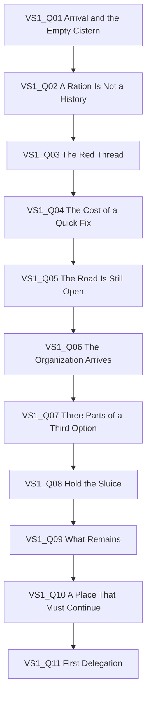

# AHTW — Act I Vertical Slice Quest Graph

**Working title:** *The Water We Share*  
**Hub:** Brackenford, a small settlement around communal waterworks and terraced gardens.  
**Region:** Ashfen Verge, an old irrigation route through damp woodland and abandoned stone channels.  
**Local nickname:** The Red Thread, a visible red filament-like Ferida manifestation; not an explanation of the Ferida's true nature.

Brackenford is already strained by a poor harvest and uneven water rationing. The Red Thread has spread through the old sluice. It amplifies exhaustion, sleeplessness, and suspicion, but does not create every social problem from nothing.

The Organization proposes closing the lower waterworks, isolating affected workers, and burning the root-vault. This reduces risk to downstream settlements but abandons lower residents and their seed reserve. A third option requires local knowledge, repair materials, a stabilized diversion, and collective effort.

**Mandatory loss:** The lower terrace seed reserve and a substantial part of the next planting cycle are destroyed during stabilization. The settlement survives and downstream water is protected. No route produces a clean victory.

## Slice cast

| ID | Character | Function |
|---|---|---|
| ALYA | Alya | Traveler; exceptional but fallible protagonist |
| ALLY-001 | First Ally / Generalist | Initial companion; flexible contribution and trust-building |
| ALLY-005 | Cuidadora | Visiting health practitioner; potentially recruitable after crisis |
| NPC-001 | Tavernkeeper | Rumors and local needs |
| NPC-003 | Community Elder | Local memory and mediation |
| NPC-005 | Pragmatic Mentor | Organization ally; explains containment and assesses alternatives |
| NPC-006 | Institutional Representative | Explains regional risk and official plan |
| NPC-VS1-001 | Mara Venn | Adult sluice keeper and keeper of the communal seed reserve; one-off quest character |

Mara is exhausted and fears being blamed for the failing waterworks. She diverted a small amount of water to protect the seed reserve after the sluice began to fail. The Red Thread worsens her fear but does not remove her agency or make her a villain. Cuidadora stays if the player commits to an organized recovery effort, reinforcing that care is a community capability, not something Alya can personally provide to everyone.

## Quest graph

The main path is mostly linear. Optional discovery and decisions change dialogue, trust, resource costs, encounter pressure, and early management capabilities without creating a separate campaign.

## VS1_Q01 — Arrival and the Empty Cistern

**Type:** Main / Social / Tutorial · **Location:** Brackenford  
Alya arrives intending to continue toward her original destination. The communal cistern is low; Mara is accused of diverting water. First Ally notices red filament residue. Tavernkeeper explains that the settlement needs safe water and enough trust to prevent sabotage of the ration line. The player can speak to Mara, inspect the cistern, and ask one additional local for context.

**State:** Set `VS1_MARA_MET`; inspection sets `VS1_CISTERN_INSPECTED`; unlock Q02.  
**Acceptance:** The player understands the immediate need and sees that the accusation may be incomplete.

## VS1_Q02 — A Ration Is Not a History

**Type:** Main / Investigation / Social · **Location:** Brackenford  
The Elder explains that rationing changed after a poor harvest; lower terraces received less water because they were considered less productive. Mara followed the schedule until the sluice failed, then diverted water to protect the seed reserve. Cuidadora treats fatigue and sleeplessness but does not claim a supernatural diagnosis from symptoms alone.

**Choice:** Enforce the schedule (small supply benefit, lower Mara trust, higher repair cost); share remaining clean water (higher local trust, reduced supply buffer); or delay judgment and investigate (no immediate gain, best clue, preserves relationship options).

**State:** Set one of `VS1_RATION_ENFORCED`, `VS1_RATION_SHARED`, `VS1_RATION_INVESTIGATE`; update discrete trust states Low/Neutral/High. Unlock Q03. No choice blocks the main path.

## VS1_Q03 — The Red Thread

**Type:** Main / Exploration / Combat · **Location:** Ashfen Verge, POI 1: Silt Path  
Red growth binds roots, masonry, and tools into unstable structures. The first encounter with two Frayed Husks teaches target selection. Inspecting a blocked channel grants a clue and small reward; skipping inspection remains viable. A second encounter with Threadlings and a Frayed Husk introduces Strain/pressure and a short-lived effect.

**State:** Set `VS1_RED_THREAD_CONFIRMED`. Optional inspection sets `VS1_CHANNEL_CLUE_FOUND` and grants `ITEM_VS1_FILTER_FIBER` x1. Unlock Q04.

## VS1_Q04 — The Cost of a Quick Fix

**Type:** Main / Encounter / Consequence · **Location:** Ashfen Verge, POI 2: Old Weir  
The secondary gate appears to protect the upper channel. First Ally notices that the lower seed reserve depends on the same flow. With the clue, the player can recognize the risk; without it, closure still appears reasonable.

**Choice:** Close the gate (upper channel safer, lower reserve dries, extra Timber later); attempt a temporary diversion (costs Fiber and time, preserves lower-channel access); or withdraw (avoids immediate commitment but lets the threat worsen).

**State:** Set one of `VS1_GATE_CLOSED`, `VS1_TEMP_DIVERSION`, `VS1_WITHDREW`; set `VS1_QUICK_FIX_COST_REVEALED`. Unlock Q05.

## VS1_Q05 — The Road Is Still Open

**Type:** Main / Character / Commitment · **Location:** Brackenford  
A messenger confirms Alya can resume her journey. First Ally asks whether they will help only until the immediate task ends or accept responsibility for what follows. The local team lacks the tools and knowledge to stabilize the waterworks. Alya chooses to stay; a prior expression of wanting to leave changes the companion response but does not create a separate campaign.

**State:** Set `VS1_ALYA_STAYS` and `VS1_RESPONSIBILITY_ACCEPTED`; unlock Q06.

## Shared rules

- Every choice has deterministic consequences and a readable explanation.
- Optional discovery and adult content never gate the main path.
- Required materials have a fallback source; optional spending cannot softlock progress.
- Retreat from optional combat costs time or opportunity, not campaign access.
- The Ferida amplifies existing vulnerabilities without absolving characters of agency.
- Do not reveal the Ferida's ultimate nature or the full truth of Alya's past.
